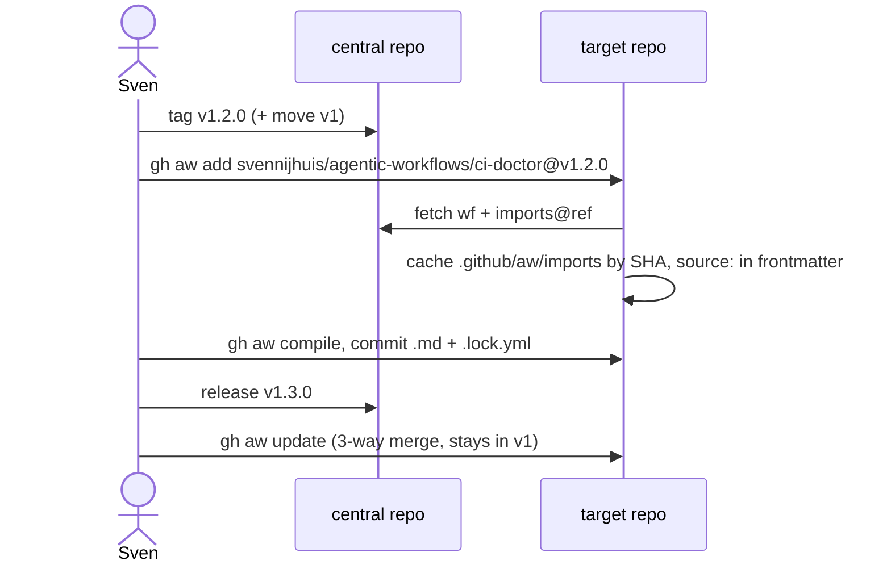

# L01: v1.0.0 + moving v1 + CHANGELOG
- Status: todo
- Area: release
- Wave: PR 0
- Block: 2
- Lane: Cursor CLI
- Depends on: C02
- proof: git tag -l v1.0.0 && ./scripts/verify.sh on tagged SHA
- door: one-way
- one-way gate: Sven's exact yes required (named ask in its block). Rollback: delete erroneous tag and re-pin consumers to prior tag
## Goal
Define first semver tag v1.0.0, moving v1 major ref, and CHANGELOG discipline for svennijhuis/agentic-workflows consumers.
## Context
Drop @marketplace branch imports (Q7). Consumers pin @v1.2.0 or SHA; @v1 moves on compatible updates per gh aw update.
## Steps
1. Document tag v1.0.0 cut criteria (F01 merged, gate green on SHA).
2. Document git ref update for moving v1 after each minor release.
3. CHANGELOG format with workflow-level notes.
4. Migration note for squad-review import pin.
## Definition of Done
- [ ] Release runbook section lists exact git tag commands (no force push).
- [ ] Q7 decisions reflected in consumer docs.
- [ ] Lock files committed with each release.
- [ ] X07 runs first; a score below baseline blocks the release
## Evidence
(commands, logs, verify log on SHA, run links)
## Flow

## Named asks for Sven
(Q7)
## Cost
n/a
## Sources
- https://github.github.com/gh-aw/reference/releases/
- https://github.github.com/gh-aw/guides/sharing-workflows/
