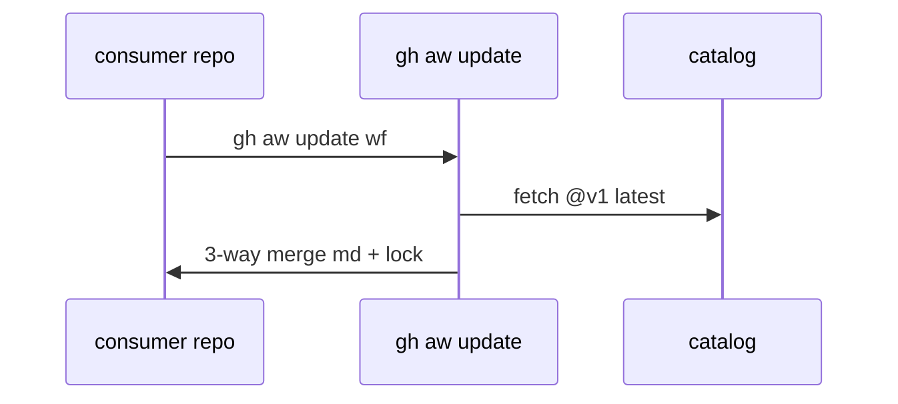

# L02: Update vs upgrade, safe update
- Status: todo
- Area: release
- Wave: PR 0
- Block: 5
- Lane: Cursor CLI
- Depends on: L01
- proof: ./scripts/bump-pin.sh --dry-run <ref> && ./scripts/verify.sh
- door: two-way
## Goal
Document gh aw update 3-way merge vs --no-merge replace and safe-update spec expectations for consumer repos.
## Context
Moving @v1 stays in major unless --major. Local edits preserved when possible.
## Steps
1. Document update command flows and conflict resolution.
2. Link safe-update specification requirements.
3. Add `scripts/bump-pin.sh <ref>`: replace agentPacks (and catalog) pin refs in all tracked files, `gh aw compile --dir workflows --strict`, then `scripts/verify.sh`. Follows C12 v1.1 tags only (gist handover point E). Replaces hand edits like PR #2 `@34e1dec` spread across seven files.
4. Trial on X01 test repo before advising prod consumers.
## Definition of Done
- [ ] CONSUMING.md cross-link content outlined.
- [ ] Rollback path: pin previous @vX.Y.Z tag.
- [ ] `scripts/bump-pin.sh` documented with example tag ref and verify gate
- [ ] Bump script refuses branch refs (POL01)
- [ ] X07 runs first; a score below baseline blocks the bump
## Evidence
(commands, logs, verify log on SHA, run links)
## Flow

## Named asks for Sven
(none)
## Cost
n/a
## Sources
- https://github.github.com/gh-aw/reference/releases/
- https://github.github.com/gh-aw/specs/safe-update-specification/
- https://github.github.com/gh-aw/setup/working-with-workflows/
