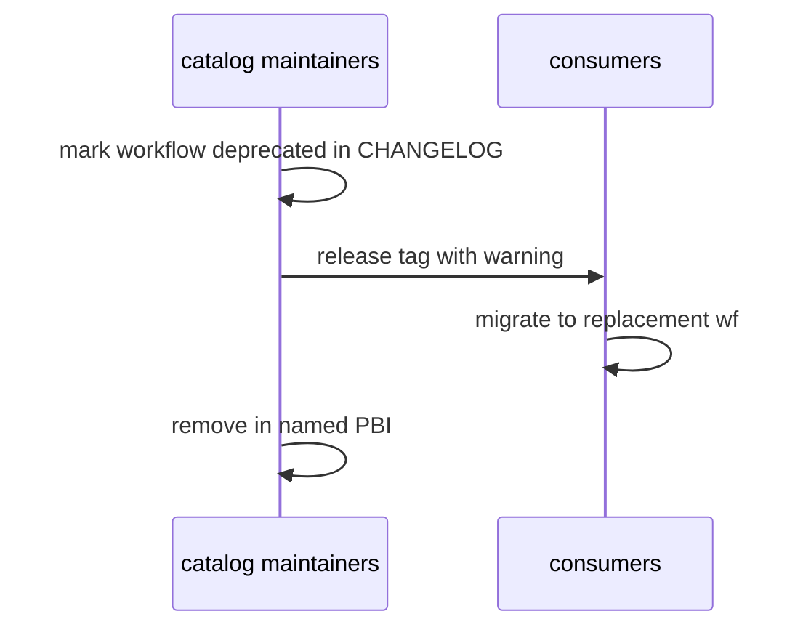

# L03: Deprecation
- Status: todo
- Area: release
- Wave: PR 0
- Block: 5
- Lane: Cursor CLI
- Depends on: L01, G01
- proof: ./scripts/verify.sh
- door: two-way
## Goal
Document deprecation policy for workflows and shared imports aligned with governance/DEPRECATION.md.
## Context
squad-review deprecates when F01 merges; removal PBIs must list each file removed.
## Steps
1. Define deprecation notice period and CHANGELOG markers.
2. Document aw.yml includes removal steps.
3. Link G06 feedback when deprecation due to upstream breakage.
## Definition of Done
- [ ] DEPRECATION.md outline in governance cross-link.
- [ ] F01 PBI lists squad-review file removals explicitly.
## Evidence
(commands, logs, verify log on SHA, run links)
## Flow

## Named asks for Sven
(none)
## Cost
n/a
## Sources
- https://github.github.com/gh-aw/reference/releases/
- https://github.github.com/gh-aw/guides/safe-rollout/
