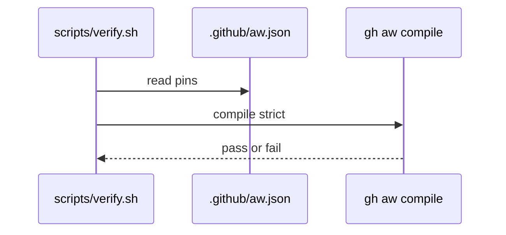

# L04: gh-aw tool pin
- Status: todo
- Area: release
- Wave: PR 0
- Block: 5
- Lane: Builder
- Depends on: C06, POL01
- proof: ./scripts/verify.sh && gh extension list | grep gh-aw
- door: one-way
- one-way gate: Sven's exact yes required (named ask in its block). Rollback: revert gh-aw pin commit and recompile
## Goal
Pin gh aw CLI version in .github/aw.json and document upgrade cadence with checksum verification.
## Context
POL01 requires pinned versions. Tool pin must match workflow import pins.
## Steps
1. Document aw.json action and compiler pins.
2. Define monthly upstream check (L07) for new gh-aw releases.
3. scripts/verify.sh verifies pin consistency.
## Definition of Done
- [ ] Pin recorded in repo config (Builder).
- [ ] Upgrade runbook references L02 safe update.
## Evidence
(commands, logs, verify log on SHA, run links)
## Flow

## Named asks for Sven
(none)
## Cost
n/a
## Sources
- https://github.github.com/gh-aw/reference/releases/
- https://github.github.com/gh-aw/reference/compilation-process/
