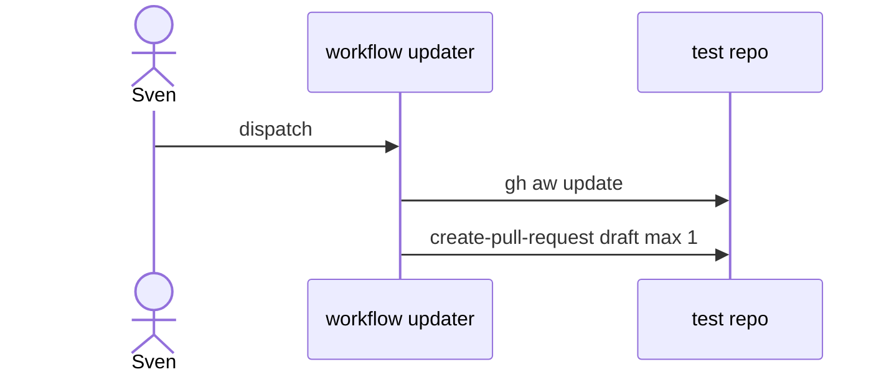

# L05: Workflow updater
- Status: todo
- Area: release
- Wave: PR 0
- Block: 5
- Lane: Builder
- Depends on: L02, L04
- proof: ./scripts/verify.sh
- door: one-way
- one-way gate: Sven's exact yes required (named ask in its block). Rollback: disable workflow updater workflow
## Goal
Optional automation to propose PRs that bump workflow pins across consumer repos (manual approval only).
## Context
Personal account: no auto-merge. Updater opens draft PRs on test repo first.
## Steps
1. Design dispatch workflow to run gh aw update and open PR.
2. Cap PR outputs at 1, draft default (O04).
3. Require Sven review on every updater PR.
## Definition of Done
- [ ] Bar H when workflow exists.
- [ ] Never runs on schedule without Sven yes.
- [ ] Trial on X01 only initially.
## Evidence
(commands, logs, verify log on SHA, run links)
## Flow

## Named asks for Sven
(Q3)
## Cost
Tier M, 20-60 AIC (unverified)
## Sources
- https://github.github.com/gh-aw/setup/working-with-workflows/
- https://github.github.com/gh-aw/reference/releases/
