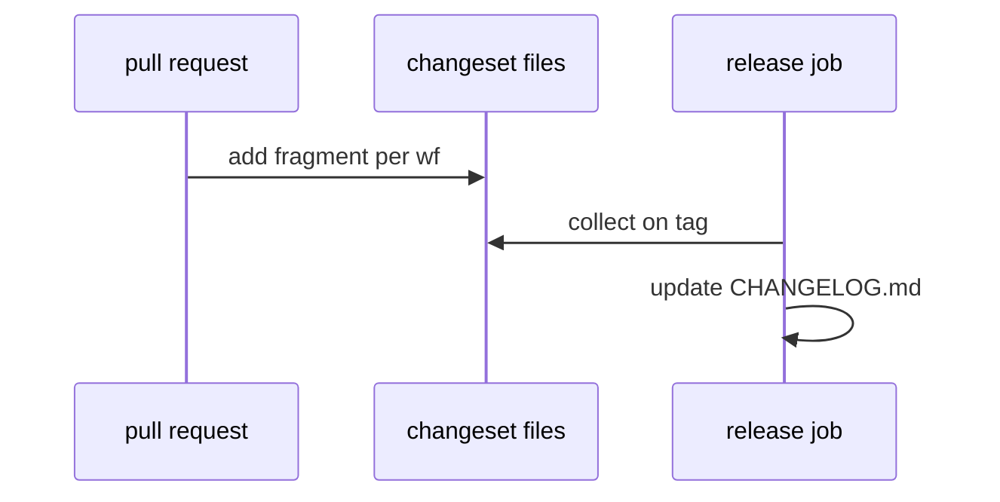

# L06: Changeset generator
- Status: todo
- Area: release
- Wave: PR 0
- Block: 5
- Lane: Cursor CLI
- Depends on: L01
- proof: ./scripts/verify.sh
- door: two-way
## Goal
Document changeset or changelog fragment workflow for multi-workflow releases.
## Context
Keeps CHANGELOG accurate when many workflows change in one PR.
## Steps
1. Define changeset file format in PR template.
2. Aggregate into CHANGELOG on release tag.
3. Link L01 tag cut process.
## Definition of Done
- [ ] Contributor guide mentions changeset expectation.
- [ ] Release PR includes aggregated changelog.
## Evidence
(commands, logs, verify log on SHA, run links)
## Flow

## Named asks for Sven
(none)
## Cost
n/a
## Sources
- https://github.github.com/gh-aw/reference/releases/
