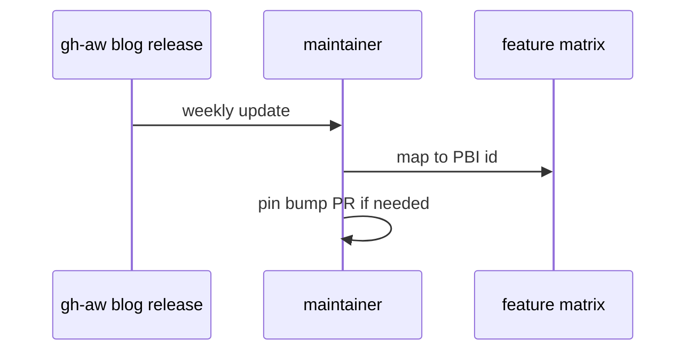

# L07: Upstream watch (blog/releases)
- Status: todo
- Area: release
- Wave: PR 0
- Block: 5
- Lane: Cursor CLI
- Depends on: L04
- proof: ./scripts/verify.sh
- door: two-way
## Goal
Process to watch gh-aw blog, releases, and weekly updates for features that affect catalog pins and matrix.
## Context
Feature matrix includes many blog entries mapped to L07. Manual review weekly until automated digest exists.
## Steps
1. Subscribe to gh-aw blog RSS or weekly review ritual.
2. Map new features to docs/pbi ids and workflow-ratings.md.
3. Open catalog PR when pin bump or new workflow PICK.
## Definition of Done
- [ ] Upstream watch checklist in CONTRIBUTING cross-link.
- [ ] Last reviewed date field in CHANGELOG or governance note.
## Evidence
(commands, logs, verify log on SHA, run links)
## Flow

## Named asks for Sven
(none)
## Cost
n/a
## Sources
- https://github.github.com/gh-aw/blog/2026-10-19-weekly-update/
- https://github.github.com/gh-aw/reference/releases/
