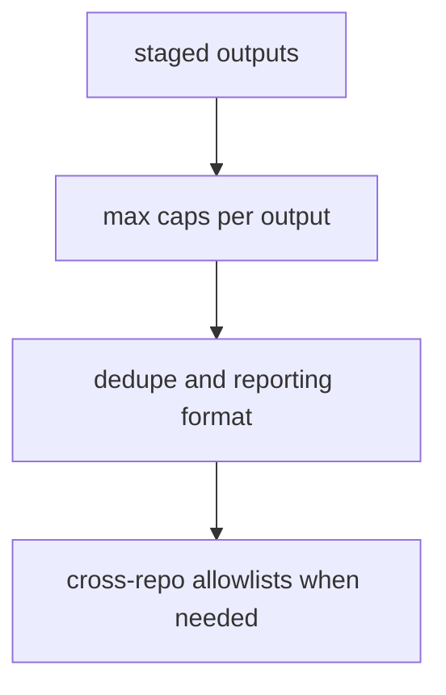

# safe-outputs: overview

**Purpose:** Workflow frontmatter rules for safe outputs: staged mode, dedupe, caps, and cross-repo writes. `gh aw compile --strict` enforces the shape; repo gate is `make verify` (POL25 dispatch-only, POL31 no skills in shared fragments).

## Rules (in workflow frontmatter, not separate policy PBIs)

- Every output has a `max` cap; prefer `staged: true` until Sven promotes a write path.
- Dedupe keys, expiry, and footers live in each workflow and in `shared/reporting.md`.
- Cross-repo issue or comment writes need explicit `target-repo` / allowlists in frontmatter and minimal `permissions`.

## Dependency sketch

