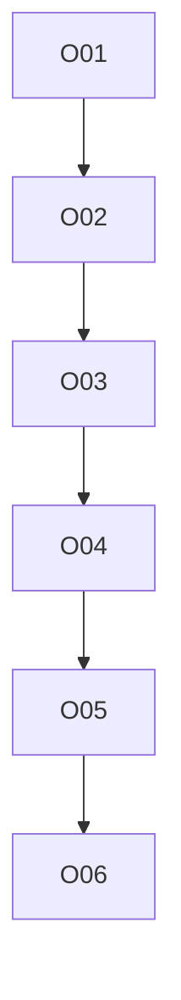

# safe-outputs: overview

**Purpose:** Output catalog, staged mode, dedupe, PR outputs.

## PBIs

- [O01: O01-output-catalog-limits](O01-output-catalog-limits.md)
- [O02: O02-staged-mode](O02-staged-mode.md)
- [O03: O03-dedupe-expiry-footers-noise](O03-dedupe-expiry-footers-noise.md)
- [O04: O04-pr-outputs-triggering-ci](O04-pr-outputs-triggering-ci.md)
- [O05: O05-cross-repo](O05-cross-repo.md) (Block 4, blocker for M05 step 2)
- [O06: O06-custom-outputs-mcp-scripts](O06-custom-outputs-mcp-scripts.md)

## Dependency sketch

