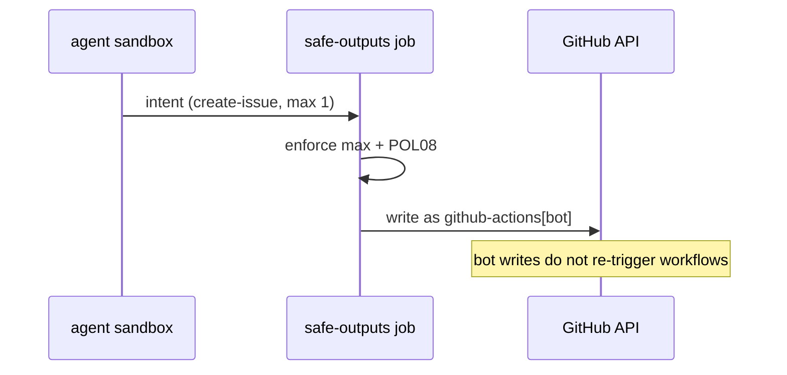

# O01: Output catalog + limits
- Status: todo
- Area: safe-outputs
- Wave: PR 0
- Block: 2
- Lane: Cursor CLI
- Depends on: C03, POL08
- proof: ./scripts/verify.sh
- door: two-way
## Goal
Document every safe-output type we allow in svennijhuis/agentic-workflows, with per-output `max` limits, forbidden types, and how they map to shared/reporting.md issue and PR formats.
## Context
Safe outputs run in a separate job from the agent sandbox. POL08 requires `max` on every output. merge-pull-request stays disabled (POL14). Catalog workflows start report-only (issues/comments) before any create-pull-request.
## Steps
1. Inventory gh-aw safe-output types (create-issue, add-comment, create-pull-request, noop, etc.) and mark allowed vs blocked for this catalog.
2. Define default `max` per type in shared/outputs.md (issues 1, comments 3, PRs 0 until staged promotion).
3. Link each agent-factory workflow PBI to its output set and caps.
4. Add gate policy cross-reference: POL08 safe-output max on every output.
5. Document bot non-retrigger behavior for issue/comment writes.
## Definition of Done
- [ ] shared/outputs.md lists allowed types, defaults, and merge-pull-request never.
- [ ] Every workflow in aw.yml declares safe-outputs with explicit max.
- [ ] Issue and PR bodies follow shared/reporting.md templates.
- [ ] Trial-repo run proves outputs respect max (Builder, post W2).
## Evidence
(commands, logs, verify log on SHA, run links)
## Flow

## Named asks for Sven
(none)
## Cost
n/a (documentation PBI)
## Sources
- https://github.github.com/gh-aw/reference/safe-outputs/
- https://github.github.com/gh-aw/specs/safe-outputs-specification/
- https://github.github.com/gh-aw/experimental/safe-outputs-samples/
