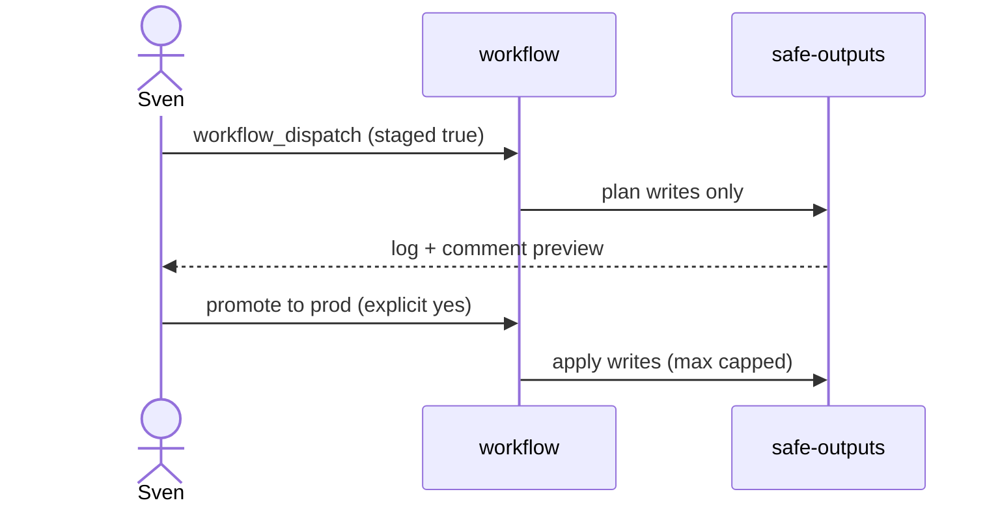

# O02: Staged mode
- Status: todo
- Area: safe-outputs
- Wave: PR 0
- Block: 2
- Lane: Cursor CLI
- Depends on: O01, POL03, G01
- proof: ./scripts/verify.sh
- door: two-way
## Goal
Require `staged: true` (or report-only) before any production safe-output writes across the catalog.
## Context
Staged mode logs what would be written without applying changes. Combined with workflow_dispatch first, this is the default posture until Sven promotes a workflow on the G01 ladder.
## Steps
1. Document staged vs report-only vs production in governance/ROLLOUT.md cross-link.
2. Specify frontmatter `staged: true` for all new workflows until explicit promotion.
3. Define promotion checklist: 3 measured runs, cost tier recorded, Sven yes for schedules.
4. Map staged output artifacts (logs, dry-run comments) for operators.
## Definition of Done
- [ ] POL03 staged/report-only before writes is documented with examples.
- [ ] New workflows default to staged or report-only in authoring guide (D05).
- [ ] Promotion steps align with G01 ladder stages.
## Evidence
(commands, logs, verify log on SHA, run links)
## Flow

## Named asks for Sven
(none)
## Cost
n/a
## Sources
- https://github.github.com/gh-aw/reference/staged-mode/
- https://github.github.com/gh-aw/guides/safe-rollout/
