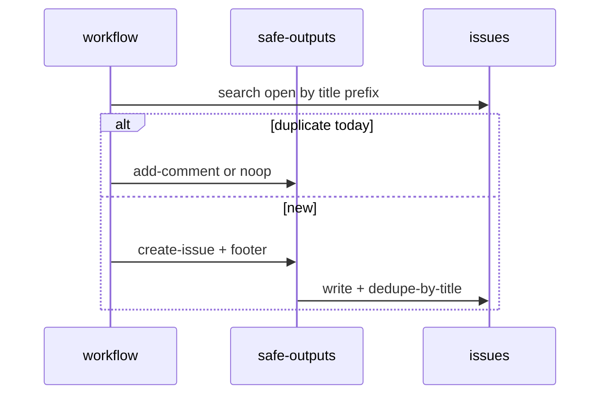

# O03: Dedupe, expiry, footers, noise
- Status: todo
- Area: safe-outputs
- Wave: PR 0
- Block: 2
- Lane: Cursor CLI
- Depends on: O01
- proof: ./scripts/verify.sh
- door: two-way
## Goal
Standardize deduplication, expiry, provenance footers, and noise controls on all issue and comment safe-outputs.
## Context
Ephemerals (deduplicate-by-title, group-by-day, close-older-issues, expires) prevent alert storms. Footers document workflow id and run link. skip-if-match reduces duplicate agent runs.
## Steps
1. Pick catalog defaults: deduplicate-by-title on, group-by-day for daily reports, close-older-issues where applicable.
2. Document footer template in shared/reporting.md (workflow name, run URL, cost snippet).
3. List skip-if-match / skip-if-no-match patterns for CI Doctor and watcher style workflows.
4. Define expires for transient triage comments.
## Definition of Done
- [ ] shared/reporting.md includes footer and title prefix conventions.
- [ ] High-volume workflows (F02, F03, M01) document dedupe fields in their PBIs.
- [ ] Noise policy: one open issue per fingerprint where possible.
## Evidence
(commands, logs, verify log on SHA, run links)
## Flow

## Named asks for Sven
(Q6 (central tracker vs per-repo issues affects dedupe search scope))
## Cost
n/a
## Sources
- https://github.github.com/gh-aw/reference/ephemerals/
- https://github.github.com/gh-aw/reference/footers/
- https://github.github.com/gh-aw/reference/safe-outputs/
