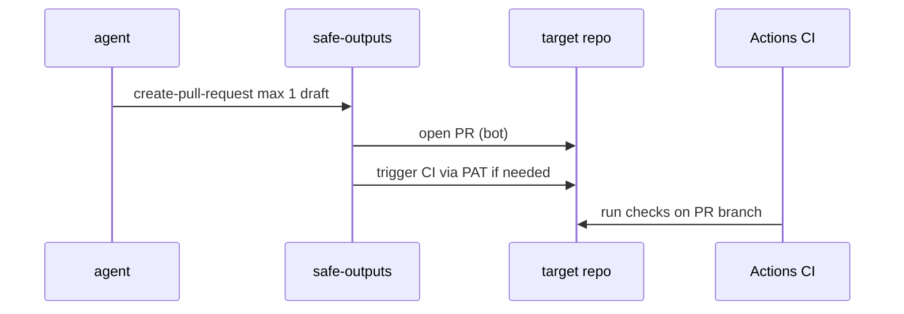

# O04: PR outputs + triggering CI
- Status: todo
- Area: safe-outputs
- Wave: PR 0
- Block: 5
- Lane: Cursor CLI
- Depends on: O01, O02, C04
- proof: ./scripts/verify.sh
- door: two-way
## Goal
Document safe create-pull-request usage (max 1, draft default) and GH_AW_GITHUB_TOKEN path to trigger consumer CI on agent PRs.
## Context
PR outputs stay gated until G01 promotion. merge-pull-request remains forbidden. Triggering CI may need a PAT with contents write beyond GITHUB_TOKEN limits.
## Steps
1. Document create-pull-request limits and draft PR default for doc-updater style workflows.
2. Explain GH_AW_GITHUB_TOKEN chain for cross-repo PR CI triggers.
3. Require workflow_dispatch + staged before first real PR output.
4. Link POL14 and org policy vars that can disable PR creation (G04/G05).
## Definition of Done
- [ ] Authoring doc states merge-pull-request is never enabled.
- [ ] PR template matches shared/reporting.md.
- [ ] CI trigger path documented with required token scopes (no secrets in repo).
## Evidence
(commands, logs, verify log on SHA, run links)
## Flow

## Named asks for Sven
(Q3 (PAT vs GitHub App for cross-repo PR CI))
## Cost
n/a
## Sources
- https://github.github.com/gh-aw/reference/safe-outputs-pull-requests/
- https://github.github.com/gh-aw/reference/triggering-ci/
