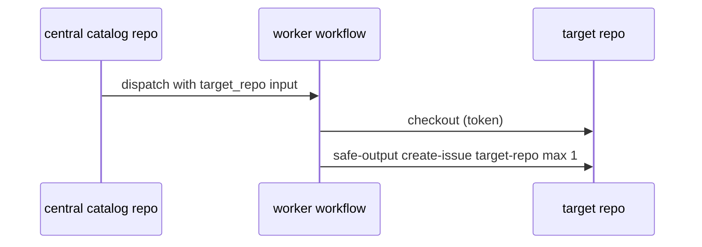

# O05: Cross-repo safe outputs
- Status: todo
- Area: safe-outputs
- Wave: PR 0
- Block: 4
- Lane: Cursor CLI
- Depends on: O01, C04, POL12
- proof: ./scripts/verify.sh
- door: two-way
## Goal
Document target-repo, allowed-repos, and cross-repo safe-output patterns for central-run vs installed workflows.
## Context
Block 4 (moved from B5): a blocker for [M05](../monitoring/M05-github-log-watcher.md) step 2 (issues on all allowlisted repos).
Personal account uses fine-grained PAT or future GitHub App. Central exception watcher may write to target repos while workflow lives in svennijhuis/agentic-workflows (Q1).
## Steps
1. Document target-repo and allowed-repos frontmatter with POL12 explicit lists.
2. Map CentralRepoOps flow (b) to safe-output target-repo on workers.
3. Require min-integrity approved on cross-repo reads.
4. Keep owner as single variable for org-ready future (G05).
## Definition of Done
- [ ] Cross-repo matrix: which workflows use central-run vs gh aw add install.
- [ ] No wildcard allowed-repos without Sven approval.
- [ ] Packet flow (b) referenced in P01/P02 PBIs.
## Evidence
(commands, logs, verify log on SHA, run links)
## Flow

## Named asks for Sven
(Q1, Q3)
## Cost
n/a
## Sources
- https://github.github.com/gh-aw/reference/cross-repository/
- https://github.github.com/gh-aw/patterns/multi-repo-ops/
- https://github.github.com/gh-aw/patterns/central-repo-ops/
