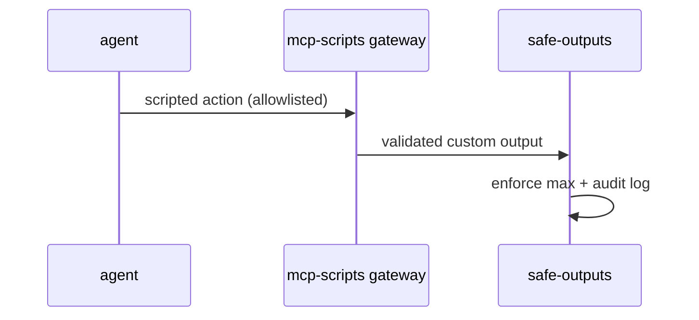

# O06: Custom outputs + mcp-scripts
- Status: todo
- Area: safe-outputs
- Wave: PR 0
- Block: 5
- Lane: Cursor CLI
- Depends on: O01, S04
- proof: ./scripts/verify.sh
- door: two-way
## Goal
Track custom safe outputs and mcp-scripts extension path for later catalog needs, with stricter review than built-in types.
## Context
Custom outputs and MCP scripts increase attack surface. Deferred until core catalog is stable. Any custom output still requires max and gate review.
## Steps
1. Summarize custom safe-output registration requirements from gh-aw specs.
2. Document mcp-scripts allowlist interaction with POL07.
3. Require security review + trial-repo proof before merge.
4. List candidate use cases (none mandatory for v1).
## Definition of Done
- [ ] Decision recorded: no custom outputs in W1-W3.
- [ ] Review checklist drafted for future O06 implementations.
- [ ] MCP gateway constraints referenced from S04.
## Evidence
(commands, logs, verify log on SHA, run links)
## Flow

## Named asks for Sven
(none)
## Cost
n/a
## Sources
- https://github.github.com/gh-aw/reference/custom-safe-outputs/
- https://github.github.com/gh-aw/reference/mcp-scripts/
- https://github.github.com/gh-aw/specs/mcp-scripts-specification/
