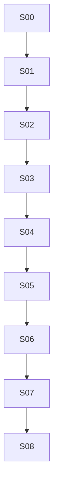

# security: overview

**Purpose:** Firewall, integrity, threat detection, sandbox.

## PBIs

- [S00: S00-security-architecture-explainer](S00-security-architecture-explainer.md)
- [S01: S01-firewall](S01-firewall.md)
- [S02: S02-integrity](S02-integrity.md)
- [S03: S03-threat-detection-protected-files](S03-threat-detection-protected-files.md)
- [S04: S04-sandbox-awf-mcp-gateway](S04-sandbox-awf-mcp-gateway.md)
- [S05: S05-action-pins-actions-lock](S05-action-pins-actions-lock.md)
- [S06: S06-checkout-forks](S06-checkout-forks.md)
- [S07: S07-private-repo-enclaves](S07-private-repo-enclaves.md)
- [S08: S08-playwright-cli-policy](S08-playwright-cli-policy.md)

## Dependency sketch

