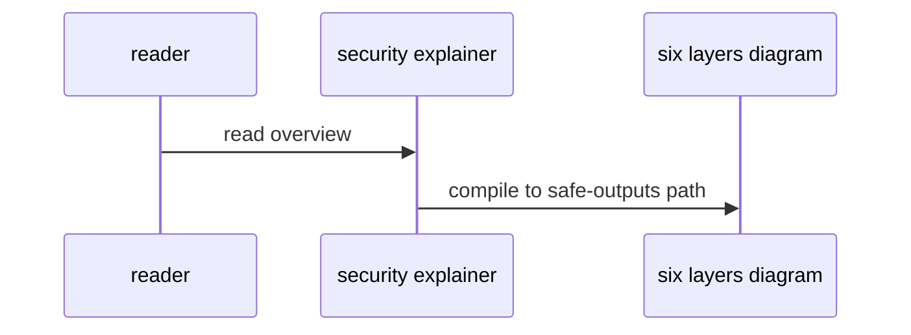

# S00: Security architecture explainer
- Status: todo
- Area: security
- Wave: W2
- Block: 2
- Lane: Cursor CLI
- Depends on: none
- proof: make verify && gh aw compile --dir workflows --strict
- door: two-way
## Goal
Publish a concise explainer of gh-aw six-layer security model for maintainers and consumers: compile validation, sandbox read-only agent, credential isolation, integrity filtering, threat detection, safe outputs in separate jobs.
## Context
Part of gh-aw defense in depth for svennijhuis/agentic-workflows. Complements workflow frontmatter security (minimal permissions, safe-outputs, timeouts) and Bar H workflow requirements.
## Steps
1. Author docs/explanation security overview linking S01 through S06.
2. Map layers to shared/security.md and policy IDs.
3. Include rollout ladder: report-only, staged, production writes.
## Definition of Done
- [ ] Explainer published and linked from docs overview
- [ ] Layers map to policies and shared fragments
- [ ] Personal vs org-only controls cross-link G05
## Evidence
(commands, logs, verify log on SHA, run links)
## Flow

## Named asks for Sven
none
## Cost
n/a
## Sources
- https://github.github.com/gh-aw/guides/sharing-workflows/
- https://github.github.com/gh-aw/reference/auth/
- https://github.github.com/gh-aw/reference/cost-management/
- https://github.github.com/gh-aw/reference/imports/
- https://github.github.com/gh-aw/reference/engines/copilot/
- https://github.github.com/svennijhuis/agentic-workflows
