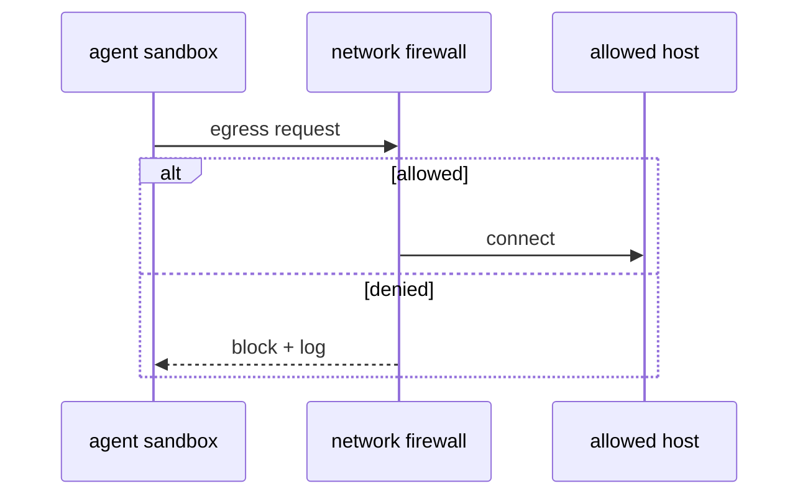

# S01: Firewall (network policy)
- Status: todo
- Area: security
- Wave: W2
- Block: 2
- Lane: Builder
- Depends on: S00, POL06
- proof: ./scripts/verify.sh && gh aw compile --dir workflows --strict
- door: two-way
## Goal
Document and enforce outbound network firewall semantics for gh-aw workflows aligned with POL06 and shared/security.md closed-by-default posture.
## Context
Part of gh-aw defense in depth for svennijhuis/agentic-workflows. Complements policies POL01 through POL18 and Bar H workflow requirements.
## Steps
1. Extend shared/security.md with host addition process.
2. Wire POL06 check to fail wildcards.
3. Document MCP host allowlisting.
## Definition of Done
- [ ] Firewall rules documented per workflow type
- [ ] POL06 passes on catalog
- [ ] B08 can report firewall denials when enabled
## Evidence
(commands, logs, verify log on SHA, run links)
## Flow

## Named asks for Sven
none
## Cost
n/a
## Sources
- https://github.github.com/gh-aw/guides/sharing-workflows/
- https://github.github.com/gh-aw/reference/auth/
- https://github.github.com/gh-aw/reference/cost-management/
- https://github.github.com/gh-aw/reference/imports/
- https://github.github.com/gh-aw/reference/engines/copilot/
- https://github.github.com/svennijhuis/agentic-workflows
