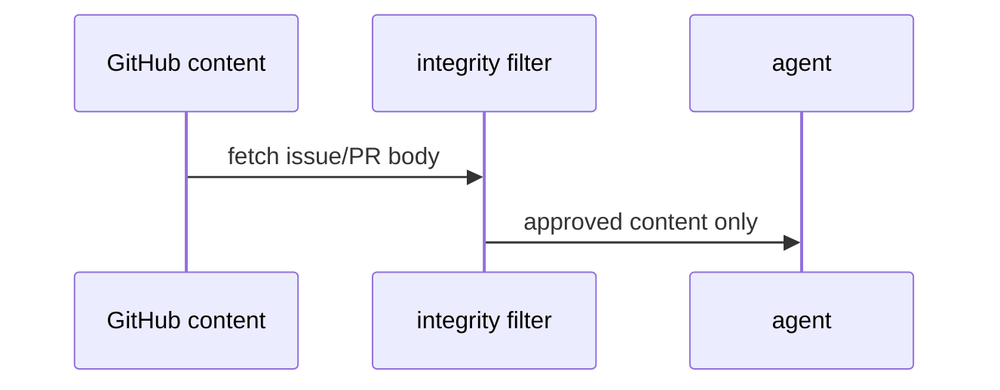

# S02: Integrity filtering
- Status: todo
- Area: security
- Wave: W2
- Block: 2
- Lane: Builder
- Depends on: S00, POL05
- proof: ./scripts/verify.sh && gh aw compile --dir workflows --strict
- door: two-way
## Goal
Implement integrity filtering defaults (`min-integrity: approved`) for untrusted GitHub content consumed by agents.
## Context
Part of gh-aw defense in depth for svennijhuis/agentic-workflows. Complements policies POL01 through POL18 and Bar H workflow requirements.
## Steps
1. Set integrity in shared security import.
2. Document approved content sources (issues, PRs, comments).
3. Align with POL05 gate.
## Definition of Done
- [ ] shared security sets min-integrity approved
- [ ] POL05 gate green
- [ ] Workflow PBIs cite integrity in Bar H section
## Evidence
(commands, logs, verify log on SHA, run links)
## Flow

## Named asks for Sven
none
## Cost
n/a
## Sources
- https://github.github.com/gh-aw/guides/sharing-workflows/
- https://github.github.com/gh-aw/reference/auth/
- https://github.github.com/gh-aw/reference/cost-management/
- https://github.github.com/gh-aw/reference/imports/
- https://github.github.com/gh-aw/reference/engines/copilot/
- https://github.github.com/svennijhuis/agentic-workflows
