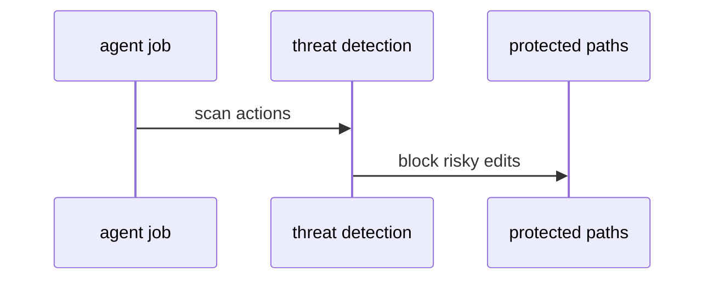

# S03: Threat detection and protected files
- Status: todo
- Area: security
- Wave: W2
- Block: 2
- Lane: Builder
- Depends on: S00, POL13
- proof: ./scripts/verify.sh && gh aw compile --dir workflows --strict
- door: two-way
## Goal
Keep threat detection enabled and define protected files that must not be modified by agents without escalation.
## Context
Part of gh-aw defense in depth for svennijhuis/agentic-workflows. Complements policies POL01 through POL18 and Bar H workflow requirements.
## Steps
1. Document threat detection job behaviour.
2. List protected paths (workflows, policies, gate scripts).
3. Enforce POL13 never-off rule.
## Definition of Done
- [ ] Threat detection on for all catalog workflows
- [ ] Protected file list in docs and policy
- [ ] POL13 fails if detection disabled
## Evidence
(commands, logs, verify log on SHA, run links)
## Flow

## Named asks for Sven
none
## Cost
n/a
## Sources
- https://github.github.com/gh-aw/guides/sharing-workflows/
- https://github.github.com/gh-aw/reference/auth/
- https://github.github.com/gh-aw/reference/cost-management/
- https://github.github.com/gh-aw/reference/imports/
- https://github.github.com/gh-aw/reference/engines/copilot/
- https://github.github.com/svennijhuis/agentic-workflows
