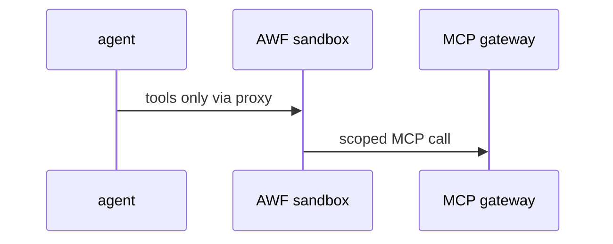

# S04: Sandbox AWF and MCP gateway
- Status: todo
- Area: security
- Wave: W2
- Block: 2
- Lane: Builder
- Depends on: S00, POL07
- proof: ./scripts/verify.sh && gh aw compile --dir workflows --strict
- door: two-way
## Goal
Document Agent Workflow sandbox boundaries and MCP gateway credential isolation; align tool allowlists with POL07.
## Context
Part of gh-aw defense in depth for svennijhuis/agentic-workflows. Complements policies POL01 through POL18 and Bar H workflow requirements.
## Steps
1. Map gh-aw sandbox read-only defaults.
2. Document MCP gateway token handling (no tokens in agent env).
3. Reference Azure MCP gap from packet (OIDC JWT vs Entra).
## Definition of Done
- [ ] Sandbox and MCP gateway section in security docs
- [ ] POL07 aligned with MCP allowlist
- [ ] M04 notes read-only Azure MCP path
## Evidence
(commands, logs, verify log on SHA, run links)
## Flow

## Named asks for Sven
Q5 (App Insights vs Log Analytics, repo to resource map)
## Cost
n/a
## Sources
- https://github.github.com/gh-aw/guides/sharing-workflows/
- https://github.github.com/gh-aw/reference/auth/
- https://github.github.com/gh-aw/reference/cost-management/
- https://github.github.com/gh-aw/reference/imports/
- https://github.github.com/gh-aw/reference/engines/copilot/
- https://github.github.com/svennijhuis/agentic-workflows
