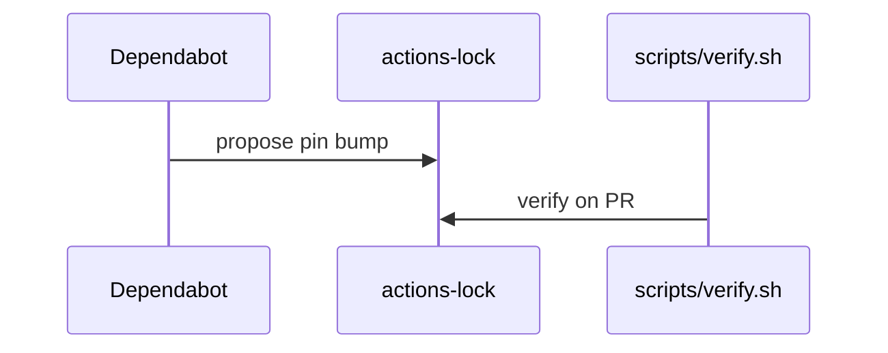

# S05: Action pins, actions-lock, frontmatter hash, Dependabot
- Status: todo
- Area: security
- Wave: W2
- Block: 2
- Lane: Builder
- Depends on: C06, POL01, POL17
- proof: ./scripts/verify.sh && gh aw compile --dir workflows --strict
- door: two-way
## Goal
Harden GitHub Actions supply chain: pinned actions in aw.json, actions-lock file, frontmatter hash integrity, Dependabot updates for gh-aw-actions.
## Context
Part of gh-aw defense in depth for svennijhuis/agentic-workflows. Complements policies POL01 through POL18 and Bar H workflow requirements.
## Steps
1. Enable Dependabot for gh-aw action bumps with review.
2. Document frontmatter hash validation on compile.
3. Tie to POL01 and POL17.
## Definition of Done
- [ ] Action pins and lock strategy documented
- [ ] Dependabot config for gh-aw actions (when repo enables)
- [ ] Gate verifies pins on compile
## Evidence
(commands, logs, verify log on SHA, run links)
## Flow

## Named asks for Sven
none
## Cost
n/a
## Sources
- https://github.github.com/gh-aw/guides/sharing-workflows/
- https://github.github.com/gh-aw/reference/auth/
- https://github.github.com/gh-aw/reference/cost-management/
- https://github.github.com/gh-aw/reference/imports/
- https://github.github.com/gh-aw/reference/engines/copilot/
- https://github.github.com/svennijhuis/agentic-workflows
