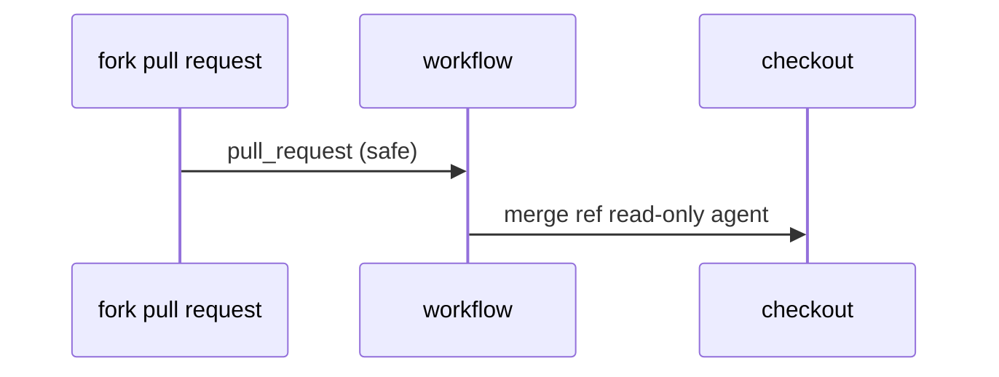

# S06: Checkout and forks
- Status: todo
- Area: security
- Wave: W2
- Block: 2
- Lane: Builder
- Depends on: S00, POL14
- proof: ./scripts/verify.sh && gh aw compile --dir workflows --strict
- door: two-way
## Goal
Define safe checkout practices for fork PRs and untrusted contributors; forbid unsafe pull_request_target workflows.
## Context
Part of gh-aw defense in depth for svennijhuis/agentic-workflows. Complements policies POL01 through POL18 and Bar H workflow requirements.
## Steps
1. Document checkout depth and ref policies.
2. Align with POL14 on trigger types.
3. Add guidance for public personal repos.
## Definition of Done
- [ ] Fork PR guidance in SECURITY.md or security docs
- [ ] POL14 passes (no pull_request_target)
- [ ] squad-review/F01 note fork behaviour
## Evidence
(commands, logs, verify log on SHA, run links)
## Flow

## Named asks for Sven
Q2 (repo visibility)
## Cost
n/a
## Sources
- https://github.github.com/gh-aw/guides/sharing-workflows/
- https://github.github.com/gh-aw/reference/auth/
- https://github.github.com/gh-aw/reference/cost-management/
- https://github.github.com/gh-aw/reference/imports/
- https://github.github.com/gh-aw/reference/engines/copilot/
- https://github.github.com/svennijhuis/agentic-workflows
