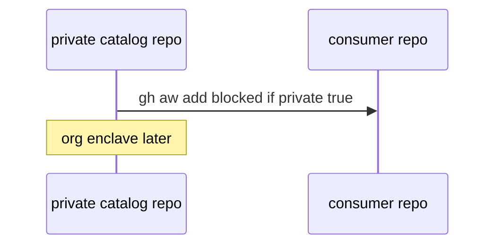

# S07: Private repo enclaves (later)
- Status: todo
- Area: security
- Wave: W6
- Block: 6
- Lane: Builder
- Depends on: S00, G05
- proof: make verify && gh aw compile --dir workflows --strict
- door: two-way
## Goal
Document private repo enclave pattern for sensitive workflows (`private: true` manifest) when org or private catalogs are needed.
## Context
Part of gh-aw defense in depth for svennijhuis/agentic-workflows. Complements workflow frontmatter security (minimal permissions, safe-outputs, timeouts) and Bar H workflow requirements.
## Steps
1. Explain gh-aw private package install restrictions.
2. Link G05 org-only private catalog options.
3. No enablement without visibility decision.
## Definition of Done
- [ ] Enclave pattern documented as later
- [ ] Q2 visibility decision referenced
- [ ] No secrets in enclave docs
## Evidence
(commands, logs, verify log on SHA, run links)
## Flow

## Named asks for Sven
Q2
## Cost
n/a
## Sources
- https://github.github.com/gh-aw/guides/sharing-workflows/
- https://github.github.com/gh-aw/reference/auth/
- https://github.github.com/gh-aw/reference/cost-management/
- https://github.github.com/gh-aw/reference/imports/
- https://github.github.com/gh-aw/reference/engines/copilot/
- https://github.github.com/svennijhuis/agentic-workflows
