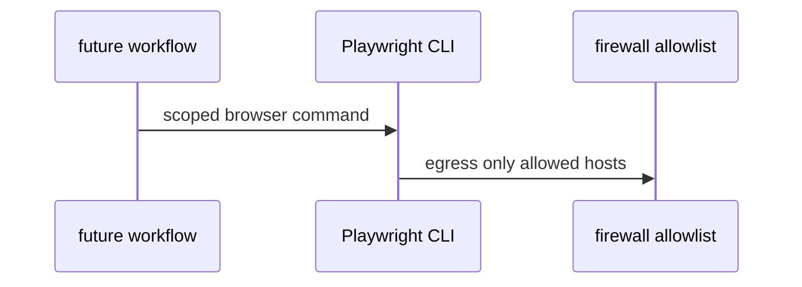

# S08: Playwright CLI policy
- Status: todo
- Area: security
- Wave: W6
- Block: 6
- Lane: Builder
- Depends on: S04
- proof: make verify && gh aw compile --dir workflows --strict
- door: two-way
## Goal
If browser automation is added to a workflow, define Playwright CLI allowlist, network hosts, and sandbox constraints.
## Context
Part of gh-aw defense in depth for svennijhuis/agentic-workflows. Complements workflow frontmatter security (minimal permissions, safe-outputs, timeouts) and Bar H workflow requirements.
## Steps
1. Draft policy for browser tool usage (none in W1 NOW set).
2. Require explicit Sven approval before any Playwright workflow ships.
3. Map to bash and tool allowlists in workflow frontmatter.
## Definition of Done
- [ ] Playwright policy doc exists (disabled by default)
- [ ] No Playwright workflow in catalog without approval
- [ ] Cost tier L or XL called out if enabled
## Evidence
(commands, logs, verify log on SHA, run links)
## Flow

## Named asks for Sven
none
## Cost
n/a
## Sources
- https://github.github.com/gh-aw/guides/sharing-workflows/
- https://github.github.com/gh-aw/reference/auth/
- https://github.github.com/gh-aw/reference/cost-management/
- https://github.github.com/gh-aw/reference/imports/
- https://github.github.com/gh-aw/reference/engines/copilot/
- https://github.github.com/svennijhuis/agentic-workflows
