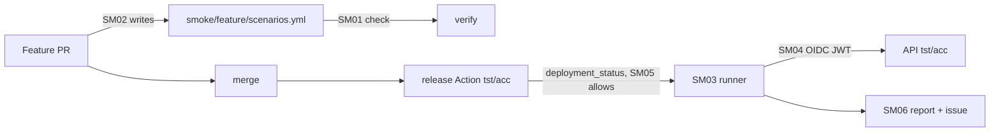

# docs/pbi/smoke/
Post-deploy API smoke on tst and acc. Order: SM07 (Sven, parallel) -> SM01 -> SM05 -> SM04 -> SM03 -> SM06 -> SM02 (agentic, last).
Nothing enabled until Sven yes; Actions billing blocked today.

