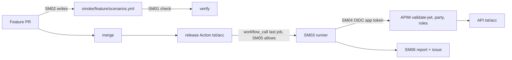

# docs/pbi/smoke/
Post-deploy API smoke on tst and acc. Order: SM08 (docs, first), SM07 (Sven's manual step, switched off), SM01, SM01a (done), SM01b (lane 2, same `check-smoke.sh`), SM05, SM04, SM03, SM06, SM02 (agentic, last).
Follow-up: [SM01a](../done/SM01a.md) (check-smoke.sh hardening, done; SM01 merged in PR #11).
Nothing enabled until Sven yes; Actions billing blocked today.
Gate (split check 2026-10-26): the rows of [SM08](SM08-cursor-findings.md) (the 8 open Cursor findings on PR #5) live in the build PBIs SM01, SM04a, SM04b, SM05a, SM05b, SM05c and SM07a. SM08 closes once those have merged.
Where things live: the API repo `svennijhuis/<api repo>` (the app repo that copies the infra release template, placeholder, named in SM07) holds the live runner workflow, the GitHub environments `smoke-tst` and `smoke-acc`, the federated subject and the `smoke/<feature>/` scenarios. This catalog holds the authoring copies (`smoke/`, `workflows/smoke-writer.md`), the checks and the fixtures.

Parts: [SM07a](../done/SM07a-setup-check.md) (`smoke/SETUP.md` and `scripts/check-smoke-setup.sh`) is done; SM07b (Sven runs the setup steps and says yes) is todo, no PR.
