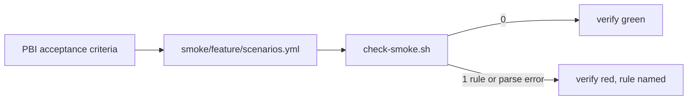
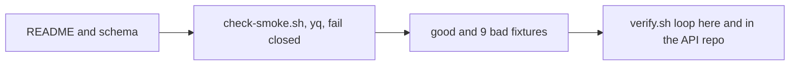

# SM01: Smoke scenario format and folder per feature
- Status: todo
- Area: smoke
- Wave: W3
- Block: 3
- Lane: Builder
- Depends on: none
- proof: `bash scripts/check-smoke.sh test/fixtures/smoke/good.yml` exits 0 and each `test/fixtures/smoke/bad-*.yml` exits 1, in the `scripts/verify.sh` loop
- door: two-way
- triage: build
- feedback: `scripts/check-smoke.sh` exits 0 on the good fixture and 1 on each bad fixture (proof)
- harness: none (script)
- review-input: diff + this PBI + DoD (+ linked spec) + PR description, never builder session logs (PA6)
- kind: script (deterministic)
- Source: PA8 (no D row; Sven, Development Agentic Workflows room, 2026-10-25 17:48 and 17:50 (post-deploy smoke on tst/acc, Azure AD JWT)) https://github.com/svennijhuis/agentic-workflows/pull/5
- Gate: no build PR for this PBI starts before [SM08](SM08-cursor-findings.md) is done (open Cursor findings on PR #5 at 8936269).
## Goal
One plain format for API smoke scenarios, one folder per feature, so writer (SM02) and runner (SM03) share one contract.
## Context
Where things live. The API repo `svennijhuis/<api repo>` (placeholder, Sven names it in SM07) holds the real scenario folders `smoke/<feature>/scenarios.yml` and runs `scripts/check-smoke.sh` in its own verify. This catalog (agentic-workflows) holds the authoring copy (`smoke/README.md`, `smoke/_schema.yml`, `scripts/check-smoke.sh`) and the fixtures. POL23 only runs `policies/checks/POLnn.sh`, so check-smoke.sh gets its own good and bad loop, like the TPL01 loop in `scripts/verify.sh`.
## Steps
1. Write `smoke/README.md` and `smoke/_schema.yml`.
2. Write `scripts/check-smoke.sh` (yq); any yq or parse error exits 1.
3. Fixtures: good, prd env, env not in the allowlist, write without test_data_only, missing expect, broken YAML, absolute URL path, protocol-relative path, unknown method, lowercase method.
4. Wire the loop into `scripts/verify.sh` here, and the same loop into the API repo verify that holds the scenarios.
## Definition of Done
- [ ] `smoke/<feature>/scenarios.yml` schema documented in `smoke/README.md`
- [ ] Fields: id, env, method, path, auth (none|smoke-jwt), expect.status, expect.json (jsonpath equals/exists), test_data_only: true for any write
- [ ] `env` is exactly `tst` or `acc` (allowlist, not a prd denylist): empty, `prd`, `prod`, `production` or any other value exits 1
- [ ] `path` is relative: starts with exactly one `/`, no scheme, no host (the host comes only from SMOKE_BASE_URL, SM03)
- [ ] A `path` that starts with `//` exits 1 (a URL join reads `//host` as a new host)
- [ ] Every `method` other than exactly `GET` or `HEAD` counts as a write (`PURGE` and `post` included)
- [ ] A write without `test_data_only: true` exits 1
- [ ] A file that does not parse (yq error) exits 1 (fail closed)
- [ ] Bad fixtures, each exits 1: `test/fixtures/smoke/bad-prd-env.yml`, `bad-env-not-allowed.yml`, `bad-write-no-test-data.yml`, `bad-missing-expect.yml`, `bad-broken.yml`, `bad-absolute-url.yml`, `bad-protocol-relative.yml` (`path: //evil.example/a`), `bad-method-unknown.yml` (`method: PURGE`, no `test_data_only`), `bad-method-lowercase.yml` (`method: post`, no `test_data_only`); good `test/fixtures/smoke/good.yml` exits 0
- [ ] `scripts/verify.sh` loop: good exits 0, each bad exits non-zero, one `file:line RULE message` line per hit; same loop in the API repo
## Technical design
- Components and files: catalog: `smoke/README.md`, `smoke/_schema.yml`, `scripts/check-smoke.sh`, `test/fixtures/smoke/{good,bad-*}.yml`, `scripts/verify.sh`; API repo `svennijhuis/<api repo>`: `smoke/<feature>/scenarios.yml`, its verify
- Module boundary: `smoke/<feature>/scenarios.yml` plus `scripts/check-smoke.sh` (exit 0/1); the schema rules (env allowlist, relative path, auth, expect, test_data_only) sit behind it
- Interfaces: input scenarios.yml; exit 0 ok, 1 failed or did not parse (PA5); output `file:line SMOKE message`
- Sequence:

- Failure modes: bad scenario fails verify with the field named; broken YAML fails closed with exit 1
- Security: no URLs with secrets, no tokens in files; host never in a scenario, base URL only from the environment var SMOKE_BASE_URL
- Observability: verify log line per file
- Cost: 0
- Rollback: revert the PR
- Proof: same as proof: above
- Door: two-way (docs, script and fixtures; revert is one commit)
## Evidence
verify log on SHA, bad fixture outputs
## Flow

## Named asks for Sven
- Name the API repo (`svennijhuis/<api repo>`) that holds the scenario folders (SM07).
## Cost
0 (script)
## Sources
- Sven, Development Agentic Workflows room, 2026-10-25 17:48 and 17:50
- [PR #5 Cursor review at 17510cc, finding 6](https://github.com/svennijhuis/agentic-workflows/pull/5)
- [PR #5 Cursor review at bf26b0e, finding 5](https://github.com/svennijhuis/agentic-workflows/pull/5#pullrequestreview-5648588578)
