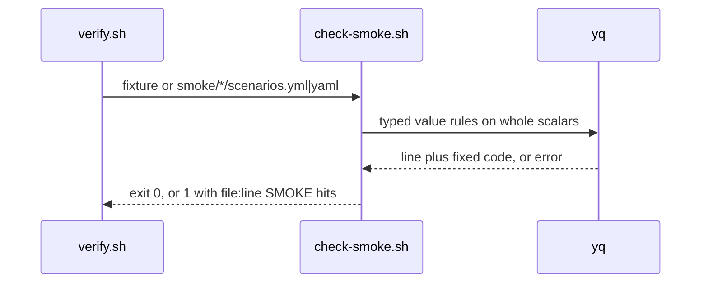

# SM01a: check-smoke.sh hardening follow-ups (fail closed on values, carry from #11)
- Status: todo
- Area: smoke
- Wave: W3
- Block: 3
- Lane: Builder
- Depends on: SM01 ([PR #11](https://github.com/svennijhuis/agentic-workflows/pull/11), not merged yet; `scripts/check-smoke.sh` lands with it)
- proof: each of the 11 new `test/fixtures/smoke/bad-*` cases below exits exactly 1 under `bash scripts/check-smoke.sh` (case 11 as a two-file call), `good.yml` and `good-dotted.yml` still exit 0, in the `scripts/verify.sh` loop; `./scripts/verify.sh` ends with `0 failures`
- door: two-way
- triage: build (the open findings Sven's 2-round cap moved off PR #11 at 68b63f2: Cursor review 5657322997 f1 to f4 and Reviewer comment 6424620155; each one exits 0 today and gets one FAKE bad fixture)
- feedback: `bash scripts/check-smoke.sh` on each new bad fixture exits 1 with one hit; the two good fixtures exit 0; `./scripts/verify.sh` gives `0 failures`
- harness: none (script)
- review-input: diff + this PBI + DoD (+ linked spec) + PR description, never builder session logs (PA6)
- kind: script (deterministic)
- Source: PA8 (no D row; Sven, Development Agentic Workflows room, 2026-10-26 19:34 "Please do not 4 round we will fix issues later and add on list") https://github.com/svennijhuis/agentic-workflows/pull/11#pullrequestreview-5657322997 and https://github.com/svennijhuis/agentic-workflows/pull/11#issuecomment-6424620155
## Goal
Close the gaps left open on #11 with typed, allowlisted values, not more patterns, so `scripts/check-smoke.sh` fails closed on every value it reads.
## Context
SM01 ships `scripts/check-smoke.sh` in [PR #11](https://github.com/svennijhuis/agentic-workflows/pull/11). Under Sven's 2-round cap (2026-10-26 19:34) Reviewer passed #11 at 68b63f2 with the findings below still open. Each one was reproduced with `scripts/check-smoke.sh` from 68b63f2 on a copy of `test/fixtures/smoke/good.yml` with one value changed, and each exits 0 today (no hit). This PBI only starts after #11 merges.

Fix map (Strategy draft, line numbers are `scripts/check-smoke.sh` at 68b63f2):

| # | Source | Gap (exits 0 at 68b63f2) | Fix |
|---|---|---|---|
| 1 | Cursor 5657322997 f1 medium | `status: 0x1000` (and `0o1130`): yq tags it `!!int`, `tostring` keeps `0x1000`, `[ "$status" -gt 599 ]` at :73 prints `integer expression expected` and the `elif` never calls `hit` (fails open) | range test inside yq: `tag == "!!int"` and decimal and `. >= 100 and . <= 599`; exit 1 when yq or the compare cannot decide |
| 2 | Cursor 5657322997 f2 medium | a token in `expect.json[].equals`: split across lines (the `@tsv` read at :40 is one physical line at a time, so the rest of the scalar is never tested), and on one line with a short middle segment (`FAKE000000.e30.FAKE000000000`, `e30` is under 10 chars) | run the token `test()` inside yq on the whole scalar, print only `line` plus a fixed code, exit 1 when that yq call fails; JWT shape is three dot segments with a short middle allowed, or an `eyJ` start; move the `env`, `path`, `auth` reads into yq too so a newline cannot drop a field |
| 3 | Cursor 5657322997 f3 low | `exists: "true"` (`!!str`): `.exists != true` at :26 treats the string as equal | `exists` must be tag `!!bool` and value `true`, same as `test_data_only` |
| 4 | Cursor 5657322997 f4 low | `docs/pbi/README.md` line 435 still says "SM01-SM07 smoke (docs only so far)" and line 56 says SM01 waits on SM08, while #11 marks SM01 done | update both lines to the 2026-10-26 split (SM01 build carries its SM08 rows, SM08 closes after its last target PBI) |
| 5 | Reviewer 6424620155 item 5 | `#access_token` fragment: `path: /x#access_token=FAKE0000000000` | `path` must not contain `#` |
| 6 | Reviewer 6424620155 item 5 | `?client_secret=` and `?password=` query keys (the key list at :61 has only token, access_token, api_key, key, secret) | query key allowlist in `smoke/_schema.yml` (empty by default); any query key not on it is a hit |
| 7 | Reviewer 6424620155 item 5 | `glpat-` prefix: `path: /x/glpat-FAKE0000000000` (PREFIX at :11 has no GitLab family) | add `glpat-` to the prefix list |
| 8 | Reviewer 6424620155 item 5 | a JWT in the path: `path: /x/FAKE000000.e30.FAKE000000000` | same yq token rule as row 2, run on `path` |
| 9 | Reviewer 6424620155 item 6 (round 1 low) | `.yaml` glob: `scripts/verify.sh` at 68b63f2 already loops `smoke/*/scenarios.yaml` (:105), but the fixture loops (:103, :104) read only `good*.yml` and `bad-*.yml`, so a `bad-*.yaml` fixture is never run | fixture loops read `*.yml` and `*.yaml` |
| 10 | Product Owner gap list | unique ids per file | done in #11 (duplicate id fixture `bad-dup-id.yml` exits 1, Reviewer probed it) |
| 11 | Product Owner gap list, probe | the same `id` in two different smoke files: `check-smoke.sh a.yml b.yml` exits 0 (`ids` resets per file in `check_file`) | ids unique across all files in one call; a repeat in a second file is a hit on that file |

Note for the build: the id match at :64 uses a space-joined list, so an id with a space (`"a b"`) makes a later id `b` a false duplicate. Make `id` a non-empty `!!str` with no whitespace and match whole ids.
## Steps
1. After #11 merges, move the value checks of rows 1, 2, 3, 5, 6, 7, 8 and 11 into yq (whole scalars, tags checked), keeping the `file:line SMOKE message` output and exit 0, 1, 2.
2. Add the query key allowlist to `smoke/_schema.yml` and `smoke/README.md`.
3. Fix the fixture loops in `scripts/verify.sh` for `.yaml` (row 9) and the two README lines (row 4).
4. Add the bad fixtures below, FAKE plus zeros values only, each differing from `good.yml` by one value.
5. Run `./scripts/verify.sh` twice, `bash scripts/check-pbi-docs.sh`, `bash scripts/check-pbi-template.sh`, gitleaks.
6. Move this file to `docs/pbi/done/` with `- Status: done` and `- PR: #<n>`, update the README rows.
## Definition of Done
- [ ] Row 1: `test/fixtures/smoke/bad-status-hex.yml` (`status: 0x1000`) exits 1 with one hit, no bash compare error on stderr
- [ ] Row 2: `bad-equals-token-oneline.yml` (`equals: FAKE000000.e30.FAKE000000000`) exits 1
- [ ] Row 2: `bad-auth-token-multiline.yml` (the FAKE token in `equals` split across two lines in a quoted scalar) exits 1
- [ ] Row 3: `bad-exists-string.yml` (`exists: "true"`) exits 1
- [ ] Row 4: `docs/pbi/README.md` lines 56 and 435 match the 2026-10-26 split
- [ ] Row 5: `bad-path-fragment.yml` (`path: /x#access_token=FAKE0000000000`) exits 1
- [ ] Row 6: `bad-query-client-secret.yml` (`?client_secret=FAKE0000000000`) exits 1
- [ ] Row 6: `bad-query-password.yml` (`?password=FAKE0000000000`) exits 1
- [ ] Row 7: `bad-auth-glpat.yml` (`glpat-FAKE00000000000000`) exits 1
- [ ] Row 8: `bad-path-jwt.yml` (`path: /x/FAKE000000.e30.FAKE000000000`) exits 1
- [ ] Row 9: `bad-yaml-ext.yaml` (a bad scenario saved as `.yaml`) is run by the verify fixture loop and exits 1
- [ ] Row 10: `bad-dup-id.yml` from #11 still exits 1 (no change)
- [ ] Row 11: `test/fixtures/smoke/bad-dup-id-cross/a.yml` plus `b.yml` (same `id` in both) exits 1 when passed together, and the verify loop runs that pair as one case
- [ ] `good.yml` and `good-dotted.yml` (`path: /v1.2.3`) still exit 0
- [ ] `./scripts/verify.sh` ends with `0 failures` (run twice); `bash scripts/check-pbi-docs.sh` and `bash scripts/check-pbi-template.sh` print nothing; gitleaks clean; no em or en dash; `policies/checks/POL23.sh` untouched
- [ ] No real or JWT-prefixed token in any file (FAKE plus zeros only)
- [ ] A fresh Cursor review on the SM01a PR head has no open medium or above
## Technical design
- Components and files: `scripts/check-smoke.sh`, `smoke/_schema.yml`, `smoke/README.md`, `scripts/verify.sh` (smoke fixture loops only), `test/fixtures/smoke/bad-*.yml`, `bad-yaml-ext.yaml`, `bad-dup-id-cross/`, `docs/pbi/README.md`
- Module boundary: `scripts/check-smoke.sh FILE...` (exit 0, 1, 2, `file:line SMOKE message`) stays the only interface; the typed yq value rules sit behind it
- Interfaces: input one or more `scenarios.yml` or `.yaml` files; output one line per hit; exit 0 ok, 1 a hit or a value yq cannot decide, 2 needs-human (yq missing)
- Sequence:

- Failure modes: a yq error or an undecidable compare is a hit (exit 1), never a pass; a missing yq is exit 2
- Security: offline, no tokens, FAKE fixtures only; closes token and secret leaks in scenario files
- Observability: `file:line SMOKE message` lines in the verify log
- Cost: 0 (script)
- Rollback: revert the SM01a PR
- Proof: same as proof: above
- Door: two-way (script and fixtures only, nothing enabled)
## Evidence
Probes on 68b63f2 (`scripts/check-smoke.sh` from #11, one value changed in a copy of `good.yml`): rows 1, 2 (split and short middle), 3, 5, 6, 7, 8 and 11 exit 0. A one-line token with three 10+ char segments in `equals` or `path` already exits 1.
## Flow

## Named asks for Sven
none
## Cost
0 (script)
## Sources
- Cursor review 5657322997 on PR #11 at 68b63f2: https://github.com/svennijhuis/agentic-workflows/pull/11#pullrequestreview-5657322997
- Reviewer PASS comment 6424620155: https://github.com/svennijhuis/agentic-workflows/pull/11#issuecomment-6424620155
- Sven 2026-10-26 19:34, 2-round cap, leftovers to a todo PBI
