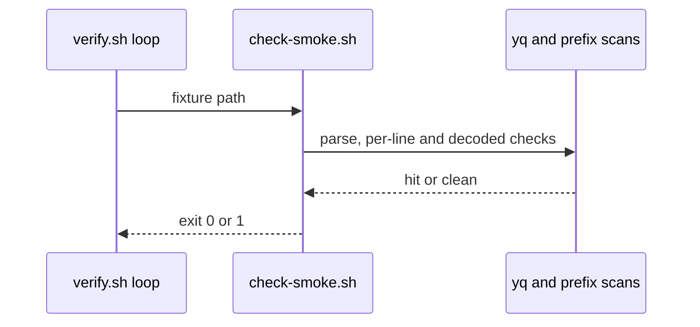
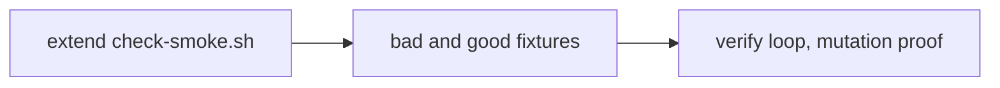

# SM01b: check-smoke carry from Cursor 5657706637 (PR #11 at 4781aac)
- Status: todo
- Area: smoke
- Wave: W3
- Block: 3
- Lane: Builder
- Depends on: SM01a
- proof: each listed bad fixture makes `scripts/check-smoke.sh` exit 1 with one hit; each listed good fixture exits 0; `./scripts/verify.sh` ends with `0 failures` twice; both PBI checks print nothing; gitleaks clean (FAKE values allowlisted by path); POL23 untouched
- door: two-way
- triage: build (lane 2 after SM01a, same file `scripts/check-smoke.sh`)
- feedback: `scripts/check-smoke.sh` exits 1 on each bad case and 0 on each good case in the DoD; `./scripts/verify.sh` ends with `0 failures` (proof)
- harness: none (script)
- review-input: diff + this PBI + DoD (+ linked spec) + PR description, never builder session logs (PA6)
- kind: script (deterministic)
- Source: PA8 (no D row; Cursor 5657706637 on PR #11 at 4781aac, Product Owner GO 6425192168) https://github.com/svennijhuis/agentic-workflows/pull/11
## Goal
`check-smoke` fails closed on every value shape and every encoded path, with no false duplicate hits.
## Context
Lane 2 after SM01a (same file `scripts/check-smoke.sh`). Filed in the next lane 3 docs PR with [WF01](../verify/WF01.md). SM01a (in PR #15) stays frozen; this is its follow-up so PR #15 keeps its SHA.

Already in SM01a, not repeated here: f2 (hex status), f8 (stale README).

Fix map:

| # | Cursor | Gap (exits 0 today, or wrong 1) | Fix |
|---|---|---|---|
| 1 | f1 high | secret on line 2+ of a multi-line value; leading-space value; value after `#` comment | scan each value line after trim, and the raw line incl. comment tail |
| 2 | f5 med | a FAKE GitHub refresh token prefix (g h r underscore), a FAKE OpenAI style key prefix (s k dash), a PEM private key header line | add to prefix list; PEM header anywhere is a hit |
| 3 | f3 med | `%2F`, `%5C` in path, `%3D` in query | decode once, then rerun path and query checks; `//`, `\` in decoded path are hits |
| 4 | f4 med | two maps on one line reuse a key, flagged as dup | dup key check per map node (yq), not per line |
| 5 | f6 low | `exists: "true"` accepted | bool only (overlaps SM01a f3: verify, no double fix) |
| 6 | f7 low | dup id matches substring (`list` vs `orders list`) | exact match on full id |

Bad cases (FAKE only, zeros):
1. multi-line `equals` with a FAKE GitHub personal access token prefix (g h p underscore) on line 2
2. value with leading space before a FAKE GitHub personal access token prefix (g h p underscore)
3. FAKE token-shaped value after `#` on the value line
4. a FAKE GitHub refresh token prefix (g h r underscore)
5. a FAKE OpenAI style key prefix (s k dash)
6. a PEM private key header line only, no body
7. path `/a%2F%2Fb`
8. path `/a%5Cb`
9. query `?limit%3D1`
10. `exists: "true"`

Good cases: 2 maps on one line with same key (exit 0), ids `list` and `orders list` (exit 0).
## Steps
1. Extend `scripts/check-smoke.sh` per the fix map (f1, f5, f3, f4, f6, f7).
2. Add bad and good fixtures for every row in Context; wire the verify loop.
3. Run `./scripts/verify.sh` twice; mutation run (old check-smoke gives at least 10 failures on the new bad set).
## Definition of Done
- [ ] f1: multi-line value, leading-space value and comment-tail value each exit 1 with one hit
- [ ] f5: refresh prefix, OpenAI style prefix and PEM header line each exit 1 with one hit
- [ ] f3: encoded path and query cases exit 1; decoded `//` and `\` in path exit 1
- [ ] f4: duplicate key per map node (yq), not per line; two maps on one line with same key exits 0
- [ ] f6: `exists: "true"` exits 1; bool `true` still passes where SM01a already allows it
- [ ] f7: ids `list` and `orders list` together exit 0; substring dup id match removed
- [ ] Each bad fixture exits 1 with exactly one hit; each good fixture exits 0
- [ ] `./scripts/verify.sh` ends with `0 failures` twice; both PBI checks print nothing; gitleaks clean (FAKE values allowlisted by path); POL23 untouched
- [ ] Two fix rounds max; anything open after goes to the list
## Technical design
- Components and files: `scripts/check-smoke.sh`, `test/fixtures/smoke/bad-*` and good fixtures for SM01b rows, `scripts/verify.sh` loop
- Module boundary: `scripts/check-smoke.sh` on `scenarios.yml`; multi-line and encoded-value rules sit behind the same exit 0/1 contract as SM01
- Interfaces: input scenarios.yml path; exit 0 ok, 1 failed; output `file:line SMOKE message`
- Sequence:

- Failure modes: a gap that exits 0 today becomes a named hit; overlapping SM01a f3 (`exists` bool) is not fixed twice
- Security: FAKE-only fixtures; no literal secret prefixes in markdown (POL20); prefix list matches SM01 families where they overlap
- Observability: one `file:line SMOKE` line per hit in verify log
- Cost: 0
- Rollback: revert the PR; SM01a behavior unchanged on PR #15 SHA until this merges
- Proof: same as proof: above
- Door: two-way (script and fixtures)
## Evidence
Gate log comment, per-case exit table, mutation run (old check-smoke gives at least 10 failures on the new bad set)
## Flow

## Named asks for Sven
- none (SM01a on PR #15 stays frozen until this lands)
## Cost
0 (script)
## Sources
- Cursor 5657706637 on [PR #11](https://github.com/svennijhuis/agentic-workflows/pull/11) at 4781aac
- Product Owner GO 6425192168
