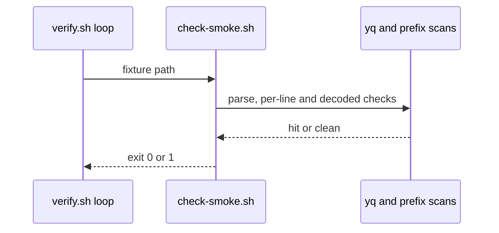
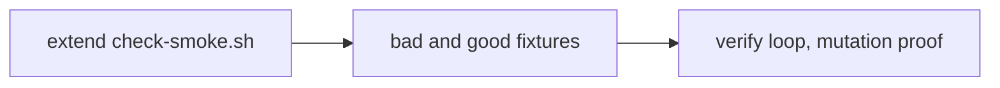

# SM01b: check-smoke carry from Cursor 5657706637 (PR #11 at 4781aac)
- Status: todo
- Area: smoke
- Wave: W3
- Block: 3
- Lane: Builder
- Depends on: SM01a
- proof: each of the 6 bad fixtures in Context makes `scripts/check-smoke.sh` exit 1 with one hit and `good-query-enc-limit.yml` exits 0; on the SM01a check (before this PBI) each of those 6 bad fixtures exits 0, so the mutation run records 6 missed hits; `bad-query-double-encoded.yml` (SM01a, `?%256cimit=1`) still exits 1; `./scripts/verify.sh` ends with `0 failures` twice; both PBI checks print nothing; gitleaks clean (FAKE values allowlisted by path); POL23 untouched
- door: two-way
- triage: build (lane 2 after SM01a, same file `scripts/check-smoke.sh`)
- feedback: `scripts/check-smoke.sh` exits 1 on each bad case and 0 on each good case in the DoD; `./scripts/verify.sh` ends with `0 failures` (proof)
- harness: none (script)
- review-input: diff + this PBI + DoD (+ linked spec) + PR description, never builder session logs (PA6)
- kind: script (deterministic)
- Source: PA8 (no D row; Cursor 5657706637 on PR #11 at 4781aac, Product Owner GO 6425192168) https://github.com/svennijhuis/agentic-workflows/pull/11
## Goal
`check-smoke` fails closed on comment tails, PEM headers and every encoded path, with no false hit on an encoded allowed key.
## Context
Lane 2 after SM01a (same file `scripts/check-smoke.sh`). Filed in the next lane 3 docs PR with [WF01](../verify/WF01.md). SM01a (in PR #15) stays frozen; this is its follow-up so PR #15 keeps its SHA.

Already in SM01a (PR #15 head 368f837), not repeated here (Cursor 5657888041 f3 on PR #18): f2 (hex status, row 1), f8 (stale README, row 4), f1 multi-line and leading-space values (row 2), f6 `exists: "true"` (row 3, `bad-exists-string.yml`), f5 GitHub refresh token and OpenAI style key prefixes (row 14), f4 two maps on one line (row 16, `good-json-oneline.yml`), f7 exact id match (row 17). SM01b keeps only what SM01a does not name.

Fix map:

| # | Cursor 5657706637 | Gap after SM01a (exits 0) | Fix |
|---|---|---|---|
| 1 | f1 high (rest) | a FAKE token-shaped value after a YAML `#` comment on the value line | scan the raw line including the comment tail, not only the parsed scalar |
| 2 | f5 medium (rest) | a PEM private key header line, no body | a PEM private key header anywhere in the file is a hit |
| 3 | f3 medium | `/%2F/evil.example/a` and `/%5C/evil.example/a` decode to a leading `//` or `/\` (host switch); `?api_key%3D` plus a FAKE value decodes to a secret key; a broken `%` escape | decode the path and the query once, then rerun the path rule (a leading `//` or any `\` is a hit) and the query key allowlist; a `%` that is not followed by two hex digits is a hit (fail closed) |
| 4 | f6 low | none: SM01a row 3 already covers `exists: "true"` | no fix here; DoD only checks `bad-exists-string.yml` still exits 1 |

Bad cases (FAKE only, zeros). After SM01a each of the six exits 0; after SM01b each exits 1 with one hit; the mutation run on the pre-SM01b script records six missed hits:
1. FAKE token-shaped value after `#` on the value line (`bad-comment-tail.yml`)
2. a PEM private key header line only, no body (`bad-pem-header.yml`)
3. path `/%2F/evil.example/a` (`bad-path-enc-slash.yml`)
4. path `/%5C/evil.example/a` (`bad-path-enc-backslash.yml`)
5. query `?api_key%3D` plus a FAKE value (`bad-query-enc-eq.yml`)
6. path with a broken escape `/a%zz` (`bad-path-bad-escape.yml`)

Good case: query `?limit%3D1` (`good-query-enc-limit.yml`) exits 0, because one decode gives the allowed key `limit` (SM01a row 6 and 13), so it must not become a false hit.

Decode once in total (Reviewer FAIL 6425915794 item 8): the query is percent-decoded exactly once. The row 3 decode replaces SM01a's key decode (SM01a row 13) and does not add to it, so `bad-query-double-encoded.yml` (`?%256cimit=1`, one decode gives `%6cimit`, which still holds `%`) still exits 1.
## Steps
1. Extend `scripts/check-smoke.sh` per the fix map (rows 1 to 3; row 4 has no code change).
2. Add the 6 bad and 1 good fixtures; the existing verify loop picks them up.
3. Run `./scripts/verify.sh` twice; mutation run: on the SM01a check-smoke (before SM01b) each of the 6 new bad fixtures exits 0, so the run records 6 missed hits, one per case.
## Definition of Done
- [ ] Row 1: `bad-comment-tail.yml` exits 1 with one hit
- [ ] Row 2: `bad-pem-header.yml` exits 1 with one hit
- [ ] Row 3: `bad-path-enc-slash.yml`, `bad-path-enc-backslash.yml`, `bad-query-enc-eq.yml` and `bad-path-bad-escape.yml` each exit 1 with one hit; `good-query-enc-limit.yml` exits 0
- [ ] Row 4: SM01a `bad-exists-string.yml` still exits 1 (no second fix)
- [ ] All SM01a fixtures keep their exit code
- [ ] Mutation proof counts only the 6 cases that still exit 0 after SM01a: on the pre-SM01b check each exits 0 (6 missed hits), after SM01b each exits 1 with one hit
- [ ] The query is decoded exactly once in total (row 3 replaces the SM01a key decode): `good-query-enc-limit.yml` exits 0 and SM01a `bad-query-double-encoded.yml` (`?%256cimit=1`) still exits 1
- [ ] `./scripts/verify.sh` ends with `0 failures` twice; both PBI checks print nothing; gitleaks clean (FAKE values allowlisted by path); POL23 untouched
- [ ] Two fix rounds max; anything open after goes to the list
## Technical design
- Components and files: `scripts/check-smoke.sh`, `test/fixtures/smoke/bad-*` and good fixtures for SM01b rows, `scripts/verify.sh` loop
- Module boundary: `scripts/check-smoke.sh` on `scenarios.yml`; multi-line and encoded-value rules sit behind the same exit 0/1 contract as SM01
- Interfaces: input scenarios.yml path; exit 0 ok, 1 failed; output `file:line SMOKE message`
- Sequence:

- Failure modes: a gap that exits 0 after SM01a becomes a named hit; a broken `%` escape fails closed; rows SM01a already names are not fixed twice
- Security: FAKE-only fixtures; no literal secret prefixes in markdown (POL20); prefix list matches SM01 families where they overlap
- Observability: one `file:line SMOKE` line per hit in verify log
- Cost: 0
- Rollback: revert the PR; SM01a behavior unchanged on PR #15 SHA until this merges
- Proof: same as proof: above
- Door: two-way (script and fixtures)
## Evidence
Gate log comment, per-case exit table, mutation run (on the SM01a check-smoke each of the 6 new bad fixtures exits 0, 6 missed hits)
## Flow

## Named asks for Sven
- none (SM01a on PR #15 stays frozen until this lands)
## Cost
0 (script)
## Sources
- Cursor 5657706637 on [PR #11](https://github.com/svennijhuis/agentic-workflows/pull/11) at 4781aac
- Product Owner GO 6425192168
- [PR #18 Cursor review 5657888041, findings 2 and 3](https://github.com/svennijhuis/agentic-workflows/pull/18)
- [PR #18 Cursor review 5658106584, finding 4; Reviewer FAIL 6425915794 item 8](https://github.com/svennijhuis/agentic-workflows/pull/18#issuecomment-6425915794)
