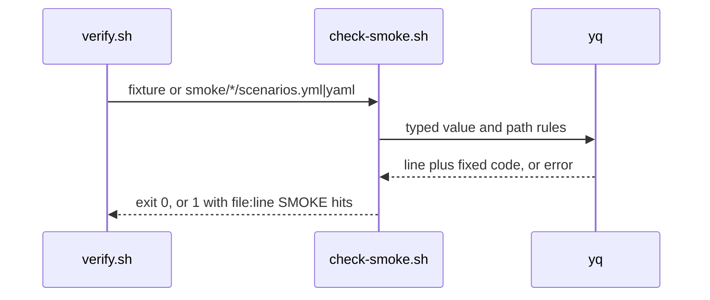
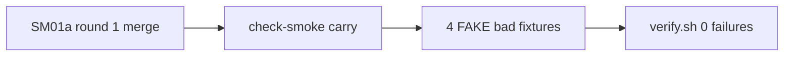

# SM01c: check-smoke carry from PR #20 round 1 lows
- Status: todo
- Area: smoke
- Wave: W3
- Block: 3
- Lane: Builder
- Depends on: SM01a
- proof: each bad fixture named in Context exits 1 under `bash scripts/check-smoke.sh` and `./scripts/verify.sh` ends with `0 failures`
- door: two-way
- triage: build (round 1 lows on PR #20, same file `scripts/check-smoke.sh`)
- feedback: `scripts/check-smoke.sh` exits 1 on each bad case and 0 on each good case in the DoD; `./scripts/verify.sh` ends with `0 failures` (proof)
- harness: none (script)
- review-input: diff + this PBI + DoD (+ linked spec) + PR description, never builder session logs (PA6)
- kind: script (deterministic)
- Source: PA8 (Tester 6535761517 and Reviewer 6535832889 on PR #20 at aca48a1) https://github.com/svennijhuis/agentic-workflows/pull/20#issuecomment-6535761517 https://github.com/svennijhuis/agentic-workflows/pull/20#issuecomment-6535832889
## Goal
Close the low findings left open after SM01a round 1 on PR #20 without weakening existing smoke gates.
## Context
SM01a round 1 on PR #20 fixed token keys, decoded-path query keys, int64 status compare, newline-split tokens and empty id stderr. Tester 2 and Reviewer left the items below for a follow-up PBI (not blocking round 1).

Fix map:

| # | Source | Gap (exits 0 today) | Fix |
|---|---|---|---|
| 1 | Cursor f4 low on PR #20 | the second copy of an id in one file is reported as `duplicate id across files` and again as `duplicate id` (`bad-dup-id.yml` gives two hits) | run the in-file duplicate check before updating `GLOBAL_IDS`; emit `across files` only when the id was seen in an earlier file |
| 2 | Tester 6535761517 low | `path: /api/x/%67hp_FAKE...` (encoded `g` in the prefix) exits 0; main at 0512fb0 also exits 0 | run the token rules on the path after one percent-decode as well as on raw scalars |
| 3 | Tester 6535761517 low | `?password` with no `=` exits 0 | treat a query segment with no `=` as a key name and apply the allowlist (fail closed) |
| 4 | Tester 6535761517 low | `status: 0200` exits 0 (leading zero, still in range) | reject HTTP status literals that are not a plain decimal integer without a leading-zero form outside the allowed grammar, or require tag `!!int` and literal `^[0-9]+$` with no leading zeros except the value `0` alone (pick one rule and document it in `smoke/README.md`) |

Bad cases (FAKE only): one fixture per row above, each exiting 1 with one hit under `scripts/check-smoke.sh`.
## Steps
1. Extend `scripts/check-smoke.sh` per the fix map.
2. Add one bad fixture per row; the existing verify loop picks them up.
3. Run `./scripts/verify.sh` twice; `bash scripts/check-pbi-docs.sh` and `bash scripts/check-pbi-template.sh` print nothing.
## Definition of Done
- [ ] Row 1: `bad-dup-id.yml` exits 1 with one hit (in-file duplicate only)
- [ ] Row 2: `bad-path-enc-ghp-prefix.yml` exits 1 with one hit
- [ ] Row 3: `bad-query-key-no-eq.yml` exits 1 with one hit
- [ ] Row 4: `bad-status-leading-zero.yml` exits 1 with one hit
- [ ] `good.yml` and the other good smoke fixtures still exit 0
- [ ] `./scripts/verify.sh` ends with `0 failures` (run twice); both PBI checks print nothing; no em or en dash; POL23 untouched
## Technical design
- Components and files: `scripts/check-smoke.sh`, `test/fixtures/smoke/bad-*`, `smoke/README.md` (row 4 rule text only if needed), `scripts/verify.sh` loop unchanged
- Module boundary: `scripts/check-smoke.sh FILE...` exit 0/1/2 and `file:line SMOKE message` output stay the only interface; duplicate-id order and path decode token rules sit behind it
- Interfaces: input one or more `scenarios.yml` or `.yaml` files; output one line per hit
- Sequence:

- Failure modes: yq error or undecidable compare is a hit (exit 1), never a pass
- Security: offline, FAKE fixtures only
- Observability: `file:line SMOKE message` lines in the verify log
- Cost: 0 (script)
- Rollback: revert the SM01c PR
- Proof: same as proof: above
- Door: two-way (script and fixtures only)
## Evidence
Probes on PR #20 head aca48a1: rows 1 to 4 exit 0 or double-hit as described; round 1 fixed the blocking items only.
## Flow

## Named asks for Sven
none
## Cost
0 (script)
## Sources
- Tester 2 FAIL comment 6535761517 on PR #20: https://github.com/svennijhuis/agentic-workflows/pull/20#issuecomment-6535761517
- Reviewer FAIL comment 6535832889 on PR #20: https://github.com/svennijhuis/agentic-workflows/pull/20#issuecomment-6535832889
- Cursor review on PR #20 at aca48a1 (f4 low): https://github.com/svennijhuis/agentic-workflows/pull/20#issuecomment-6535832889
