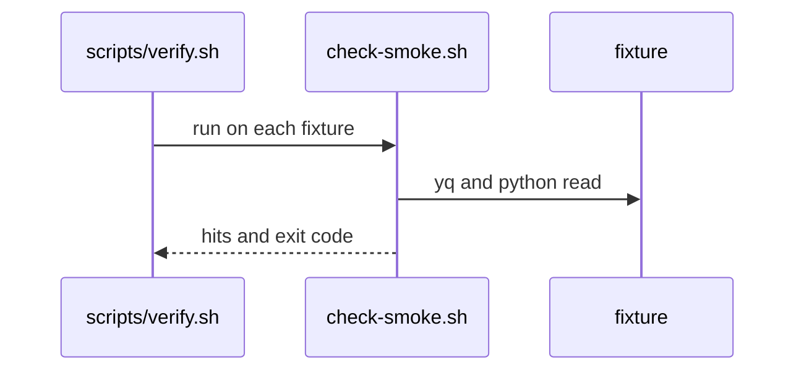
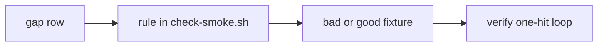

# SM01d: check-smoke carry from PR #24 Tester 2 lows
- Status: todo
- Area: smoke
- Wave: W3
- Block: 3
- Lane: Builder
- Depends on: SM01b
- proof: each bad fixture in Context exits 1 with 1 hit under `bash scripts/check-smoke.sh`; each good fixture exits 0; `./scripts/verify.sh` ends with `0 failures`; both PBI checks print nothing
- door: two-way
- triage: build (Tester 2 lows on PR #24 at d836922, same on main, not blocking)
- feedback: `scripts/check-smoke.sh` exits 1 on each bad case and 0 on each good case; `./scripts/verify.sh` ends with `0 failures` (proof)
- harness: none (script)
- review-input: diff + this PBI + DoD (+ linked spec) + PR description, never builder session logs (PA6)
- kind: script (deterministic)
- Source: PA8 (Tester 2 FAIL on PR #24 at d836922, lows list; Cursor review 5724841554 f2 to f6 on PR #24, confirmed by Reviewer 6548976117; Cursor review 5724950625 f1 to f7 fixed in PR #24) https://github.com/svennijhuis/agentic-workflows/pull/24 https://github.com/svennijhuis/agentic-workflows/pull/24#pullrequestreview-5724841554
- Module boundary: `scripts/check-smoke.sh` only, input a smoke YAML file, output `file:line SMOKE message`, exit 0, 1 or 2
## Goal
Close the low findings Tester 2 left on PR #24, without weakening any smoke gate.
## Context
| # | Gap today | Fix |
|---|---|---|
| 1 | `/api/../admin` and `/api/%2e%2e/admin` exit 0 (path traversal on the same host) | reject `..` segments on the raw and the once-decoded path (`bad-path-dotdot.yml`, `bad-path-enc-dotdot.yml`) |
| 2 | `/https:%2f%2fevil.example` exits 0 (stays on base host) | reject a decoded path that holds a scheme (`bad-path-dec-scheme.yml`) |
| 3 | `?q=a%20b` in a query value is a hit (false positive) | done in PR #24 (Cursor 5724950625 f5): a plain decoded space is allowed inside a query value, any decoded whitespace stays banned in the path part (`good-query-value-space.yml` exits 0, `bad-path-dec-space.yml` still 1) |
| 4 | `Authorization: Token FAKE` gives 2 hits | one hit per scalar for the scheme rules (`bad-auth-token-scheme.yml` exits 1 with 1 hit) |
| 5 | Cursor 5724841554 f2 high: newline plus U+2028 between `Bearer` and the value exits 0 | done in PR #24 (Cursor 5724950625 f2): the unicode pass reads JSON records from yq (no `@tsv` split), strips CR and LF, then runs the separator normalization (`bad-auth-newline-u2028.yml`, `bad-auth-newline-nbsp.yml`, `bad-auth-newline-u2028-prefix.yml`) |
| 6 | Cursor 5724841554 f3 medium: a full-line comment `# ghp_FAKE...` exits 0 | done in PR #24 (Cursor 5724950625 f3): full-line and indented comments get the token rules (`bad-comment-full-line.yml`, `bad-comment-full-line-indent.yml`); f1 high in the same pass: an apostrophe in a plain scalar no longer opens a quote (`bad-comment-apostrophe.yml`, `bad-comment-apostrophe-header.yml`) |
| 7 | Cursor 5724841554 f4 medium: lowercase `token` in a comment tail exited 0 | done in PR #24 (Tester 2 6548986713): `token` scheme match is case insensitive everywhere, only `token refresh` allowed (`bad-token-scheme-lower.yml`, `bad-token-scheme-upper.yml`, `good-token-refresh.yml` stays 0) |
| 8 | Cursor 5724841554 f5 medium: `%C2%A0` (NBSP) in the path exits 0 | done in PR #24 (Cursor 5724950625 f4): python rejects NBSP and every unicode whitespace in the decoded path part (`bad-path-dec-nbsp.yml`) |
| 9 | Cursor 5724841554 f6 low: SM01b proof count says 17 new bad fixtures, real count 16 | fix the count in `docs/pbi/done/SM01b.md` (docs only) |
## Steps
1. Extend `scripts/check-smoke.sh` per the table.
2. Add the fixtures; the verify one-hit loop picks them up.
3. Run `./scripts/verify.sh`; both PBI checks print nothing.
## Definition of Done
- [ ] Rows 1, 2 and 4 each have a bad fixture that exits 1 with 1 hit.
- [x] Rows 5, 6 and 8 have bad fixtures that exit 1 with 1 hit (PR #24, Cursor 5724950625).
- [x] Row 3 has a good fixture that exits 0 (PR #24).
- [ ] Every existing smoke fixture keeps its exit code and hit count.
- [ ] `./scripts/verify.sh` ends with `0 failures`; no `scripts/check-*.sh` gate weakened.
- [ ] Row 9 count fixed. Docs updated; no em or en dashes, no secrets.
## Technical design
- Components and files: `scripts/check-smoke.sh`, `test/fixtures/smoke/bad-path-dotdot.yml`, `bad-path-enc-dotdot.yml`, `bad-path-dec-scheme.yml`, `bad-auth-token-scheme.yml`, `smoke/README.md`, `docs/pbi/done/SM01b.md`
- Module boundary: `scripts/check-smoke.sh FILE...` is the interface; the yq and python token, path and comment rules behind it are the deep part
- Interfaces: input one or more smoke YAML files; output one `file:line SMOKE message` line per hit; exit 0 ok, 1 hit or parse error (fail closed), 2 yq or python3 missing
- Sequence:

- Failure modes: a missed traversal or scheme case exits 0 (bad fixture then fails the verify one-hit loop); a rule that fires twice gives 2 hits (one-hit loop fails); a python error is a hit, never a skip
- Security: fixtures hold FAKE values only; no network, no tokens; the host still comes only from `SMOKE_BASE_URL`
- Observability: `scripts/verify.sh` log lines `file:line SMOKE ...` and its `0 failures` tail
- Cost: 0 tokens (script)
- Rollback: revert the PR (script, fixtures and docs go back together)
- Proof: same as `proof:` above
- Door: two-way (script and fixtures in this repo, no token spend, no write outside the repo)
## Evidence
(todo: `scripts/verify.sh` log on the exact SHA and the exit and hit count of each new fixture; rows 3, 5, 6 and 8 landed in PR #24, see the fix log on that PR)
## Flow

## Named asks for Sven
- None.
## Cost
0 tokens.
## Sources
- PR #24 Tester 2 lows at d836922: https://github.com/svennijhuis/agentic-workflows/pull/24
- Cursor review 5724841554: https://github.com/svennijhuis/agentic-workflows/pull/24#pullrequestreview-5724841554
- Cursor review 5724950625: https://github.com/svennijhuis/agentic-workflows/pull/24#pullrequestreview-5724950625
