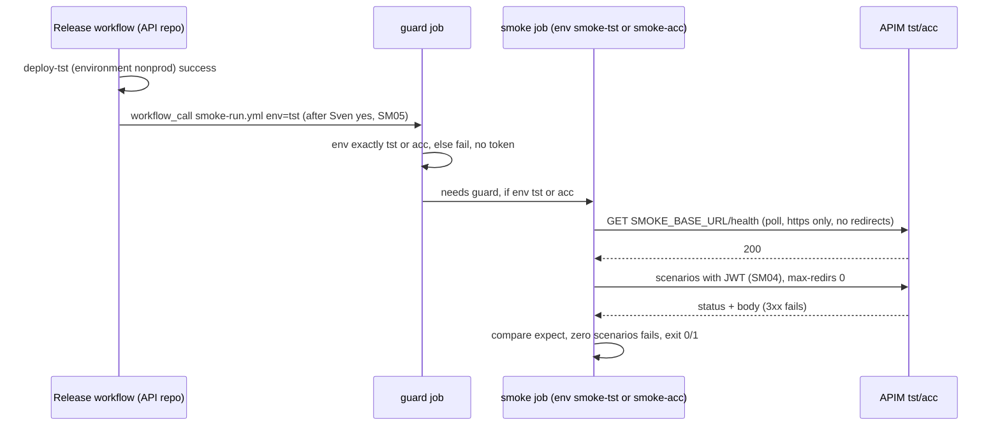
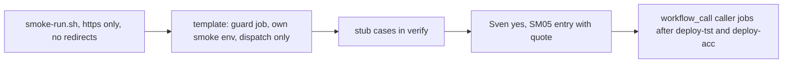

# SM03: Post-deploy smoke runner for tst and acc (no AI)
- Status: todo
- Area: smoke
- Wave: W3
- Block: 3
- Lane: Builder
- Depends on: SM01, SM04, SM05, SM07
- proof: `scripts/smoke-run.sh` against the local stub in `scripts/verify.sh` exits 0 on `test/fixtures/smoke-run/good/` and 1 on each `test/fixtures/smoke-run/bad-*`; after Sven's yes, a tst deploy in the API repo release run calls the smoke job last, which runs the scenarios and prints a pass/fail table
- door: one-way (live job at the end of every tst/acc release and a bearer token to tst/acc)
- one-way gate: Sven's exact yes required (quoted in the SM05 entry in `governance/rollout.yml`, SM04 and SM07 setup done) before the `workflow_call` smoke jobs are added to the API repo release workflow. Rollback: remove the `smoke-tst` and `smoke-acc` caller jobs from the release workflow (smoke back to `workflow_dispatch` only), revert
- triage: build
- feedback: `scripts/smoke-run.sh` against the local stub in `scripts/verify.sh`: exit 0 on the good case, 1 on each bad case (proof)
- harness: none (script)
- review-input: diff + this PBI + DoD (+ linked spec) + PR description, never builder session logs (PA6)
- kind: script (deterministic)
- Source: PA8 (no D row; Sven, Development Agentic Workflows room, 2026-10-25 17:48 and 17:50 (post-deploy smoke on tst/acc, Azure AD JWT)) https://github.com/svennijhuis/agentic-workflows/pull/5
## Goal
When the release deploys tst or acc, the last job of that release run calls the API with the scenarios for that env and reports.
## Context
Where the runner lives and why it does not use `deployment_status`:
- The API repo `svennijhuis/<api repo>` is the app repo that copies the release template (`example-project-dotnet/pipelines/release.yml` L3 "Copy this file to the APP repo", svennijhuis/infrastructure-azure-white-label@cccc9c5e).
- Sven names the API repo in SM07.
- In that template `deploy-tst` (L54) deploys under GitHub environment `nonprod` (L62).
- `deploy-acc` (L120) also deploys under `nonprod` (L130).
- `deploy-stage.yml` L24 maps tst and acc to `nonprod`.
- A `deployment_status` event therefore names `nonprod`, never `tst` or `acc`.
- So this runner does not use `deployment_status` at all, and SM05 keeps it forbidden.

How the runner is wired, one rule per line:
- The live workflow is `.github/workflows/smoke-run.yml` in the API repo.
- It is a reusable workflow: `on: workflow_call` with input `env` (string, required).
- It also has `on: workflow_dispatch` with input `env` (choice `tst`, `acc`) for a manual run.
- The release workflow gets caller job `smoke-tst`: `needs: deploy-tst`, `uses: ./.github/workflows/smoke-run.yml`, `with: {env: tst}`.
- The release workflow gets caller job `smoke-acc`: `needs: deploy-acc`, `with: {env: acc}`.
- There is no caller job for prd.
- A job that calls a reusable workflow cannot set `environment`.
- So the smoke job inside `smoke-run.yml` declares its own `environment: smoke-${{ inputs.env }}` (resolves to `smoke-tst` or `smoke-acc`).
- The smoke job never omits `environment` and never uses `nonprod`.
- With `nonprod` the OIDC subject would be `environment:nonprod`, which does not match the SM04 federated subjects.

This catalog holds the authoring copy `smoke/templates/smoke-run.yml` (not under `.github/workflows/`, so it never runs here), the caller job snippet in `smoke/README.md`, `scripts/smoke-run.sh`, the stub and the fixtures. Until Sven's yes the API repo workflow is `workflow_dispatch` only and the release has no smoke caller jobs.
## Steps
1. Runner script `scripts/smoke-run.sh` (curl + jq), every call `curl --proto =https --max-redirs 0`, never `-L` or `--location`.
2. Workflow template, `guard` job: `permissions: {}`, no environment, no token. It fails unless `inputs.env` is exactly `tst` or `acc`.
3. Workflow template, `smoke` job: `needs: guard`, `if: inputs.env == 'tst' || inputs.env == 'acc'`, `environment: smoke-${{ inputs.env }}` and the permission set below. It is the only job with `id-token: write`.
4. Triggers are `workflow_dispatch` only until Sven's yes, then `workflow_call` too.
5. Caller job snippet for the release workflow (`smoke-tst` after `deploy-tst`, `smoke-acc` after `deploy-acc`).
6. Good and bad cases against a local stub server in `scripts/verify.sh`.
7. After Sven's yes: this PR adds the SM05 `smoke-run.yml` entry with the quote, installs the workflow and the caller jobs in the API repo.
## Definition of Done
- [ ] Triggers are exactly `workflow_call` and `workflow_dispatch`, each with input `env`.
- [ ] Any other trigger fails the SM04 check: `deployment_status`, `workflow_run`, `repository_dispatch`, `push`, `pull_request`, `schedule`.
- [ ] `guard` job fails unless `inputs.env` is exactly `tst` or `acc` (allowlist, not a denylist).
- [ ] Empty, missing, `nonprod`, `prd`, `prod`, `production` or any other value fails in `guard`, before any OIDC step.
- [ ] `smoke` job runs only when `inputs.env` is `tst` or `acc` (job `if` plus `needs: guard`), so no token is minted for any other value
- [ ] `smoke` job declares its own `environment: smoke-${{ inputs.env }}` (`smoke-tst` or `smoke-acc`).
- [ ] That environment is never inherited, never omitted, never `nonprod`, never bare `${{ inputs.env }}`, never hardcoded (SM04 fixtures).
- [ ] Release caller jobs: `smoke-tst` needs `deploy-tst` with `env: tst`, `smoke-acc` needs `deploy-acc` with `env: acc`; no prd caller; they are the last jobs of the run
- [ ] Base URL comes only from the environment var `SMOKE_BASE_URL` on that GitHub environment.
- [ ] Inputs carry only `env` (and the sha). An unknown input such as a URL is rejected. Nothing else is read as a host.
- [ ] Every call uses `curl --proto =https --max-redirs 0`.
- [ ] A 3xx is a scenario failure. The `Location` host is never called, so the bearer token never leaves `SMOKE_BASE_URL`.
- [ ] Waits on the health endpoint (max 10 min, 15 s poll) before scenarios
- [ ] Runs only scenarios for that env. Zero matching scenarios is a failure (exit 1).
- [ ] A scenarios file that does not parse (yq error) exits 1, before any call (fail closed).
- [ ] Exit 0 all pass, 1 any fail
- [ ] Permissions on the `smoke` job only, granted by the caller job (a called workflow can only keep or lower them): `id-token: write`, `contents: read`, `pull-requests: write`, `issues: write` (same list as SM06); no `deployments: write`
- [ ] SM06 failure reporting never re-triggers the smoke (no deployment status write, no dispatch, no rerun; no trigger that a report can fire)
- [ ] Good case `test/fixtures/smoke-run/good/` exits 0
- [ ] Bad cases, each exits 1:
  - `test/fixtures/smoke-run/bad-env-prd/` (`env: prd`)
  - `test/fixtures/smoke-run/bad-env-empty/` (`env` empty)
  - `test/fixtures/smoke-run/bad-env-nonprod/` (`env: nonprod`)
  - `test/fixtures/smoke-run/bad-zero-scenarios/` (no scenario for that env)
  - `test/fixtures/smoke-run/bad-broken/` (scenarios file is invalid YAML)
  - `test/fixtures/smoke-run/bad-url-input/` (a caller passes a `base_url` input; the runner rejects it; the stub records only the SMOKE_BASE_URL host)
  - `test/fixtures/smoke-run/bad-redirect/` (stub returns 302 to another host; the stub records no second host; the run exits 1)
  - `test/fixtures/smoke-run/bad-scenario-fail/` (a scenario gets the wrong status)
## Technical design
- Components and files: catalog: `smoke/templates/smoke-run.yml`, `smoke/README.md` (caller job snippet), `scripts/smoke-run.sh`, `test/stub-api/`, `test/fixtures/smoke-run/`, `scripts/verify.sh`; API repo `svennijhuis/<api repo>`: `.github/workflows/smoke-run.yml`, the `smoke-tst` and `smoke-acc` caller jobs in its release workflow, environments `smoke-tst`, `smoke-acc`
- Module boundary: `scripts/smoke-run.sh` takes env, sha and SMOKE_BASE_URL and exits 0/1 with a table; health polling, auth, redirect refusal and expect matching sit behind it
- Interfaces: input `env` (`tst` or `acc` only), sha, environment var SMOKE_BASE_URL; output table + `smoke-result.json` + exit 0/1
- Sequence:

- Failure modes: env not allowlisted: guard fails before any token; scenarios file does not parse: exit 1 before any call; health never ready: fail with timeout named; 3xx: fail with scenario id, no second host; 5xx: fail with scenario id; zero scenarios: fail
- Security: env allowlist in a guard job before OIDC; own environment `smoke-tst` or `smoke-acc`, never `nonprod`; host only from SMOKE_BASE_URL; https only, no redirects; token from SM04, masked; permissions as listed; no write scenario without test_data_only
- Observability: job summary table, artifact `smoke-result.json` (no tokens, no bodies)
- Cost: 0 AIC, Actions minutes only
- Rollback: remove the caller jobs from the release workflow (smoke back to `workflow_dispatch`), revert
- Proof: same as proof: above
- Door: one-way (live job in every tst/acc release and a token sent to tst/acc)
## Evidence
local stub run log, verify cases, first live run table after Sven's yes
## Flow

## Named asks for Sven
- Exact yes (date and quote) for the SM05 `smoke-run.yml` entry and the `workflow_call` caller jobs in the API repo release workflow (after SM04, SM05, SM07).
## Cost
0 AIC, Actions minutes only
## Sources
- Sven, Development Agentic Workflows room, 2026-10-25 17:48 and 17:50
- svennijhuis/infrastructure-azure-white-label@cccc9c5e: `example-project-dotnet/pipelines/release.yml` L3, L54, L62, L120, L130; `example-project-dotnet/pipelines/deploy-stage.yml` L4, L24
- [PR #5 Cursor review at 17510cc, findings 2 and 3](https://github.com/svennijhuis/agentic-workflows/pull/5)
- [PR #5 Cursor review at 3c65a17, finding 3; Strategy note on `nonprod`; Tester note on the smoke job environment](https://github.com/svennijhuis/agentic-workflows/pull/5)
- [PR #5 Cursor review at 719cd75, findings 3, 4 and 9](https://github.com/svennijhuis/agentic-workflows/pull/5)
