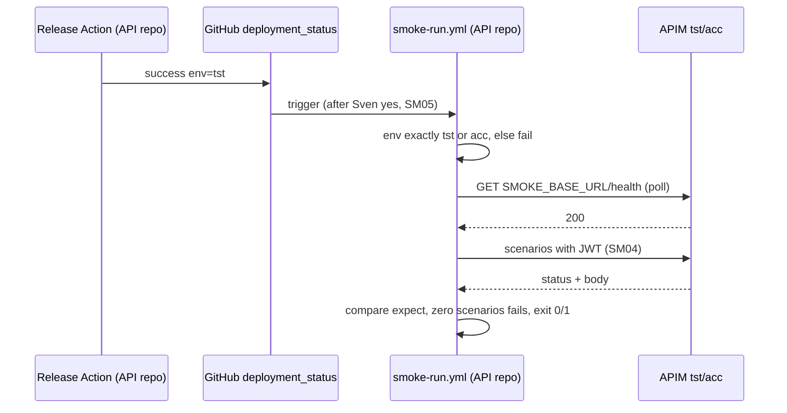
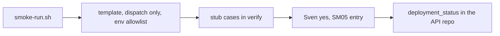

# SM03: Post-deploy smoke runner for tst and acc (no AI)
- Status: todo
- Area: smoke
- Wave: W3
- Block: 3
- Lane: Builder
- Depends on: SM01, SM04, SM05, SM07
- proof: `scripts/smoke-run.sh` against the local stub in `scripts/verify.sh` exits 0 on `test/fixtures/smoke-run/good/` and 1 on each `test/fixtures/smoke-run/bad-*`; after Sven's yes, a tst deploy success in the API repo runs the scenarios and prints a pass/fail table
- door: one-way (live trigger on deploys and a bearer token to tst/acc)
- one-way gate: Sven's exact yes required (SM05 entry in `governance/rollout.yml`, SM04 and SM07 setup done) before `deployment_status` is added. Rollback: remove `deployment_status` from the API repo workflow (back to `workflow_dispatch`), revert
- triage: build
- feedback: `scripts/smoke-run.sh` against the local stub in `scripts/verify.sh`: exit 0 on the good case, 1 on each bad case (proof)
- harness: none (script)
- review-input: diff + this PBI + DoD (+ linked spec) + PR description, never builder session logs (PA6)
- kind: script (deterministic)
- Source: PA8 (no D row; Sven, Development Agentic Workflows room, 2026-10-25 17:48 and 17:50 (post-deploy smoke on tst/acc, Azure AD JWT)) https://github.com/svennijhuis/agentic-workflows/pull/5
## Goal
When the release Action finishes on tst or acc, a plain workflow waits for the deployment, calls the API with the scenarios and reports.
## Context
`deployment_status` only starts workflows in the repo that created the deployment, and the OIDC subject is the workflow repo. So the live workflow `.github/workflows/smoke-run.yml`, the GitHub environments `smoke-tst` and `smoke-acc` and the federated subject all live in the API repo `svennijhuis/<api repo>`. This catalog holds the authoring copy `smoke/templates/smoke-run.yml` (not under `.github/workflows/`, so it never runs here), `scripts/smoke-run.sh`, the stub and the fixtures. `deployment_status` is registered only in the API repo, after the SM05 yes. Until then the workflow is `workflow_dispatch` only.
## Steps
1. Runner script `scripts/smoke-run.sh` (curl + jq).
2. Workflow template with the env allowlist guard and the permission set below, `workflow_dispatch` only.
3. Good and bad cases against a local stub server in `scripts/verify.sh`.
4. After Sven's yes: install in the API repo and add `deployment_status`.
## Definition of Done
- [ ] Job fails unless `github.event.deployment.environment` (or the dispatch input) is exactly `tst` or `acc`; empty, missing, `prd`, `prod`, `production` or anything else fails (allowlist, not a denylist)
- [ ] Job runs in GitHub environment `smoke-tst` or `smoke-acc` (mapped from `tst` or `acc`)
- [ ] Base URL only from the environment var `SMOKE_BASE_URL` on that GitHub environment; the deployment payload, `environment_url` and description are untrusted and never read
- [ ] Waits on the health endpoint (max 10 min, 15 s poll) before scenarios
- [ ] Runs only scenarios for that env; zero matching scenarios is a failure (exit 1)
- [ ] Exit 0 all pass, 1 any fail
- [ ] `workflow_dispatch` only until Sven's yes adds the SM05 entry; then `deployment_status` (state success) in the API repo only
- [ ] Permissions on this one workflow, nothing else: `id-token: write`, `contents: read`, `pull-requests: write`, `issues: write`, `deployments: write` (same list as SM06)
- [ ] Bad cases, each exits 1: `test/fixtures/smoke-run/bad-env-prd/`, `bad-env-empty/`, `bad-zero-scenarios/`, `bad-payload-url/` (event `environment_url` points at another host; the runner must call only SMOKE_BASE_URL, the stub records the host), `bad-scenario-fail/`; good `test/fixtures/smoke-run/good/` exits 0
## Technical design
- Components and files: catalog: `smoke/templates/smoke-run.yml`, `scripts/smoke-run.sh`, `test/stub-api/`, `test/fixtures/smoke-run/`, `scripts/verify.sh`; API repo `svennijhuis/<api repo>`: `.github/workflows/smoke-run.yml`, environments `smoke-tst`, `smoke-acc`
- Module boundary: `scripts/smoke-run.sh` takes env, sha and SMOKE_BASE_URL and exits 0/1 with a table; health polling, auth and expect matching sit behind it
- Interfaces: input env (`tst` or `acc` only), sha, environment var SMOKE_BASE_URL; output table + `smoke-result.json` + exit 0/1
- Sequence:

- Failure modes: env not allowlisted: fail before any call; health never ready: fail with timeout named; 5xx: fail with scenario id; zero scenarios: fail
- Security: env allowlist; host only from SMOKE_BASE_URL, never from the event; token from SM04, masked; permissions as listed; no write scenario without test_data_only
- Observability: job summary table, artifact `smoke-result.json` (no tokens, no bodies)
- Cost: 0 AIC, Actions minutes only
- Rollback: back to `workflow_dispatch` or disable the workflow in the API repo, revert
- Proof: same as proof: above
- Door: one-way (live trigger and a token sent to tst/acc)
## Evidence
local stub run log, verify cases, first live run table after Sven's yes
## Flow

## Named asks for Sven
- Exact yes before `deployment_status` goes live in the API repo (after SM04, SM05, SM07).
## Cost
0 AIC, Actions minutes only
## Sources
- Sven, Development Agentic Workflows room, 2026-10-25 17:48 and 17:50
- [PR #5 Cursor review at 17510cc, findings 2 and 3](https://github.com/svennijhuis/agentic-workflows/pull/5)
