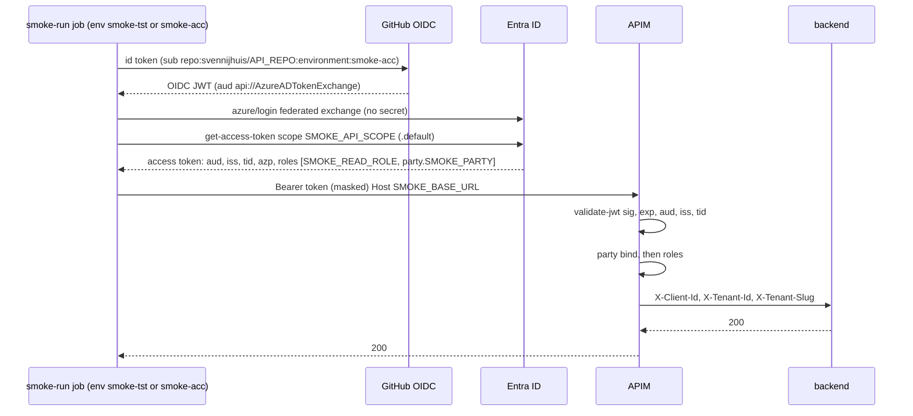

# SM04 Smoke token: GitHub OIDC to Entra to APIM validate-jwt to backend
- proof: runner gets an app-only token (aud = API app, roles = smoke read role + party.{slug}), APIM returns 200 on the read route and 401/403 on the negative probes, token never in log
- door: one-way (Azure identity, Sven sets up)
- one-way gate: Sven's exact yes required (Sven does the Azure and GitHub setup himself, SM07). Rollback: Sven deletes the federated credential or the smoke app; revert the workflow
block: B3   depends: SM07
- triage: build
- feedback: `scripts/check-smoke-auth.sh` exits 0 on the good and 1 on each bad fixture; then the first run probe table (200, 401, 403) (proof)
- harness: none
- review-input: diff + PBI only (PA6)
- kind: script (deterministic)
- Source: PA8 (no D row; Sven, Development Agentic Workflows room, 2026-10-25 17:48 and 17:50 (post-deploy smoke on tst/acc, Azure AD JWT); 2026-10-25 "Check how azure GitHub apim then jwt works" and "Real user backend smoke test") https://github.com/svennijhuis/agentic-workflows/pull/5
Sources: svennijhuis/infrastructure-azure-white-label@cccc9c5e (main, read only); Microsoft Learn URLs in the Sources section below

## Goal
The smoke runner calls the real API through APIM with a token that passes the same `validate-jwt`, party bind and role checks a real caller passes. No client secret, no password, no MFA bypass. Real interactive user (delegated `scp`) smoke is a separate later item, not this PBI.

## How the chain works today (Sven's infra repo, read only)
- APIM `validate-jwt` (`infrastructure/shared/apim/policies/fragments/jwt.xml` L2 to L25): header `Authorization`, `require-scheme="Bearer"`, signed and `exp` required, 401 on fail. Keys from `openid-config` `https://login.microsoftonline.com/{{TenantId}}/v2.0/.well-known/openid-configuration` (L9). Audience is APIM named value `{api}-audience` (L12). Issuers: v1 `sts.windows.net/{{TenantId}}/` and v2 `login.microsoftonline.com/{{TenantId}}/v2.0` (L15 to L16). Required claim `tid` = our tenant (L19 to L24).
- After validate-jwt: `azp` (else `appid`) forwarded as `X-Client-Id`, `tid` as `X-Tenant-Id`, hostname slug as `X-Tenant-Slug` (jwt.xml L27 to L50).
- Party bind (`tool/src/policy.rs` L513 to L552, consts `tool/src/isolation.rs` L8 to L9): our-directory token needs role `party.{slug}` for that hostname, or `party.*`. Empty slug (default `*.azure-api.net`) needs `party.*`. Else 403.
- Role check (`policies/fragments/roles.xml` L1 to L22): `jwt.Roles` must contain one of the operation `requiredRoles`, else 403. It reads `roles`, not `scp`. Example: `GET /items` needs `API.Read`, `POST` needs `API.Write`, `DELETE` needs `API.Admin`, `/health` is exempt mock with no JWT and no backend call (`api-specifications/public/example-api/config.json` L30 to L76; `policies/fragments/exempt.xml` L1 to L14).
- Status contract (`policies/README.md` L29 to L36): no or bad token 401, valid token wrong role or host 403, health 200.
- Audience value: `api://{api}-{env}` (for example `api://example-api-acc`; `tool/src/apim.rs` L484 to L490, test L798). API apps are set to `requestedAccessTokenVersion: 2` (`tool/src/entra.rs` L772).
- App roles allow both `User` and `Application` members (`tool/src/diff.rs` L23). So the same role values can sit on a test user or on an app.
- Machine callers: one `*.clientconfig.json` per caller with `objectId` + `apiAccess` roles; `entra reconcile` assigns them and adds `party.{slug}` when `tenant` is set, else `party.*` (`tool/src/entra.rs` L238 to L262, `tool/src/isolation.rs` L58 to L70; schema `schemas/client-service-principal.schema.json`). Token scope is `api://{audience}/.default` (`docs/get-jwt.md` L98 to L120).
- People: MSAL in the dashboard SPA, scope `api://example-api-acc/access_as_user`; ROPC is listed as "No" (`docs/get-jwt.md` L13 to L23, L29 to L81).
- Backend (`example-project-dotnet/src/Program.cs` L1 to L18, `TenantPartyFilter.cs` L13 to L44): no JWT middleware, no Microsoft.Identity.Web. It trusts APIM and 403s when `X-Tenant-Slug` is empty (except `/health`). Backend is `publicNetworkAccess: Disabled` (`docs/get-jwt.md` L139), so smoke must go through APIM.
- GitHub OIDC today: workflows use `azure/login@v2` with `client-id`, `tenant-id`, `subscription-id` from `secrets.*` and `id-token: write` (for example `.github/workflows/deploy-shared.yml` L45, L159 to L163). Federated subject is `repo:{org}/{repo}:environment:nonprod|prod`, not tst/acc (`infrastructure/shared/apim/bicep/main.bicep` L206 to L224, `docs/go-to-prod.md` L146). All infra workflows are parked (`deploy-shared.yml` L14 `__actions_disabled__`).
- Risk to check: Entra v2 access tokens carry `aud` = API client id (GUID), not the `api://` URI. The named value holds the `api://` URI. If any API app issues v2 tokens, `validate-jwt` may 401 every caller. SM04 first run proves it either way; fix (add the client id as a second `<audience>`) belongs in the infra repo, not here.

## Options compared (unattended CI "as a real user")
| Option | MFA | Conditional Access | Risk | Sven sets up in Entra |
|---|---|---|---|---|
| a. Test user + ROPC | Blocks it; ROPC is incompatible with MFA | User and app must be excluded from the MFA policy | Password stored as secret, Microsoft says do not use, only in a separate test tenant; no federated or MSA guest users; Azure mandatory MFA says user accounts are not for automation | Test user, public client app, admin consent, CA exclusion |
| b. App-only via GitHub OIDC federated credential (chosen) | Not applicable to service principals | CA for workload identities (location or risk) optional, needs Workload ID Premium | No secret, subject pinned to repo + environment, short-lived token; app-only is high privilege, so give only the read role + one party role | App registration per env, federated credential, `clientconfig.json` with roles, GitHub environment |
| c. Test user + TOTP via Playwright | TOTP seed in a secret means the second factor sits next to the password | Must satisfy CA (often device or location rules break it) | Seed + password leak equals full account; brittle UI automation; not a Microsoft supported pattern | Test user, TOTP method registered, CA review |
| d1. Temporary Access Pass | TAP counts as strong auth | Normal | Built for onboarding and recovery, max 30 days, manual reissue; not for CI | TAP policy + user |
| d2. On-behalf-of | Needs a user token first | Same as the user | Only for API A to API B as the user; does not solve getting the first token | Not useful here |
| d3. APIM test header bypass | None | None | Skips the very check smoke must prove; also blocked by repo rule (custom policy cannot set tenant headers) | Not recommended |

Recommendation: b. App-only smoke principal through GitHub OIDC, one app per env, roles `SMOKE_READ_ROLE` (for example `API.Read`) + `party.{test company slug}` via a clientconfig with `tenant` set, never `party.*`, never Write or Admin. It walks the same APIM path (validate-jwt, party bind, roles) as a real user because APIM authorizes on `roles` and the backend has no user specific check. A delegated user path (`scp` access_as_user, `oid` of a person) stays a separate later PBI with an interactive or broker sign-in, not ROPC.

## DoD
- `azure/login` with `client-id`, `tenant-id` from GitHub environment vars `AZURE_CLIENT_ID`, `AZURE_TENANT_ID` (names only, no values in files), `allow-no-subscriptions: true`, `id-token: write`
- token from `az account get-access-token --scope "$SMOKE_API_SCOPE"` then `::add-mask::` before any other use
- federated credential subjects only `repo:svennijhuis/<api repo>:environment:smoke-tst` and `:environment:smoke-acc`; no prd or prod subject, no branch or pull-request subject
- token must carry: `aud` = API app (URI or client id, per APIM audiences), `iss` our tenant, `tid` our tenant, `azp` = smoke app, `roles` contains `SMOKE_READ_ROLE` and `party.SMOKE_PARTY`
- probes: read route with token 200; no token 401; token on a route needing Write 403; health 200
- log prints only decoded `aud`, `azp`, `roles`, `exp`; never the token, never ids in files
- check: workflow has no `client-secret`, no `password`, no `AZURE_USERNAME`, no echo of the token, no prd subject

## Steps
1. doc the auth chain in smoke/README.md (copy sequence above)
2. auth step in smoke-run.yml (env-scoped job, mask first)
3. negative probes (401, 403) added to SM01 scenarios for the smoke feature
4. check-smoke-auth.sh: grep bans client-secret, password, ROPC, echo of token, prd or prod subject, `party.*`

## Technical design
- Components and files: .github/workflows/smoke-run.yml, scripts/check-smoke-auth.sh, smoke/README.md
- Module boundary: the auth step gives one masked app-only token from the environment vars AZURE_CLIENT_ID, AZURE_TENANT_ID, SMOKE_API_SCOPE; the OIDC federated exchange and the APIM validate-jwt, party and role checks sit behind it
- Interfaces: GitHub environment vars per env `smoke-tst`, `smoke-acc`: AZURE_CLIENT_ID, AZURE_TENANT_ID, SMOKE_API_SCOPE (`api://<api>-<env>/.default`), SMOKE_BASE_URL (company hostname on APIM), SMOKE_PARTY (company slug), SMOKE_READ_ROLE (names only; Sven sets values)
- Sequence: see mermaid above
- Failure modes: no federated cred or wrong subject gives AADSTS error, job fails at the named step, no retry loop; 401 means aud, iss or tid mismatch (see v2 aud risk); 403 means missing party or role, or empty host slug; backend 403 means call went to `*.azure-api.net` instead of the company hostname
- Security: no client secret, no password, least privilege (read + one party), tst/acc subjects only, prd excluded, token masked, bots never sign in to Azure or edit Entra
- Observability: log shows aud, azp, roles and status per probe; never the token
- Cost: 0 (Entra app and federated credential are free; Workload ID Premium only if Sven wants CA on the smoke app)
- Rollback: Sven deletes the federated credential or the smoke app; revert the workflow

## Evidence
check-smoke-auth.sh good/bad fixtures; first run log with masked token and 200/401/403 probe table

## Sources
- repo: svennijhuis/infrastructure-azure-white-label@cccc9c5e: infrastructure/shared/apim/policies/fragments/jwt.xml, roles.xml, exempt.xml, README.md, fragments.json; api-specifications/public/example-api/config.json; tool/src/policy.rs, isolation.rs, entra.rs, apim.rs, diff.rs; docs/get-jwt.md; example-project-dotnet/src/Program.cs, TenantPartyFilter.cs; .github/workflows/deploy-shared.yml; infrastructure/shared/apim/bicep/main.bicep; docs/go-to-prod.md
- https://learn.microsoft.com/en-us/azure/api-management/validate-jwt-policy (2026-08-18)
- https://learn.microsoft.com/en-us/azure/api-management/validate-azure-ad-token-policy (2026-08-18)
- https://learn.microsoft.com/en-us/entra/identity-platform/access-token-claims-reference (2023-05-26, v2 aud is client id; roles for app tokens)
- https://learn.microsoft.com/en-us/entra/identity-platform/v2-oauth-ropc (2025-01-04)
- https://learn.microsoft.com/en-us/entra/identity-platform/test-automate-integration-testing (2025-06-11)
- https://learn.microsoft.com/en-us/entra/identity/authentication/concept-mandatory-multifactor-authentication (2026-04-03)
- https://learn.microsoft.com/en-us/entra/workload-id/workload-identity-federation-create-trust (2024-12-13)
- https://learn.microsoft.com/en-us/entra/identity/conditional-access/workload-identity (2026-03-24)
- https://learn.microsoft.com/en-us/entra/identity/authentication/howto-authentication-temporary-access-pass (2026-03-04)
- https://learn.microsoft.com/en-us/entra/identity-platform/howto-add-app-roles-in-apps (2026-09-25)
