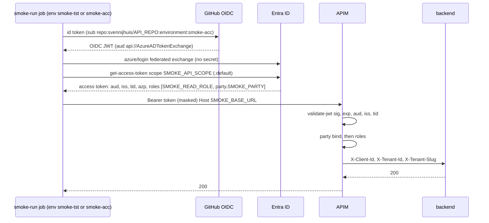
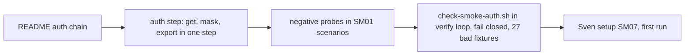

# SM04: Smoke token: GitHub OIDC to Entra to APIM validate-jwt to backend
- Status: todo
- Area: smoke
- Wave: W3
- Block: 3
- Lane: Builder
- Depends on: SM07
- proof: the `scripts/verify.sh` loop runs `scripts/check-smoke-auth.sh`: exit 0 on `test/fixtures/smoke-auth/good.yml` and `test/fixtures/smoke-auth/good-comment-party-star.yml`, exit 1 on each `test/fixtures/smoke-auth/bad-*`; after Sven's setup, the runner gets an app-only token (aud = API app, roles = smoke read role + party.{slug}), APIM returns 200 on the read route and 401/403 on the negative probes, token never in log
- door: one-way (Azure identity, Sven sets up)
- one-way gate: Sven's exact yes required (Sven does the Azure and GitHub setup himself, SM07). Rollback: Sven deletes the federated credential or the smoke app; revert the workflow
- triage: build
- feedback: `scripts/check-smoke-auth.sh` in its own `scripts/verify.sh` loop exits 0 on both good and 1 on each bad fixture; then the first run probe table (200, 401, 403) (proof)
- harness: none (script)
- review-input: diff + this PBI + DoD (+ linked spec) + PR description, never builder session logs (PA6)
- kind: script (deterministic)
- Source: PA8 (no D row; Sven, Development Agentic Workflows room, 2026-10-25 17:48 and 17:50 (post-deploy smoke on tst/acc, Azure AD JWT); 2026-10-25 "Check how azure GitHub apim then jwt works" and "Real user backend smoke test") https://github.com/svennijhuis/agentic-workflows/pull/5
- Gate: [SM08](SM08-cursor-findings.md) findings 1 and 2 and Cursor review 5654162636 findings 2 and 3 (on PR #8) are folded into SM04a. Per the Strategy split check (2026-10-26) SM08 closes when the last of its target PBIs merges, so the SM04a build carries its SM08 rows.
## Goal
The smoke runner calls the real API through APIM with a token that passes the same `validate-jwt`, party bind and role checks a real caller passes. No client secret, no password, no MFA bypass. Real interactive user (delegated `scp`) smoke is a separate later item, not this PBI.
## Context
Parts (Strategy split check, 2026-10-26):
- SM04a `check-smoke-auth.sh` parse, triggers through `on_triggers` and the OIDC environment rule, anchor, duplicate key and permissions shape hits, 3 good and 29 bad fixtures, verify loop: done, [SM04a](../done/SM04a-auth-check.md) (SM08 f1, f2; Cursor 5654162636 f2, f3).
- SM04b token hygiene in the same script: done, [SM04b](../done/SM04b-token-hygiene.md) (secrets, mask, debug trace, roles, `good-comment-party-star.yml`; Cursor 5658105243 f1 and Reviewer 6425694406 lows 1 and 2 from PR #17). The template auth step, README auth chain and negative probes go to SM03b; the first live run probe table goes to SM03L.

Where things live: the smoke workflow, the GitHub environments `smoke-tst` and `smoke-acc` and the federated subject `repo:svennijhuis/<api repo>:environment:smoke-tst|smoke-acc` are in the API repo `svennijhuis/<api repo>` (placeholder, Sven names it in SM07). This catalog holds the authoring copy of the auth step (in `smoke/templates/smoke-run.yml`), `scripts/check-smoke-auth.sh` and its fixtures. POL23 only runs `policies/checks/POLnn.sh`, so check-smoke-auth.sh gets its own good and bad loop in `scripts/verify.sh`, like SM01.

The smoke job is a reusable workflow called from the release (SM03), and the release deploy jobs run in GitHub environment `nonprod` (`example-project-dotnet/pipelines/release.yml` L62, L130; `deploy-stage.yml` L24). A caller job cannot set `environment`, so the smoke job declares its own `environment: smoke-${{ inputs.env }}`. Without it, or with `nonprod`, the OIDC subject is not `environment:smoke-tst` or `environment:smoke-acc` and the federated exchange fails (or, worse, matches a `nonprod` credential).

How the chain works today (Sven's infra repo, read only):
- APIM `validate-jwt` (`infrastructure/shared/apim/policies/fragments/jwt.xml` L2 to L25): header `Authorization`, `require-scheme="Bearer"`, signed and `exp` required, 401 on fail. Keys from `openid-config` `https://login.microsoftonline.com/{{TenantId}}/v2.0/.well-known/openid-configuration` (L9). Audience is APIM named value `{api}-audience` (L12). Issuers: v1 `sts.windows.net/{{TenantId}}/` and v2 `login.microsoftonline.com/{{TenantId}}/v2.0` (L15 to L16). Required claim `tid` = our tenant (L19 to L24).
- After validate-jwt: `azp` (else `appid`) forwarded as `X-Client-Id`, `tid` as `X-Tenant-Id`, hostname slug as `X-Tenant-Slug` (jwt.xml L27 to L50).
- Party bind (`tool/src/policy.rs` L513 to L552, consts `tool/src/isolation.rs` L8 to L9): our-directory token needs role `party.{slug}` for that hostname, or `party.*`. Empty slug (default `*.azure-api.net`) needs `party.*`. Else 403.
- Role check (`policies/fragments/roles.xml` L1 to L22): `jwt.Roles` must contain one of the operation `requiredRoles`, else 403. It reads `roles`, not `scp`. Example: `GET /items` needs `API.Read`, `POST` needs `API.Write`, `DELETE` needs `API.Admin`, `/health` is exempt mock with no JWT and no backend call (`api-specifications/public/example-api/config.json` L30 to L76; `policies/fragments/exempt.xml` L1 to L14).
- Status contract (`policies/README.md` L29 to L36): no or bad token 401, valid token wrong role or host 403, health 200.
- Audience value: `api://{api}-{env}` (for example `api://example-api-acc`; `tool/src/apim.rs` L484 to L490, test L798). API apps are set to `requestedAccessTokenVersion: 2` (`tool/src/entra.rs` L772).
- App roles allow both `User` and `Application` members (`tool/src/diff.rs` L23). So the same role values can sit on a test user or on an app.
- Machine callers: one `*.clientconfig.json` per caller with `objectId` + `apiAccess` roles; `entra reconcile` assigns them and adds `party.{slug}` when `tenant` is set, else `party.*` (`tool/src/entra.rs` L238 to L262, `tool/src/isolation.rs` L58 to L70; schema `schemas/client-service-principal.schema.json`). Token scope is `api://{audience}/.default` (`docs/get-jwt.md` L98 to L120).
- People: MSAL in the dashboard SPA, scope `api://example-api-acc/access_as_user`; ROPC is listed as "No" (`docs/get-jwt.md` L13 to L23, L29 to L81).
- Backend (`example-project-dotnet/src/Program.cs` L1 to L18, `TenantPartyFilter.cs` L13 to L44): no JWT middleware, no Microsoft.Identity.Web. It trusts APIM and 403s when `X-Tenant-Slug` is empty (except `/health`). Backend is `publicNetworkAccess: Disabled` (`docs/get-jwt.md` L139), so smoke must go through APIM.
- GitHub OIDC today: workflows use `azure/login@v2` with `client-id`, `tenant-id`, `subscription-id` from `secrets.*` and `id-token: write` (for example `.github/workflows/deploy-shared.yml` L45, L159 to L163). Federated subject is `repo:{org}/{repo}:environment:nonprod|prod`, not tst/acc (`infrastructure/shared/apim/bicep/main.bicep` L206 to L224, `docs/go-to-prod.md` L146). All infra workflows are parked (`deploy-shared.yml` L14 `__actions_disabled__`).
- Risk to check: Entra v2 access tokens carry `aud` = API client id (GUID), not the `api://` URI. The named value holds the `api://` URI. If any API app issues v2 tokens, `validate-jwt` may 401 every caller. SM04 first run proves it either way; fix (add the client id as a second `<audience>`) belongs in the infra repo, not here.

Options compared (unattended CI "as a real user"):
| Option | MFA | Conditional Access | Risk | Sven sets up in Entra |
|---|---|---|---|---|
| a. Test user + ROPC | Blocks it; ROPC is incompatible with MFA | User and app must be excluded from the MFA policy | Password stored as secret, Microsoft says do not use, only in a separate test tenant; no federated or MSA guest users; Azure mandatory MFA says user accounts are not for automation | Test user, public client app, admin consent, CA exclusion |
| b. App-only via GitHub OIDC federated credential (chosen) | Not applicable to service principals | CA for workload identities (location or risk) optional, needs Workload ID Premium | No secret, subject pinned to repo + environment, short-lived token; app-only is high privilege, so give only the read role + one party role | App registration per env, federated credential, `clientconfig.json` with roles, GitHub environment |
| c. Test user + TOTP via Playwright | TOTP seed in a secret means the second factor sits next to the password | Must satisfy CA (often device or location rules break it) | Seed + password leak equals full account; brittle UI automation; not a Microsoft supported pattern | Test user, TOTP method registered, CA review |
| d1. Temporary Access Pass | TAP counts as strong auth | Normal | Built for onboarding and recovery, max 30 days, manual reissue; not for CI | TAP policy + user |
| d2. On-behalf-of | Needs a user token first | Same as the user | Only for API A to API B as the user; does not solve getting the first token | Not useful here |
| d3. APIM test header bypass | None | None | Skips the very check smoke must prove; also blocked by repo rule (custom policy cannot set tenant headers) | Not recommended |

Recommendation: b. App-only smoke principal through GitHub OIDC, one app per env, roles `SMOKE_READ_ROLE` (for example `API.Read`) + `party.{test company slug}` via a clientconfig with `tenant` set, never `party.*`, never Write or Admin. It walks the same APIM path (validate-jwt, party bind, roles) as a real user because APIM authorizes on `roles` and the backend has no user specific check. A delegated user path (`scp` access_as_user, `oid` of a person) stays a separate later PBI with an interactive or broker sign-in, not ROPC.
## Steps
1. Doc the auth chain in `smoke/README.md` (copy the sequence above).
2. Auth step in `smoke/templates/smoke-run.yml` (env-scoped job): one step gets, masks and exports the token.
3. Negative probes (401, 403) added to the SM01 scenarios for the smoke feature.
4. `scripts/check-smoke-auth.sh`: parses the workflow with yq and fails closed; requires the items below (mask before any use, own smoke environment, allowed triggers) and bans the rest on parsed values (a comment that forbids `party.*` does not trip it); one bad fixture per required or banned item.
5. Wire the SM01-style loop into `scripts/verify.sh`: good exits 0, each bad exits 1, one `file:line RULE message` line per hit.
## Definition of Done
- [x] `azure/login` with `client-id`, `tenant-id` from GitHub environment vars `AZURE_CLIENT_ID`, `AZURE_TENANT_ID` (names only, no values in files), `allow-no-subscriptions: true`, `id-token: write` (offline check in [SM04b](../done/SM04b-token-hygiene.md))
- [x] One step captures the token from `az account get-access-token --scope "$SMOKE_API_SCOPE" --query accessToken -o tsv` into a variable, runs `::add-mask::` on that value before any other use, never echoes it, and runs without debug trace (no `set -x`, no `ACTIONS_STEP_DEBUG`) (SM04b)
- [x] The environment rule applies only to the job with `id-token: write` (the smoke job). The `guard` job (`permissions: {}`, no `environment`) passes. Done in SM04a (every job that has or inherits `id-token: write`, `write-all` included; SM08 finding 2)
- [x] That job declares exactly `environment: smoke-${{ inputs.env }}` (resolves to `smoke-tst` or `smoke-acc`). Done in SM04a
- [x] No `environment`, `nonprod`, bare `${{ inputs.env }}` or a hardcoded `smoke-tst` on that job fails the check. Done in SM04a
- [x] Workflow triggers only `workflow_call` and `workflow_dispatch`. Done in SM04a
- [x] The check is an allowlist, not a denylist: after dropping the setting keys (`roles`, `skip-bots`, `skip-roles`), every `on:` key must be `workflow_dispatch` or `workflow_call`. Done in SM04a
- [x] Any other trigger fails the check, also one not named here. Done in SM04a
- [x] One bad fixture each: `deployment_status`, `workflow_run`, `repository_dispatch`, `push`, `pull_request`, `schedule`, and `release` (proves an unnamed trigger fails). Done in SM04a
- [ ] Federated credential subjects only `repo:svennijhuis/<api repo>:environment:smoke-tst` and `:environment:smoke-acc`; no prd or prod subject, no branch or pull-request subject
- [ ] Token must carry: `aud` = API app (URI or client id, per APIM audiences), `iss` our tenant, `tid` our tenant, `azp` = smoke app, `roles` contains `SMOKE_READ_ROLE` and `party.SMOKE_PARTY`
- [ ] Probes: read route with token 200; no token 401; token on a route needing Write 403; health 200
- [ ] Log prints only decoded `aud`, `azp`, `roles`, `exp`; never the token, never ids in files
- [x] `check-smoke-auth.sh` fails closed: a file that does not parse exits 1; a token step without `::add-mask::` on the captured value fails even when nothing echoes it (required, not only banned) (SM04b)
- [x] `scripts/verify.sh` loop for `check-smoke-auth.sh` (SM01 style): both good exit 0, each bad exits 1 (SM04a+SM04b: 5 good, 43 bad)
- [x] Bad fixtures, one per fail-closed path and banned item, each exits 1 (SM04a+SM04b; token hygiene rows in [SM04b](../done/SM04b-token-hygiene.md)):
  - `test/fixtures/smoke-auth/bad-broken.yml` (YAML does not parse)
  - `test/fixtures/smoke-auth/bad-client_secret.yml` (`client_secret` input)
  - `test/fixtures/smoke-auth/bad-clientSecret.yml` (`clientSecret` input)
  - `test/fixtures/smoke-auth/bad-client-secret.yml` (`client-secret` input)
  - `test/fixtures/smoke-auth/bad-echo-token.yml` (a step echoes or prints the token)
  - `test/fixtures/smoke-auth/bad-mask-after-use.yml` (token used before `::add-mask::`)
  - `test/fixtures/smoke-auth/bad-no-mask.yml` (token captured and sent, never masked, never echoed)
  - `test/fixtures/smoke-auth/bad-debug-trace.yml` (`set -x` or `ACTIONS_STEP_DEBUG` on the token step)
  - `test/fixtures/smoke-auth/bad-password.yml` (`password` input)
  - `test/fixtures/smoke-auth/bad-azure-username.yml` (`AZURE_USERNAME`)
  - `test/fixtures/smoke-auth/bad-ropc.yml` (`grant_type=password`)
  - `test/fixtures/smoke-auth/bad-party-star.yml` (`party.*` as a role value)
  - `test/fixtures/smoke-auth/bad-write-role.yml` (a Write role requested)
  - `test/fixtures/smoke-auth/bad-admin-role.yml` (an Admin role requested)
  - `test/fixtures/smoke-auth/bad-prd-subject.yml` (job environment `prd`)
  - `test/fixtures/smoke-auth/bad-prod-subject.yml` (job environment `prod` or `production`)
  - `test/fixtures/smoke-auth/bad-no-environment.yml` (the `id-token: write` job has no `environment`)
  - `test/fixtures/smoke-auth/bad-nonprod-environment.yml` (smoke job environment `nonprod`)
  - `test/fixtures/smoke-auth/bad-env-inputs.yml` (smoke job `environment: ${{ inputs.env }}`)
  - `test/fixtures/smoke-auth/bad-env-hardcoded.yml` (smoke job `environment: smoke-tst`, hardcoded)
  - `test/fixtures/smoke-auth/bad-trigger-deployment-status.yml` (workflow has a `deployment_status` trigger)
  - `test/fixtures/smoke-auth/bad-trigger-workflow-run.yml` (`workflow_run` trigger)
  - `test/fixtures/smoke-auth/bad-trigger-repository-dispatch.yml` (`repository_dispatch` trigger)
  - `test/fixtures/smoke-auth/bad-trigger-push.yml` (`push` trigger)
  - `test/fixtures/smoke-auth/bad-trigger-pull-request.yml` (`pull_request` trigger)
  - `test/fixtures/smoke-auth/bad-trigger-schedule.yml` (`schedule` trigger)
  - `test/fixtures/smoke-auth/bad-trigger-release.yml` (`release` trigger, on no named list; the allowlist fails it)
- [x] Good fixtures, each exits 0: `test/fixtures/smoke-auth/good.yml` (the `guard` job with `permissions: {}` and no `environment`, plus the smoke job with `environment: smoke-${{ inputs.env }}`), `test/fixtures/smoke-auth/good-comment-party-star.yml` (a comment forbids `party.*`), `good-flow-on-line.yml`, `good-trigger-scalar.yml`, `good-trigger-list.yml` (SM04b)
## Technical design
- Components and files: catalog: `smoke/templates/smoke-run.yml` (auth step), `scripts/check-smoke-auth.sh`, `test/fixtures/smoke-auth/`, `smoke/README.md`; API repo `svennijhuis/<api repo>`: `.github/workflows/smoke-run.yml`, environments `smoke-tst`, `smoke-acc`
- Module boundary: the auth step gives one masked app-only token from the environment vars AZURE_CLIENT_ID, AZURE_TENANT_ID, SMOKE_API_SCOPE; the OIDC federated exchange and the APIM validate-jwt, party and role checks sit behind it
- Interfaces: GitHub environment vars per env `smoke-tst`, `smoke-acc`: AZURE_CLIENT_ID, AZURE_TENANT_ID, SMOKE_API_SCOPE (`api://<api>-<env>/.default`), SMOKE_BASE_URL (company hostname on APIM), SMOKE_PARTY (company slug), SMOKE_READ_ROLE (names only; Sven sets values); `check-smoke-auth.sh FILE...` exit 0/1
- Sequence: see the sequence diagram in Context
- Failure modes: no federated cred or wrong subject (for example `environment:nonprod`) gives AADSTS error, job fails at the named step, no retry loop; 401 means aud, iss or tid mismatch (see v2 aud risk); 403 means missing party or role, or empty host slug; backend 403 means call went to `*.azure-api.net` instead of the company hostname; a workflow file that does not parse fails the check
- Security: no client secret, no password, least privilege (read + one party), tst/acc subjects only, own smoke environment never `nonprod`, prd excluded, token captured and masked in one step, no debug trace, bots never sign in to Azure or edit Entra
- Observability: log shows aud, azp, roles and status per probe; never the token
- Cost: 0 (Entra app and federated credential are free; Workload ID Premium only if Sven wants CA on the smoke app)
- Rollback: Sven deletes the federated credential or the smoke app; revert the workflow
- Proof: same as proof: above
- Door: one-way (Azure identity; Sven sets it up)
## Evidence
check-smoke-auth.sh good/bad fixture outputs; first run log with masked token and 200/401/403 probe table
## Flow

## Named asks for Sven
- Do the SM07 setup (smoke app per env, federated credential, clientconfig, environments) and say yes in the room.
- Check the v2 token audience (SM07 step 5) before the first run.
## Cost
0 (Workload ID Premium only if Sven wants Conditional Access on the smoke apps)
## Sources
- repo: svennijhuis/infrastructure-azure-white-label@cccc9c5e: infrastructure/shared/apim/policies/fragments/jwt.xml, roles.xml, exempt.xml, README.md, fragments.json; api-specifications/public/example-api/config.json; tool/src/policy.rs, isolation.rs, entra.rs, apim.rs, diff.rs; docs/get-jwt.md; example-project-dotnet/src/Program.cs, TenantPartyFilter.cs; .github/workflows/deploy-shared.yml; infrastructure/shared/apim/bicep/main.bicep; docs/go-to-prod.md
- https://learn.microsoft.com/en-us/azure/api-management/validate-jwt-policy (2026-08-18)
- https://learn.microsoft.com/en-us/azure/api-management/validate-azure-ad-token-policy (2026-08-18)
- https://learn.microsoft.com/en-us/entra/identity-platform/access-token-claims-reference (2023-05-26, v2 aud is client id; roles for app tokens)
- https://learn.microsoft.com/en-us/entra/identity-platform/v2-oauth-ropc (2025-01-04)
- https://learn.microsoft.com/en-us/entra/identity-platform/test-automate-integration-testing (2025-06-11)
- https://learn.microsoft.com/en-us/entra/identity/authentication/concept-mandatory-multifactor-authentication (2026-04-03)
- https://learn.microsoft.com/en-us/entra/workload-id/workload-identity-federation-create-trust (2024-12-13)
- https://learn.microsoft.com/en-us/entra/identity/conditional-access/workload-identity (2026-03-24)
- https://learn.microsoft.com/en-us/entra/identity/authentication/howto-authentication-temporary-access-pass (2026-03-04)
- https://learn.microsoft.com/en-us/entra/identity-platform/howto-add-app-roles-in-apps (2026-09-25)
- [PR #5 Cursor review at 17510cc, findings 2 and 5](https://github.com/svennijhuis/agentic-workflows/pull/5)
- [PR #5 Cursor review at 3c65a17, finding 4; Tester note on the smoke job environment](https://github.com/svennijhuis/agentic-workflows/pull/5)
- [PR #5 Cursor review at 719cd75, finding 3](https://github.com/svennijhuis/agentic-workflows/pull/5)
- svennijhuis/infrastructure-azure-white-label@cccc9c5e: `example-project-dotnet/pipelines/release.yml` L62, L130; `example-project-dotnet/pipelines/deploy-stage.yml` L24
- [PR #5 Cursor review at bf26b0e, finding 3](https://github.com/svennijhuis/agentic-workflows/pull/5#pullrequestreview-5648588578)
