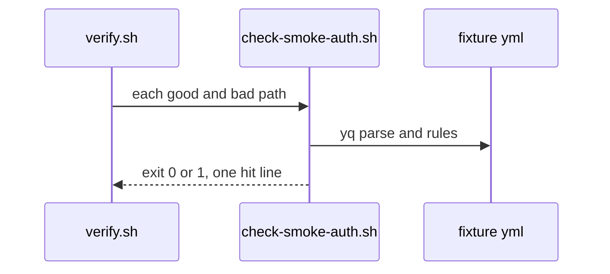
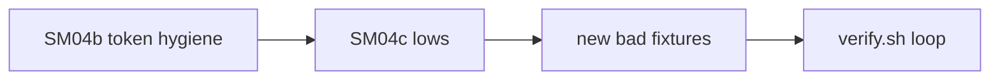

# SM04c: check-smoke-auth.sh hardening follow-ups (PR #22 lows, fail closed)
- Status: todo
- Area: smoke
- Wave: W3
- Block: 3
- Lane: Builder
- Depends on: SM04b (done, #22). Part of [SM04](SM04.md); same script as SM04a and SM04b
- proof: each new `test/fixtures/smoke-auth/bad-*` case below exits exactly 1 under `bash scripts/check-smoke-auth.sh`, every existing good and bad fixture keeps its current exit code, and `./scripts/verify.sh` ends with `0 failures`
- door: two-way
- triage: build (Tester 2 lows on PR #22 at 8ea04b8, comment 6540392309, moved off the SM04b fix round under Sven's 2-round cap)
- feedback: `bash scripts/check-smoke-auth.sh` on each new bad fixture exits 1 with one hit; `./scripts/verify.sh` gives `0 failures`
- harness: none (script)
- review-input: diff + this PBI + DoD (+ [SM04](SM04.md), Tester 2 comments 6540392309 and 6546014746, Reviewer 6546017537, Cursor 5723767631 on PR #22) + PR description, never builder session logs (PA6)
- kind: script (deterministic)
- Source: PA8 (Sven, Development Agentic Workflows room, 2026-10-31; Tester 2 FAIL comment 6540392309 on PR #22) https://github.com/svennijhuis/agentic-workflows/pull/22#issuecomment-6540392309
## Goal
Close the gaps Tester 2 listed as lows on PR #22 so `scripts/check-smoke-auth.sh` fails closed on case variants of forbidden inputs, secrets under `azure/login`, banned values in any multiline step, and case variants of Write and Admin role requests.
## Context
SM04b (#22) fixed the six blocking token-hygiene probes from Tester 2 comment 6540392309 (printf or echo of the token, shell debug trace variants, `ACTIONS_STEP_DEBUG` at workflow or job or step env, `::add-mask::` on the captured variable, every `get-access-token` step masked, `azure/login@v2` pin). PR #22 fix round 1 also closed Cursor 5721745072 (yq fail closed, multiline step scalars, mask order including curl, debug `1` at workflow level). PR #22 fix round 2 (Cursor 5723767631, Tester 2 6546014746, Reviewer 6546017537) folded the three Tester 2 lows and the later lows into SM04b; the one open row below is what is left.

POL23 only runs `policies/checks/POLnn.sh`, so the smoke auth loop in `scripts/verify.sh` stays the proof path.
## Steps
1. Extend `scripts/check-smoke-auth.sh` for the four low rows below without weakening existing rules.
2. Add one FAKE bad fixture per row under `test/fixtures/smoke-auth/`, each a copy of `good.yml` with one edit.
3. Run `./scripts/verify.sh`, `bash scripts/check-pbi-docs.sh`, and `bash scripts/check-pbi-template.sh`.
## Definition of Done
- [x] Done in SM04b PR #22 round 2, Tester 2 6540392309 low / Cursor 5723767631: forbidden workflow inputs and `workflow_call` secrets are matched case insensitively (`Password`, `CLIENT_SECRET`, and similar) and exit 1 with one hit; fixtures `bad-forbidden-input-case.yml`, `bad-call-secret.yml`
- [x] Done in SM04b PR #22 round 2, Tester 2 6540392309 low / Cursor 5723767631: any `secrets.*` value under `azure/login` `with:` (including `client-secret`) on every login step is a hit; fixtures `bad-login-client-secret.yml`, `bad-second-login-secret.yml`
- [x] Done in SM04b PR #22 round 1, Tester 2 6540392309 low / Cursor 5721745072: banned values and forbidden secret-shaped names in any multiline `run` or `env` scalar are hits, not only in the `get-access-token` step; fixture `bad-client-secret-other-step.yml`
- [x] Done in SM04b PR #22 round 2, Tester 2 6540392309 low / Cursor 5723767631: Write, ReadWrite and Admin role bans are case insensitive (`orders.write`, `Orders.ReadWrite`, `orders.admin`); fixtures `bad-write-role-case.yml`, `bad-readwrite-role-case.yml`, `bad-admin-role-case.yml`
- [x] Done in SM04b PR #22 round 2, Reviewer 6546017537: `echo "::add-mask::$TOKEN" && echo "$TOKEN"` on one line is a hit; fixture `bad-same-line-mask-echo.yml`
- [x] Done in SM04b PR #22 round 2, Reviewer 6546017537 / Tester 2 6546014746: later smoke job steps that echo, tee, `printenv` or `env` dump the token, or cat `$GITHUB_ENV` are hits; fixtures `bad-later-smoke-token-echo.yml`, `bad-later-tee-token.yml`, `bad-later-printenv.yml`, `bad-later-env-dump.yml`, `bad-later-cat-github-env.yml`
- [x] Done in SM04b PR #22 round 2, Tester 2 6546014746: `ACTIONS_RUNNER_DEBUG` true and `ACTIONS_STEP_DEBUG` from any expression are hits; fixtures `bad-actions-runner-debug.yml`, `bad-actions-step-debug-expr.yml`
- [ ] Todo, Cursor 5723767631 item 1 follow-up: the token step split on `;`, `&&`, `||`, `|`, `&` is not quote aware and does not model heredocs, `eval`, or shell functions; a token read hidden in those shapes needs its own bad fixture before this row closes
- [ ] `./scripts/verify.sh` ends with `0 failures`; no secret values in repo files
## Technical design
- Components and files: `scripts/check-smoke-auth.sh`, `test/fixtures/smoke-auth/` (new bad fixtures), `scripts/verify.sh` (unchanged loop)
- Module boundary: `check-smoke-auth.sh FILE...` with exit 0/1/2 and one `file:line SMOKEAUTH message` per hit; input parsing and scalar walks sit behind the same entrypoint as SM04a and SM04b
- Interfaces: `check-smoke-auth.sh FILE...` exit 0 ok, 1 a hit (fail closed), 2 needs-human (yq missing); `--help`
- Sequence:

- Failure modes: a low that still exits 0 fails verify when its bad fixture is added; yq missing exits 2 (needs-human)
- Security: FAKE test data only in fixtures; secret names only in files
- Observability: verify log one line per new bad fixture
- Cost: 0
- Rollback: revert the PR
- Proof: same as proof: above
- Door: two-way
## Evidence
verify log on the PR head SHA, one hit line per new bad fixture
## Flow

## Named asks for Sven
- None (offline check only).
## Cost
0 (script)
## Sources
- Tester 2 comment 6540392309 on [PR #22](https://github.com/svennijhuis/agentic-workflows/pull/22#issuecomment-6540392309)
- [SM04b](../done/SM04b-token-hygiene.md) (merged scope for token hygiene round 1)
- [SM04](SM04.md) parent PBI
