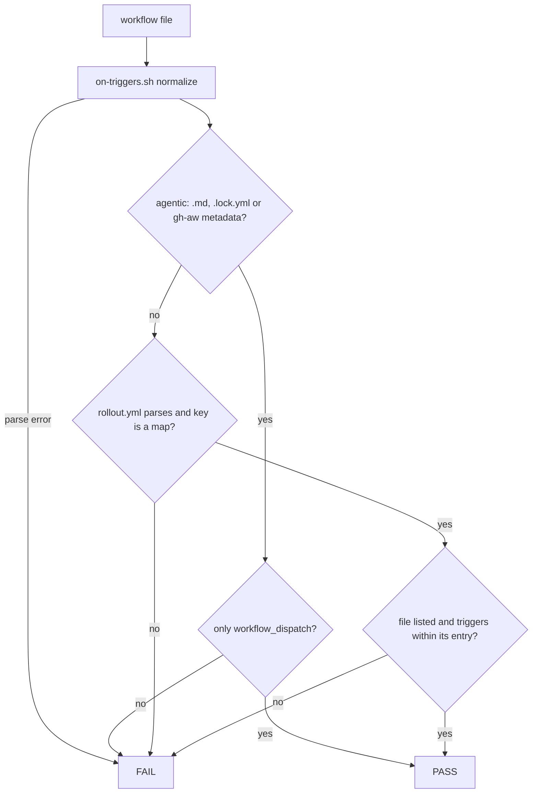
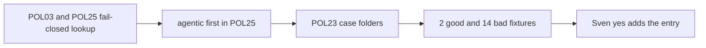

# SM05: POL03 + POL25 allow deployment_status for the smoke runner only
- Status: todo
- Area: smoke
- Wave: W3
- Block: 3
- Lane: Builder
- Depends on: POL25, POL03, scripts/lib/on-triggers.sh
- proof: `./scripts/verify.sh` green; POL23 runs every `test/fixtures/good/POL03-smoke-*` and `good/POL25-smoke-*` case (exit 0) and every `test/fixtures/bad/POL03-smoke-*` and `bad/POL25-smoke-*` case (exit 1)
- door: two-way (the policy change; the entry itself needs Sven's yes)
- triage: build
- feedback: `./scripts/verify.sh`: POL03 and POL25 pass the good smoke runner and exit 1 on each bad fixture listed in the DoD, POL23 covers them (proof)
- harness: none (script)
- review-input: diff + this PBI + DoD (+ linked spec) + PR description, never builder session logs (PA6)
- kind: script (deterministic)
- Source: PA8 (no D row; Sven, Development Agentic Workflows room, 2026-10-25 17:48 and 17:50 (post-deploy smoke on tst/acc, Azure AD JWT)) https://github.com/svennijhuis/agentic-workflows/pull/5
## Goal
Let the deterministic smoke runner use `deployment_status` while agentic workflows stay workflow_dispatch only (PA1).
## Context
Today POL03 holds every workflow to `workflow_dispatch` unless it is promoted in `governance/rollout.yml` (empty, the Sven-yes gate), and POL25 skips a non-agentic yml. A flat trigger list edited in the same PR as a workflow would skip that gate, and `pull_request` is wider than the smoke runner needs (SM03 has `id-token: write`). So the allowlist is one map entry for the smoke runner file only, recorded with Sven's exact yes in `governance/rollout.yml`. `pull_request` stays on the existing promotion path. The checks read the rollout file from `$POL_ROLLOUT` (default `governance/rollout.yml`) so fixture folders can carry their own `rollout.yml`.

Entry shape (empty until Sven's yes):

```yaml
deterministic_triggers:
  smoke-run.yml:
    triggers: [workflow_dispatch, deployment_status]
    yes: {date: "<YYYY-MM-DD>", quote: "<Sven's exact words>"}
```

## Steps
1. POL03 and POL25 read `deterministic_triggers` with yq; a parse error, a missing key for a file with a non-dispatch trigger, or a value that is not a map is a hit (fail closed).
2. POL25 treats `*.lock.yml` and any yml with a gh-aw-metadata header as agentic before any allowlist lookup.
3. Extend POL23 to run `bad/POLnn-*/` and `good/POLnn-*/` case folders (each holds `rollout.yml` plus the workflow file).
4. Fixtures as listed in the DoD; verify run.
## Definition of Done
- [ ] Allowlist is exactly one map entry, key `smoke-run.yml`, triggers `workflow_dispatch` and `deployment_status`, with `yes: {date, quote}` in `governance/rollout.yml`; no other file, no other trigger (`pull_request` stays on the promotion path)
- [ ] POL03 and POL25 changed together; both fail closed when `rollout.yml` does not parse, the key is missing, or the value is not a map
- [ ] POL25 treats `*.lock.yml` and gh-aw-metadata yml as agentic before the allowlist: `deployment_status` there always fails
- [ ] Agentic `.md` with `deployment_status` fails even if its name is in the map
- [ ] `on:` that does not parse fails (existing `scripts/lib/on-triggers.sh`)
- [ ] Good fixtures, each exits 0: `test/fixtures/good/POL03-smoke-runner/` and `test/fixtures/good/POL25-smoke-runner/` (`rollout.yml` with the entry plus `smoke-run.yml`)
- [ ] POL03 bad fixtures, each exits 1:
  - `test/fixtures/bad/POL03-smoke-missing-key/` (`rollout.yml` without `deterministic_triggers`, runner has `deployment_status`)
  - `test/fixtures/bad/POL03-smoke-rollout-broken/` (`rollout.yml` does not parse)
  - `test/fixtures/bad/POL03-smoke-not-map/` (`deterministic_triggers` is a list)
  - `test/fixtures/bad/POL03-smoke-extra-trigger/` (listed runner adds `pull_request`)
  - `test/fixtures/bad/POL03-smoke-unlisted.yml` (`deployment_status`, not in the map)
  - `test/fixtures/bad/POL03-smoke-on-broken.yml` (`on:` does not parse)
- [ ] POL25 bad fixtures, each exits 1:
  - `test/fixtures/bad/POL25-smoke-missing-key/` (`rollout.yml` without `deterministic_triggers`)
  - `test/fixtures/bad/POL25-smoke-rollout-broken/` (`rollout.yml` does not parse)
  - `test/fixtures/bad/POL25-smoke-not-map/` (`deterministic_triggers` is a list)
  - `test/fixtures/bad/POL25-smoke-agentic.md` (agentic `.md` with `deployment_status`)
  - `test/fixtures/bad/POL25-smoke-agentic.lock.yml` (its compiled `.lock.yml`)
  - `test/fixtures/bad/POL25-smoke-metadata.yml` (gh-aw-metadata yml with `deployment_status`)
  - `test/fixtures/bad/POL25-smoke-unlisted.yml` (unlisted deterministic yml with `deployment_status`)
  - `test/fixtures/bad/POL25-smoke-on-broken.yml` (`on:` does not parse)
- [ ] POL23 runs all of them; making POL03 or POL25 always pass turns POL23 red
## Technical design
- Components and files: `policies/checks/POL03.sh`, `policies/checks/POL25.sh`, `policies/checks/POL23.sh`, `governance/rollout.yml` (key added empty), `test/fixtures/good/POL03-smoke-*`, `test/fixtures/bad/POL03-smoke-*`, `test/fixtures/good/POL25-smoke-*`, `test/fixtures/bad/POL25-smoke-*`
- Module boundary: `governance/rollout.yml` `deterministic_triggers` plus the POL03 and POL25 exit 0/1; trigger normalizing and the fail-closed allowlist lookup sit behind it
- Interfaces: `rollout.yml` key `deterministic_triggers`: map of file name to `{triggers, yes}`; `$POL_ROLLOUT` overrides the path for fixtures; exit 0/1
- Sequence:



- Failure modes: any parse error, missing key or wrong shape fails closed with the file and trigger named
- Security: keeps PA1; the entry needs Sven's exact yes; no new secrets
- Observability: verify names file + trigger + reason
- Cost: 0
- Rollback: revert the PR; remove the entry from `rollout.yml`
- Proof: same as proof: above
- Door: two-way (policy code; adding the entry is Sven's one-way yes, tracked in SM03)
## Evidence
fixture outputs on SHA, POL23 fake-check output
## Flow

## Named asks for Sven
- Exact yes (date and quote) before the `smoke-run.yml` entry is added to `governance/rollout.yml`.
## Cost
0 (script)
## Sources
- Sven, Development Agentic Workflows room, 2026-10-25 17:48 and 17:50
- [PR #5 Cursor review at 17510cc, finding 1](https://github.com/svennijhuis/agentic-workflows/pull/5)
