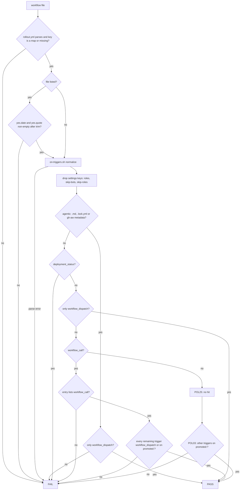
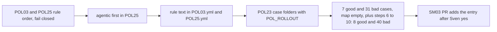

# SM05: POL03 + POL25 allow workflow_call for the smoke runner only
- Status: todo
- Area: smoke
- Wave: W3
- Block: 3
- Lane: Builder
- Depends on: POL25, POL03, POL23, scripts/lib/on-triggers.sh
- proof: `./scripts/verify.sh` green; POL23 runs the 8 good and 56 bad smoke cases: every `test/fixtures/good/POL03-smoke-*` and `good/POL25-smoke-*` case (exit 0), keeps `test/fixtures/good/POL03.md`, `good/POL25.md` and `good/POL25-ci.yml` green, and runs every `test/fixtures/bad/POL03-smoke-*` and `bad/POL25-smoke-*` case (exit 1), each case folder with `POL_ROLLOUT` set to its own `rollout.yml` and `POL25_CFG` to its own `POL25.yml` when present; plus steps 6 to 10 (1 good: unquoted `yes.date`; 9 bad including step 9 promoted-call cases; step 10 docs only in SM05b)
- door: two-way (policy code plus `deterministic_triggers: {}`; the one map entry is added in the SM03 PR after Sven's yes)
- triage: build
- feedback: `./scripts/verify.sh`: POL03 and POL25 pass the good smoke cases and exit 1 on each bad case listed in the DoD, POL23 covers them with the case `rollout.yml` (proof)
- harness: none (script)
- review-input: diff + this PBI + DoD (+ linked spec) + PR description, never builder session logs (PA6)
- kind: script (deterministic)
- Source: PA8 (no D row; Sven, Development Agentic Workflows room, 2026-10-25 17:48 and 17:50 (post-deploy smoke on tst/acc, Azure AD JWT)) https://github.com/svennijhuis/agentic-workflows/pull/5
- Gate: [SM08](SM08-cursor-findings.md) rows 3, 4, 5 and 8 (Cursor review 5648771343 on PR #5) and Cursor review 5654162636 findings 1 and 6 (on PR #8) are folded into the SM05 parts. Per the Strategy split check (2026-10-26) SM08 closes when the last of its target PBIs merges, so each part carries its SM08 rows.
Parts (Strategy split check 2026-10-26, one PBI per PR; this file stays todo until the last part merges):
- SM05a deterministic_triggers lib, POL03 allowlist, case folders: done, [SM05a](../done/SM05a-det-triggers-pol03.md) (SM08 f3, f5 and f8 POL03 half; Cursor 5654162636 f6).
- SM05b POL25 deterministic_triggers allowlist: done, [SM05b](../done/SM05b-det-triggers-pol25.md) (SM08 f5 and f8 POL25 half; Cursor 5654162636 f6; steps 6 to 8 and 10).
- SM05c POL25 sven_yes order, POL25_CFG, md/lock pair: done, [SM05c](../done/SM05c-pol25-sven-yes-order.md) (SM08 f4; Cursor 5654162636 f1; step 9).
## Goal
Let the deterministic smoke runner be called as the last job of the release (`workflow_call`) while agentic workflows stay workflow_dispatch only (PA1). `deployment_status` stays forbidden everywhere.
## Context
Why `workflow_call` and not `deployment_status`:
- The API repo copies the infra release template (`example-project-dotnet/pipelines/release.yml` L3 "Copy this file to the APP repo", svennijhuis/infrastructure-azure-white-label@cccc9c5e).
- In that template `deploy-tst` runs in GitHub environment `nonprod` (L62).
- `deploy-acc` also runs in `nonprod` (L130).
- `deploy-stage.yml` L24 maps tst and acc to `nonprod`.
- So a `deployment_status` event names `nonprod`, never `tst` or `acc`, and the SM03 exact env check could never pass.
- SM03 therefore runs as a reusable workflow, called from the tst and acc deploy jobs with input `env: tst|acc`.

Today POL03 holds every workflow to `workflow_dispatch` unless it is promoted in `governance/rollout.yml` (empty, the Sven-yes gate) or listed in `deterministic_triggers` for `workflow_call` on a non-agentic file (SM05a). POL25 skips a non-agentic yml except for `deployment_status` and an unlisted `workflow_call` (SM05b). Before the `promoted && return 0` short-circuit, POL03 always fails `deployment_status` and applies the `workflow_call` allowlist (`policies/checks/POL03.sh` after SM05a: map and entry checks, then those trigger hits, then `promoted && return 0` near the end of `triggers_ok`). A flat trigger list edited in the same PR as a workflow would skip the Sven-yes gate. So the allowlist is one map entry for the smoke runner file only, recorded with Sven's exact yes.

Rules, in this order, one per line:
- A `rollout.yml` that does not parse fails the check for every file.
- A `deterministic_triggers` value that is not a map (a list, a string or null) fails the check for every file.
- A missing `deterministic_triggers` key counts as an empty map.
- An empty map does not fail a file that needs no entry.
- A listed entry is always validated: `yes.date` and `yes.quote` must both be non-empty after trimming whitespace, else that file fails, even when it is dispatch-only.
- Before any trigger test, drop the setting keys listed in `policies/POL25.yml` `settings:` (`roles`, `skip-bots`, `skip-roles`). They are settings, not triggers.
- So `good/POL03.md`, `good/POL25.md` and `workflows/squad-review.md` (`roles` and `skip-bots` beside `workflow_dispatch`) still pass.
- Agentic files come first: a `.md`, a `*.lock.yml` or any yml with a gh-aw-metadata header allows only `workflow_dispatch`, even when its name is in the map.
- `deployment_status` always fails, also when an entry lists it and also when the name is on `promoted:`.
- `workflow_call` passes only when that file's entry lists it.
- After `workflow_call` passes, every remaining trigger must be `workflow_dispatch` or already on `promoted:`.
- `workflow_dispatch` alone passes with no map entry.
- On a non-agentic file, POL25 fails only `deployment_status` (always) and `workflow_call` (unless that file's entry lists it).
- In POL25, `deployment_status`, the `workflow_call` allowlist and the agentic `workflow_call` fail run before `sven_yes` (`$POL25_CFG`, default `policies/POL25.yml`). A `sven_yes` row lifts only the agentic dispatch-only rule (e.g. `schedule`); it never lifts `deployment_status`, an unlisted or listed agentic `workflow_call`, or an `on:` parse error. A `.lock.yml` under `sven_yes` may use only triggers its `.md` also has. POL23 exports `POL25_CFG=<case>/POL25.yml` when the case folder holds one; `POL25.yml` is not a workflow file.
- POL25 returns no hit for every other trigger (`pull_request`, `push`). POL03 `promoted:` gates them.
- `test/fixtures/good/POL25-ci.yml` (`on: pull_request`) stays green under POL25 with `promoted: []` and no case `rollout.yml`.
- POL03 keeps its staged rule: a write output without `safe-outputs.staged: true` needs a `promoted:` entry, also on a dispatch-only file.
- In `POL03.sh` and `POL25.sh` the `deployment_status` fail and the `workflow_call` allowlist run before the `promoted && return 0` short-circuit.

The checks read the rollout file from `$POL_ROLLOUT` (default `governance/rollout.yml`), so case folders carry their own `rollout.yml`.

Entry shape (added in the SM03 PR, after Sven's yes is quoted):

```yaml
deterministic_triggers:
  smoke-run.yml:
    triggers: [workflow_dispatch, workflow_call]
    yes: {date: "<YYYY-MM-DD>", quote: "<Sven's exact words>"}
```

## Steps
1. POL03 and POL25 read `deterministic_triggers` with yq and apply the rules above in that order. A parse error or a non-map value is a hit for every file (fail closed). The `deployment_status` fail and the `workflow_call` allowlist move above `promoted && return 0`.
2. POL25 classifies `.md`, `*.lock.yml` and gh-aw-metadata yml as agentic before any allowlist lookup.
3. Update the `rule:` text in `policies/POL03.yml` and `policies/POL25.yml` to the rules above. Keep the POL03 sentence on write outputs without `safe-outputs.staged: true`.
4. Extend POL23 to run `bad/POLnn-*/` and `good/POLnn-*/` case folders: export `POL_ROLLOUT=<case>/rollout.yml` and pass only the one workflow file in the folder (never `rollout.yml`); a folder with zero or more than one workflow file fails POL23.
5. Set `governance/rollout.yml` `deterministic_triggers: {}`; fixtures as listed in the DoD; verify run.
6. Todo, Cursor 5657758110 f2 low (same as Cursor 5657632108 f4 medium and the Tester 2 small on PR #14; not fixed there, max 2 fix rounds per Sven 2026-10-26): in `scripts/lib/det-triggers.sh` `det_entry_err` (L58), an unquoted `yes.date: 2026-01-01` (a YAML `!!timestamp`) prints `Error: cannot trim !!timestamp` on stderr and fails as "yes.date is empty"; it still fails closed (exit 1), but the message is wrong. Use `tostring | trim` after the select, and add a good case with an unquoted date that exits 0 and writes nothing to stderr.
7. Todo, Cursor 5657758110 f1 medium (same as Cursor 5657632108 f2 medium; open at `92cdc03`, round 2 already used): `det_agentic` (`scripts/lib/det-triggers.sh` L66) reads only `head -3` for `# gh-aw-metadata:`, so a `.yml` or `.yaml` with that header on line 4 or later (or indented with a leading space, or line 1 starting with a UTF-8 BOM; all three reproduced by Cursor 5658001602 f1 medium at `2512df8`) counts as non-agentic, and with an entry that lists `workflow_call` it exits 0. `.md` and `*.lock.yml` still fail (`policies/checks/POL03.sh` L43 and L55). Strip one leading UTF-8 BOM, match `gh-aw-metadata:` with optional leading whitespace in the whole leading comment block (or the whole file), and add three bad cases that each exit 1 with an entry that lists `workflow_call`: `test/fixtures/bad/POL03-smoke-metadata-late/` (header on line 4), `bad/POL03-smoke-metadata-indent/` (leading space before `#`) and `bad/POL03-smoke-metadata-bom/` (BOM before the header on line 1). POL25 needs the same fix (Cursor 5658106584 f3 medium on #18): `agentic_yml` (`policies/checks/POL25.sh` L14) has the same `head -3` match and #14 does not change `POL25.sh`, so a header on line 4 or with a leading space or a BOM stays non-agentic there and POL25 accepts `workflow_call` when the entry lists it. Use the same BOM strip and whole leading comment match in `agentic_yml`, or call `det_agentic` from POL25, and add `test/fixtures/bad/POL25-smoke-metadata-late/` (header on line 4), `bad/POL25-smoke-metadata-indent/` (leading space before `#`) and `bad/POL25-smoke-metadata-bom/` (BOM on line 1), each with an entry that lists `workflow_call`, each exit 1.
8. Todo, Cursor 5657632108 f5 low: the entry loop in `policies/checks/POL03.sh` treats `''` as allowed (the `workflow_dispatch|workflow_call|''` case at L46 on #14, not L38, which is `l=$(on_line "$f")`), and `det_entry_err` (`scripts/lib/det-triggers.sh` L53 to L55) only needs a non-empty list of strings, so `triggers: [""]` on a dispatch-only file exits 0. Reject a trigger name that is empty after trim, with a bad case `test/fixtures/bad/POL03-smoke-trigger-blank/` that exits 1. Edit L46 and L53 to L55, not L38 (Cursor 5658106584 f7 low on #18).
9. Todo, Cursor 5657632108 f6 low: a promoted file with `workflow_call` and no entry fails today because the `workflow_call` hit runs before `promoted && return 0` (`policies/checks/POL03.sh` L51), but no fixture pins that order, so moving the hit below the return keeps the current fixtures green. Add `test/fixtures/bad/POL03-smoke-promoted-call/` (plain yml) and `bad/POL03-smoke-promoted-agentic-call/` (agentic md), each with the name on `promoted:`, each exits 1.
10. Todo, Cursor 5658001602 f5 low: the Context paragraph that says `policies/checks/POL03.sh` L22 is `promoted && return 0` is stale. At `2512df8` the short circuit is L59 and the `deployment_status` hit is L53. Rewrite that paragraph to the POL03 behavior at merge time and leave the POL25 half in the SM05b steps.
## Definition of Done
- [ ] `governance/rollout.yml` has `deterministic_triggers: {}` and no entry; the `smoke-run.yml` entry (triggers `workflow_dispatch`, `workflow_call`, `yes: {date, quote}`) is added only in the SM03 PR after Sven's exact yes is quoted
- [ ] POL03 and POL25 changed together and follow the rule order in Context; the `rule:` text in `policies/POL03.yml` and `policies/POL25.yml` says the same
- [ ] The `policies/POL03.yml` `rule:` text still says a write output without `safe-outputs.staged: true` needs a `promoted:` entry
- [ ] The setting keys from `policies/POL25.yml` `settings:` are dropped before the trigger tests; `test/fixtures/good/POL03.md` and `test/fixtures/good/POL25.md` still exit 0
- [ ] `workflow_dispatch` alone passes with no entry. An empty map or a missing key does not fail it.
- [ ] After a valid entry lets `workflow_call` through, every remaining trigger is `workflow_dispatch` or already on `promoted:`; anything else fails
- [ ] The `deployment_status` fail and the `workflow_call` allowlist run before `promoted && return 0` in `POL03.sh` and `POL25.sh`
- [ ] A listed entry with an empty or whitespace-only `yes.quote`, or an empty `yes.date`, fails that file even when it is dispatch-only
- [ ] On a non-agentic file POL25 fails only `deployment_status` and an unlisted `workflow_call`; `pull_request` and `push` stay on the POL03 `promoted:` path
- [ ] `test/fixtures/good/POL25-ci.yml` stays green under POL25 with `promoted: []` and no case `rollout.yml`
- [ ] `deployment_status` fails in every case: listed, unlisted or promoted
- [ ] A `rollout.yml` that does not parse fails every file
- [ ] A `deterministic_triggers` that is a list, a string or null fails every file
- [ ] Agentic `.md`, `*.lock.yml` and gh-aw-metadata yml fail on any trigger besides `workflow_dispatch`, even when the name is in the map
- [ ] `on:` that does not parse fails (existing `scripts/lib/on-triggers.sh`)
- [ ] POL23 exports `POL_ROLLOUT` to the case `rollout.yml` and passes only the workflow file
- [ ] Good cases, each exits 0:
  - `test/fixtures/good/POL03-smoke-runner/` and `good/POL25-smoke-runner/` (`rollout.yml` with the entry, `smoke-run.yml` with `workflow_dispatch` and `workflow_call`)
  - `test/fixtures/good/POL03-smoke-dispatch-unlisted/` and `good/POL25-smoke-dispatch-unlisted/` (`rollout.yml` with `deterministic_triggers: {}`, a dispatch-only yml not in the map)
  - `test/fixtures/good/POL25-smoke-call-plus-pr/` (entry lists `workflow_call`, file also has `pull_request`; POL25 exits 0)
  - `test/fixtures/good/POL25-smoke-sven-yes-schedule/` and `good/POL25-smoke-sven-yes-schedule-lock/` (case `POL25.yml` `sven_yes` lifts `schedule` on the md and lock pair)
  - existing `test/fixtures/good/POL25-ci.yml` (`pull_request`, non-agentic, POL25 returns no hit)
  - existing `test/fixtures/good/POL03.md` and `good/POL25.md` (`roles` and `skip-bots` beside `workflow_dispatch`)
- [ ] POL03 bad cases, each exits 1:
  - `test/fixtures/bad/POL03-smoke-missing-key/` (`rollout.yml` without `deterministic_triggers`, runner has `workflow_call`)
  - `test/fixtures/bad/POL03-smoke-rollout-broken/` (`rollout.yml` does not parse, runner is dispatch-only)
  - `test/fixtures/bad/POL03-smoke-not-map/` (`deterministic_triggers` is a list)
  - `test/fixtures/bad/POL03-smoke-extra-trigger/` (listed runner adds `pull_request`, not promoted)
  - `test/fixtures/bad/POL03-smoke-no-quote/` (entry omits `yes.quote`)
  - `test/fixtures/bad/POL03-smoke-deployment-status/` (entry lists `deployment_status`, runner uses it)
  - `test/fixtures/bad/POL03-smoke-unlisted/` (empty map, runner has `workflow_call`)
  - `test/fixtures/bad/POL03-smoke-on-broken.yml` (`on:` does not parse)
  - `test/fixtures/bad/POL03-smoke-quote-empty/` (`yes.quote: ""`, runner is dispatch-only)
  - `test/fixtures/bad/POL03-smoke-quote-blank/` (`yes.quote: " "`, runner is dispatch-only)
  - `test/fixtures/bad/POL03-smoke-date-empty/` (`yes.date: ""`, runner is dispatch-only)
  - `test/fixtures/bad/POL03-smoke-map-string/` (`deterministic_triggers` is a string, runner is dispatch-only)
  - `test/fixtures/bad/POL03-smoke-map-null/` (`deterministic_triggers: null`, runner is dispatch-only)
  - `test/fixtures/bad/POL03-smoke-promoted-deployment-status/` (name on `promoted:`, runner uses `deployment_status`)
  - `test/fixtures/bad/POL03-smoke-promoted-call/` (name on `promoted:`, runner uses `workflow_call`, no map entry)
  - `test/fixtures/bad/POL03-smoke-promoted-agentic-call/` (promoted agentic `.md` uses `workflow_call`)
  - `test/fixtures/bad/POL03-smoke-unstaged-write.md` (`workflow_dispatch` only, a write output, no `safe-outputs.staged: true`)
- [ ] POL25 bad cases, each exits 1:
  - `test/fixtures/bad/POL25-smoke-missing-key/` (`rollout.yml` without `deterministic_triggers`, runner has `workflow_call`)
  - `test/fixtures/bad/POL25-smoke-rollout-broken/` (`rollout.yml` does not parse)
  - `test/fixtures/bad/POL25-smoke-not-map/` (`deterministic_triggers` is a list)
  - `test/fixtures/bad/POL25-smoke-no-quote/` (entry omits `yes.quote`)
  - `test/fixtures/bad/POL25-smoke-deployment-status/` (entry lists `deployment_status`)
  - `test/fixtures/bad/POL25-smoke-agentic-md/` (`rollout.yml` lists `smoke-agentic.md` with `workflow_call`; the agentic `.md` uses it and still fails)
  - `test/fixtures/bad/POL25-smoke-agentic-lock/` (`rollout.yml` lists `smoke-agentic.lock.yml` with `workflow_call`; the compiled lock file still fails)
  - `test/fixtures/bad/POL25-smoke-metadata/` (`rollout.yml` lists a gh-aw-metadata yml with `workflow_call`; still fails)
  - `test/fixtures/bad/POL25-smoke-unlisted/` (empty map, deterministic yml with `workflow_call`)
  - `test/fixtures/bad/POL25-smoke-on-broken.yml` (`on:` does not parse)
  - `test/fixtures/bad/POL25-smoke-quote-empty/` (`yes.quote: ""`, runner is dispatch-only)
  - `test/fixtures/bad/POL25-smoke-quote-blank/` (`yes.quote: " "`, runner is dispatch-only)
  - `test/fixtures/bad/POL25-smoke-date-empty/` (`yes.date: ""`, runner is dispatch-only)
  - `test/fixtures/bad/POL25-smoke-map-string/` (`deterministic_triggers` is a string, runner is dispatch-only)
  - `test/fixtures/bad/POL25-smoke-map-null/` (`deterministic_triggers: null`, runner is dispatch-only)
  - `test/fixtures/bad/POL25-smoke-promoted-deployment-status/` (name on `promoted:`, runner uses `deployment_status`)
  - `test/fixtures/bad/POL25-smoke-metadata-late/` (`rollout.yml` lists a gh-aw-metadata yml with `workflow_call`; header on line 4)
  - `test/fixtures/bad/POL25-smoke-metadata-indent/` (leading space before `# gh-aw-metadata:`, entry lists `workflow_call`)
  - `test/fixtures/bad/POL25-smoke-metadata-bom/` (UTF-8 BOM before the header, entry lists `workflow_call`)
  - `test/fixtures/bad/POL25-smoke-date-blank/` (`yes.date: " "`, runner is dispatch-only)
  - `test/fixtures/bad/POL25-smoke-sven-yes-deployment-status/` (case `POL25.yml` `sven_yes` lists the workflow, it uses `deployment_status`)
  - `test/fixtures/bad/POL25-smoke-sven-yes-unlisted-call/` (`workflow_call` with no `deterministic_triggers` entry, `sven_yes` lists it)
  - `test/fixtures/bad/POL25-smoke-sven-yes-listed-call/` (agentic `.md` on `workflow_call`, entry lists it, `sven_yes` lists it)
  - `test/fixtures/bad/POL25-smoke-sven-yes-lock-parse/` (only `.lock.yml`, `on: 1`, `sven_yes` lists the basename)
- [ ] POL23 runs all of them; making POL03 or POL25 always pass, or always skip unlisted files, turns POL23 red (the good runner cases fail today's checks, so they prove the new code; the quote, date, map-shape and promoted cases prove it stays closed)
- [ ] Step 6 (Cursor 5657758110 f2 low): an unquoted `yes.date` exits 0 with no stderr
- [ ] Step 7 (Cursor 5657758110 f1 medium, 5658001602 f1 medium, 5658106584 f3 medium): `bad/POL03-smoke-metadata-late/` (gh-aw-metadata header on line 4), `bad/POL03-smoke-metadata-indent/` (leading space), `bad/POL03-smoke-metadata-bom/` (UTF-8 BOM), `bad/POL25-smoke-metadata-late/` (header on line 4), `bad/POL25-smoke-metadata-indent/` (leading space) and `bad/POL25-smoke-metadata-bom/` (UTF-8 BOM), each with an entry that lists `workflow_call`, each exit 1
- [ ] Step 8 (Cursor 5657632108 f5 low, cites per 5658106584 f7): `triggers: [""]` exits 1
- [x] Step 9 (Cursor 5657632108 f6 low): `bad/POL03-smoke-promoted-call/` and `bad/POL03-smoke-promoted-agentic-call/` exit 1 (SM05c)
- [ ] Step 10 (Cursor 5658001602 f5 low): the Context paragraph on the POL03 `promoted && return 0` line matches the POL03 code at merge time
## Technical design
- Components and files: `policies/checks/POL03.sh`, `policies/checks/POL25.sh`, `policies/checks/POL23.sh`, `policies/POL03.yml` and `policies/POL25.yml` (`rule:` text), `governance/rollout.yml` (`deterministic_triggers: {}`), `test/fixtures/good/POL03-smoke-*`, `test/fixtures/bad/POL03-smoke-*`, `test/fixtures/good/POL25-smoke-*`, `test/fixtures/bad/POL25-smoke-*`
- Module boundary: `governance/rollout.yml` `deterministic_triggers` plus the POL03 and POL25 exit 0/1; trigger normalizing, agentic classification and the fail-closed allowlist lookup sit behind it
- Interfaces: `rollout.yml` key `deterministic_triggers`: map of file name to `{triggers, yes: {date, quote}}`; `$POL_ROLLOUT` overrides the path for fixtures; exit 0/1
- Sequence:



- Failure modes: a parse error or a non-map value fails every file. An unlisted `workflow_call` fails. An empty quote or date fails. Any `deployment_status` fails, promoted or not. Each hit names the file and trigger.
- Security: keeps PA1; agentic files never get `workflow_call` or `deployment_status`; the entry needs Sven's exact yes; no new secrets
- Observability: verify names file + trigger + reason
- Cost: 0
- Rollback: revert the PR; `deterministic_triggers: {}` has no effect on existing files
- Proof: same as proof: above
- Door: two-way (policy code; adding the entry is Sven's one-way yes, tracked in SM03)
## Evidence
fixture outputs on SHA, POL23 fake-check output (always-pass and skip-unlisted variants turn it red)
## Flow

## Named asks for Sven
- none in this PBI; the exact yes (date and quote) for the `smoke-run.yml` entry is asked in SM03.
## Cost
0 (script)
## Sources
- Sven, Development Agentic Workflows room, 2026-10-25 17:48 and 17:50
- svennijhuis/infrastructure-azure-white-label@cccc9c5e: `example-project-dotnet/pipelines/release.yml` L3, L54, L62, L120, L130; `example-project-dotnet/pipelines/deploy-stage.yml` L4, L24
- [PR #5 Cursor review at 17510cc, finding 1](https://github.com/svennijhuis/agentic-workflows/pull/5)
- [PR #5 Cursor review at 3c65a17, findings 1, 2 and 5; Strategy note on `nonprod`](https://github.com/svennijhuis/agentic-workflows/pull/5)
- [PR #5 Cursor review at 719cd75, findings 1, 2 and 9](https://github.com/svennijhuis/agentic-workflows/pull/5)
- [PR #5 Cursor review at bf26b0e, findings 1, 2 and 4](https://github.com/svennijhuis/agentic-workflows/pull/5#pullrequestreview-5648588578)
- [PR #14 Cursor review 5657632108, findings 2, 4, 5 and 6](https://github.com/svennijhuis/agentic-workflows/pull/14#pullrequestreview-5657632108)
- [PR #14 Cursor review 5657758110, findings 1 and 2](https://github.com/svennijhuis/agentic-workflows/pull/14#pullrequestreview-5657758110)
- [PR #14 Cursor review 5658001602, findings 1 and 5](https://github.com/svennijhuis/agentic-workflows/pull/14#pullrequestreview-5658001602)
- [PR #18 Cursor review 5658106584, findings 3 and 7](https://github.com/svennijhuis/agentic-workflows/pull/18)
