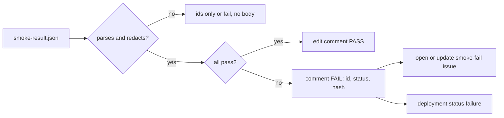
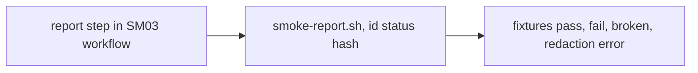

# SM06: Smoke reporting on PR or release, ping on fail
- Status: todo
- Area: smoke
- Wave: W3
- Block: 3
- Lane: Builder
- Depends on: SM03
- proof: `scripts/smoke-report.sh` on `test/fixtures/smoke-report/fail.json` produces one comment and one issue body with scenario id, status and a truncated hash only, and exit 1; each `test/fixtures/smoke-report/bad-*` posts ids only or fails with no body
- door: two-way
- triage: build
- feedback: `scripts/smoke-report.sh` fixture runs in `scripts/verify.sh`: pass, fail and each bad case give the expected output and exit code (proof)
- harness: none (script)
- review-input: diff + this PBI + DoD (+ linked spec) + PR description, never builder session logs (PA6)
- kind: script (deterministic)
- Source: PA8 (no D row; Sven, Development Agentic Workflows room, 2026-10-25 17:48 and 17:50 (post-deploy smoke on tst/acc, Azure AD JWT)) https://github.com/svennijhuis/agentic-workflows/pull/5
## Goal
Everyone sees the smoke result where the change lives; a failure is loud.
## Context
The report step runs inside the SM03 workflow in the API repo `svennijhuis/<api repo>`; this catalog holds `scripts/smoke-report.sh` and its fixtures. Response bodies from the API are untrusted input, so they never reach a comment, an issue or an agent.
## Steps
1. Report step in the SM03 workflow (`gh api`, GITHUB_TOKEN with the SM03 permission list).
2. `scripts/smoke-report.sh`: reads `smoke-result.json`, prints id, status and a truncated sha256 of the body; never the body.
3. Fixture runs: pass, fail, broken JSON, redaction failure.
## Definition of Done
- [ ] Pass: job summary + one PR or release comment (edit in place, no spam)
- [ ] Fail: deployment status set to failure + comment with scenario id, status (expected vs got code) and a truncated sha256 of the body; no raw body, no tokens, no personal data
- [ ] Fail opens or updates one issue labeled `smoke-fail` (dedupe by env+feature) with the same fields only
- [ ] If `smoke-result.json` or the redaction filter does not parse or errors: post ids only, or fail with no body
- [ ] Permissions named and the same list as SM03: `id-token: write`, `contents: read`, `pull-requests: write`, `issues: write`, `deployments: write`
- [ ] No raw smoke-fail text goes to an agent as instructions; M05 reads only the id, env and status fields as data
- [ ] Fixtures: `test/fixtures/smoke-report/pass.json` (exit 0), `fail.json` (exit 1, ids, status, hash), `bad-broken.json` (ids only or no body, exit 1), `bad-redaction-error.json` (ids only or no body, exit 1)
## Technical design
- Components and files: catalog: `scripts/smoke-report.sh`, `test/fixtures/smoke-report/`; API repo `svennijhuis/<api repo>`: report step in `.github/workflows/smoke-run.yml`
- Module boundary: input `smoke-result.json`, output one comment and at most one issue; hashing, redaction and dedupe sit behind it
- Interfaces: input `smoke-result.json`; output one comment, one issue max, deployment status; exit 0 pass, 1 fail or parse error
- Sequence:

- Failure modes: gh api error: job still fails red, summary keeps result; parse or redaction error: ids only or no body
- Security: GITHUB_TOKEN with the SM03 list only; no raw bodies anywhere; issue text is data, never agent instructions
- Observability: issue per env+feature
- Cost: 0
- Rollback: remove the report step
- Proof: same as proof: above
- Door: two-way (report step only; the live trigger is gated in SM03)
## Evidence
fixture run outputs, stub fail run comment text
## Flow

## Named asks for Sven
none
## Cost
0 (script)
## Sources
- Sven, Development Agentic Workflows room, 2026-10-25 17:48 and 17:50
- [PR #5 Cursor review at 17510cc, finding 7](https://github.com/svennijhuis/agentic-workflows/pull/5)
