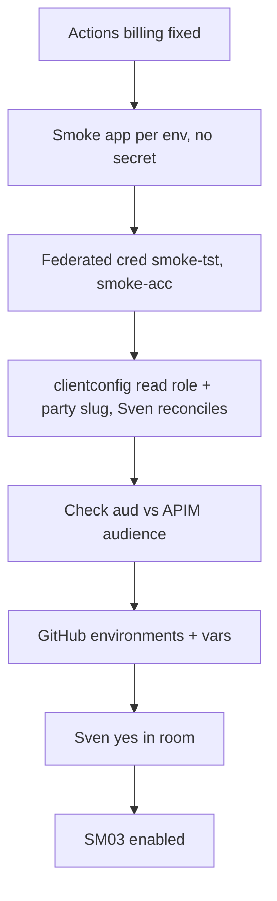
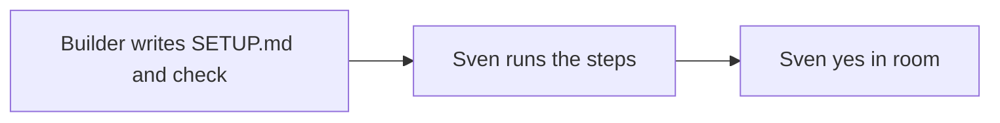

# SM07: Setup steps only Sven does
- Status: todo
- Area: smoke
- Wave: W3
- Block: 3
- Lane: Builder
- Depends on: none
- proof: `bash scripts/check-smoke-setup.sh smoke/SETUP.md` exits 0 (every step has a verify line); then Sven runs the checklist and says yes in the room
- door: one-way (Azure, Entra and GitHub settings)
- one-way gate: Sven's exact yes required (Sven does every step himself). Rollback: Sven deletes the federated credentials and smoke apps, removes the clientconfig and reconciles
- triage: build
- feedback: `scripts/check-smoke-setup.sh` exits 0 on `test/fixtures/smoke-setup/good.md` and on `smoke/SETUP.md`, 1 on `test/fixtures/smoke-setup/bad-missing-verify.md` (a step without a verify line)
- harness: none (script)
- review-input: diff + this PBI + DoD (+ linked spec) + PR description, never builder session logs (PA6)
- kind: script (human checklist plus a script that checks it)
- Source: PA8 (no D row; Sven, Development Agentic Workflows room, 2026-10-25 17:48 and 17:50 (post-deploy smoke on tst/acc, Azure AD JWT); 2026-10-25 "Check how azure GitHub apim then jwt works" and "Real user backend smoke test") https://github.com/svennijhuis/agentic-workflows/pull/5
## Goal
Name every manual step so bots never touch Azure, Entra or GitHub settings. Auth option is SM04 option b (app-only through GitHub OIDC, no secret, no test user password).
## Context
Builder writes `smoke/SETUP.md` and the check; Sven does every step and gives the yes on the one-way gate. The GitHub environments and the federated subject are in the API repo `svennijhuis/<api repo>` (placeholder: Sven names the repo in step 3). Auth background is in [C04](../done/C04-auth-copilot-pat.md) and SM04.
## Steps
1. Builder writes `smoke/SETUP.md` (one verify line per step) and `scripts/check-smoke-setup.sh`.
2. Sven runs it.
3. Sven says yes in the room.
## Definition of Done
- [ ] `smoke/SETUP.md` lists, in this order:
  1. Actions billing unblocked (blocks everything)
  2. one smoke app registration per env (`Platform smoke (tst)`, `Platform smoke (acc)`), no client secret, no certificate, public client flows off
  3. one federated credential per app: issuer `https://token.actions.githubusercontent.com`, audience `api://AzureADTokenExchange`, subject `repo:svennijhuis/<api repo>:environment:smoke-tst` (resp. `smoke-acc`); no prd, prod, branch or pull-request subject
  4. role assignment through the infra repo: a `app-smoke.<env>.clientconfig.json` with the smoke app service principal `objectId`, `apiAccess` read role only, and `tenant` = the test company slug so reconcile adds `party.<slug>` (not `party.*`); Sven runs `platform entra reconcile` himself
  5. check the API audience: decode one smoke token, confirm `aud` matches the APIM `<api>-audience` named value (v2 tokens carry the client id); if not, Sven fixes the APIM audience in the infra repo first
  6. GitHub environments `smoke-tst`, `smoke-acc` in the API repo with vars AZURE_CLIENT_ID, AZURE_TENANT_ID, SMOKE_API_SCOPE, SMOKE_BASE_URL, SMOKE_PARTY, SMOKE_READ_ROLE (values only in GitHub, never in files or chat); deployment branch rule main only; required reviewers off for smoke-tst, on for smoke-acc
  7. optional: Conditional Access for workload identities on the smoke apps (location block outside GitHub runner ranges), needs Workload ID Premium
  8. not set up: no test user, no ROPC, no TOTP seed, no CA exclusions
- [ ] Each step has a `verify:` line Sven can run (portal path or `gh variable list --env smoke-tst`); `scripts/check-smoke-setup.sh` checks that every numbered step has one
- [ ] Fixtures: `test/fixtures/smoke-setup/good.md` exits 0, `test/fixtures/smoke-setup/bad-missing-verify.md` exits 1
- [ ] Later, separate PBI: delegated real-user smoke (interactive or broker sign-in, `scp` access_as_user)
## Technical design
- Components and files: catalog: `smoke/SETUP.md`, `scripts/check-smoke-setup.sh`, `test/fixtures/smoke-setup/`
- Module boundary: `smoke/SETUP.md`, one verify line per step; the Azure, Entra and GitHub settings Sven makes sit behind it
- Interfaces: `check-smoke-setup.sh FILE` exit 0/1; for Sven, the checklist
- Sequence:

- Failure modes: missing step shows as SM04 auth error with step named (AADSTS on exchange, 401 on aud or tid, 403 on party or role); a step without a verify line fails the check
- Security: no secret values in repo or chat; bots never sign in to Azure or edit Entra; least privilege (read + one party); prd excluded
- Observability: room yes logged by PO
- Cost: 0 (Workload ID Premium only if step 7 is wanted)
- Rollback: Sven deletes the federated credentials and smoke apps, removes the clientconfig and reconciles
- Proof: same as proof: above
- Door: one-way (Azure, Entra and GitHub settings)
## Evidence
check-smoke-setup.sh output; Sven yes message link
## Flow

## Named asks for Sven
- Name the API repo (`svennijhuis/<api repo>`).
- GitHub environments `smoke-tst` and `smoke-acc`, or reuse the existing `nonprod` federated subject from the infra repo?
- Check the v2 token audience in step 5.
- Do steps 1 to 7 and say yes in the room.
## Cost
0 (Workload ID Premium only if step 7 is wanted)
## Sources
- svennijhuis/infrastructure-azure-white-label@cccc9c5e (docs/get-jwt.md L98 to L120, schemas/client-service-principal.schema.json, tool/src/entra.rs L238 to L262, infrastructure/shared/apim/bicep/main.bicep L206 to L224); Microsoft Learn: https://learn.microsoft.com/en-us/entra/workload-id/workload-identity-federation-create-trust (2024-12-13), https://learn.microsoft.com/en-us/entra/identity-platform/howto-add-app-roles-in-apps (2026-09-25), https://learn.microsoft.com/en-us/entra/identity/conditional-access/workload-identity (2026-03-24)
- [PR #5 Cursor review at 17510cc, findings 8 and 9](https://github.com/svennijhuis/agentic-workflows/pull/5)
