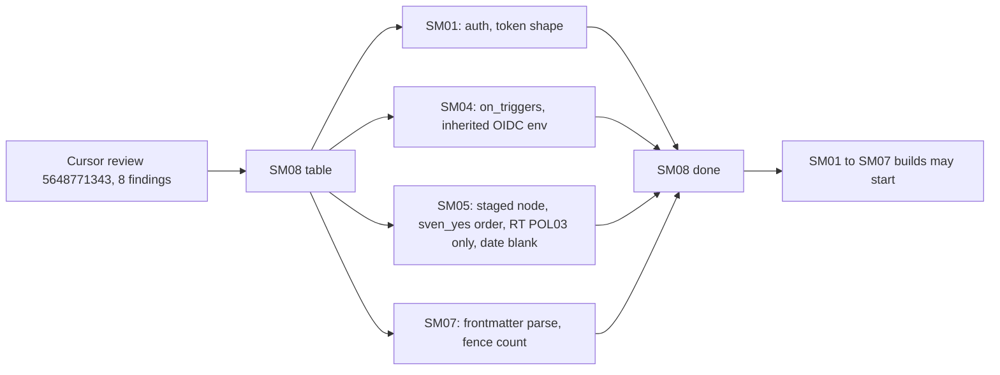
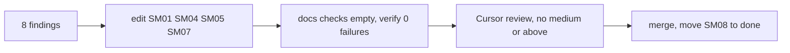

# SM08: Close the 8 open Cursor findings on SM01, SM04, SM05, SM07 (docs first)
- Status: todo
- Area: smoke
- Wave: W3
- Block: 3
- Lane: Cursor CLI
- Depends on: none (docs only; SM01, SM04, SM05 and SM07 are on main at b3e05e1)
- proof: every SM08 DoD row below is a line in SM01, SM04, SM05 or SM07 on the merged SHA (Reviewer greps each named fixture path in its target PBI); `bash scripts/check-pbi-template.sh` and `bash scripts/check-pbi-docs.sh` print nothing; `./scripts/verify.sh` ends with `0 failures`
- door: two-way
- triage: spec (the 8 findings of Cursor review 5648771343 on PR #5 at 8936269; each one is a doc fix with a named fixture and a DoD row)
- feedback: `grep -c` on each fixture path from the table below in its target PBI returns 1 or more; the two docs checks print nothing; `./scripts/verify.sh` gives `0 failures`
- harness: none (docs)
- review-input: diff + this PBI + DoD (+ linked spec) + PR description, never builder session logs (PA6)
- kind: script (docs edits; the checks they specify are scripts)
- Source: PA8 (no D row; Sven, Development Agentic Workflows room, 2026-10-26 12:49 "Please merge pbis pr", Product Owner GO on #5 moved the open findings here) https://github.com/svennijhuis/agentic-workflows/pull/5#pullrequestreview-5648771343
## Goal
Fold the 8 open findings (1 high, 6 medium, 1 low) of the Cursor review on PR #5 at 8936269 into SM01, SM04, SM05 and SM07, so no smoke build starts on a spec that fails open.
## Context
PR #5 merged as b3e05e1 with these 8 findings open. Product Owner waived the Cursor gate for #5 only (docs, nothing turned on), on the condition that this PBI lands first.

Gate rule: no SM01 to SM07 build PR starts before SM08 is done (this PBI merged and moved to `docs/pbi/done/`). SM01, SM04, SM05 and SM07 link here. SM02, SM03 and SM06 are untouched by the findings, but they depend on SM01, SM04, SM05 or SM07, so the gate reaches them too.

Each finding was checked against the repo at b3e05e1. All 8 hold. Finding 4 is narrowed (see its row): the evidence is `policies/checks/POL25.sh:31` and `:40` (`yes_for ... && continue` skips every trigger test) and `policies/POL25.yml:13` (`sven_yes: []`, the documented PA1 yes path for agentic schedules). Dropping `sven_yes` fully would remove that PA1 path, which is out of scope for a smoke PBI. So `sven_yes` keeps lifting only the agentic `workflow_dispatch`-only rule, and the `deployment_status` fail and the `workflow_call` allowlist run before it.

Findings (line numbers at b3e05e1):

| # | Sev | Where | Verdict | Fix (text to add to the target PBI) | Fixture | DoD row added to the target PBI |
|---|---|---|---|---|---|---|
| 1 | high | `docs/pbi/smoke/SM04.md:82` | fix | `check-smoke-auth.sh` reads triggers only through `on_triggers` in `scripts/lib/on-triggers.sh`; exit 2 (parse error or bad shape) and exit 3 (no `on:`) are hits. After dropping `roles`, `skip-bots`, `skip-roles` the list must be non-empty and every name `workflow_dispatch` or `workflow_call`. Never `yq '.on \| keys'`. | `test/fixtures/smoke-auth/bad-trigger-push.yml` is the scalar `on: push`; new `bad-trigger-list.yml` (`on: [issue_comment]`); `bad-trigger-release.yml` stays a map (`on: {release: {}}`) | Triggers are read with `on_triggers`; scalar, list and map forms are checked alike; `bad-trigger-push.yml` (scalar) and `bad-trigger-list.yml` (list) each exit 1 |
| 2 | medium | `docs/pbi/smoke/SM04.md:79` | fix | The environment rule applies to every job that can mint an OIDC token: job `permissions` has `id-token: write`, or the job has no `permissions` key and the workflow-level `permissions` has `id-token: write`. On each such job the parsed `environment` must be the string `smoke-${{ inputs.env }}`; a map, null or any other string exits 1. | new `test/fixtures/smoke-auth/bad-env-object.yml` (`environment: {name: nonprod}`), new `bad-inherited-id-token.yml` (workflow-level `id-token: write`, second job without job `permissions`, `environment: nonprod`) | Every job that has or inherits `id-token: write` declares `environment` as the string `smoke-${{ inputs.env }}`; `bad-env-object.yml` and `bad-inherited-id-token.yml` each exit 1; `good.yml` still exits 0 |
| 3 | medium | `docs/pbi/smoke/SM05.md:141` | fix | Agentic path: after `D -->\|yes\|`, add a POL03 staged node before `OK`: a write output without `safe-outputs.staged: true` and a basename not on `promoted:` fails. Matches `policies/checks/POL03.sh:34` to `:42` (staged check after `triggers_ok`, skipped when promoted). | existing `test/fixtures/bad/POL03-smoke-unstaged-write.md` (SM05:102) | The SM05 sequence diagram draws the POL03 staged check before `OK` on the agentic dispatch-only path; `bad/POL03-smoke-unstaged-write.md` exits 1 |
| 4 | medium | `docs/pbi/smoke/SM05.md:46` | fix (narrowed) | In `POL25.sh` the `deployment_status` fail and the `workflow_call` allowlist run before `yes_for` (`:31`, `:40`) as well as before `promoted`. A `sven_yes` row never lets `deployment_status` or an unlisted `workflow_call` through; it lifts only the agentic dispatch-only rule. `POL25.sh` reads its config from `$POL25_CFG` (default `policies/POL25.yml`) so case folders carry their own. | new `test/fixtures/bad/POL25-smoke-sven-yes-deployment-status/` (case `POL25.yml` `sven_yes` lists the workflow, it uses `deployment_status`), new `bad/POL25-smoke-sven-yes-unlisted-call/` (same, `workflow_call` with no `deterministic_triggers` entry) | `sven_yes` does not bypass the `deployment_status` fail or the `workflow_call` allowlist; both `POL25-smoke-sven-yes-*` cases exit 1 |
| 5 | medium | `docs/pbi/smoke/SM05.md:149` | fix | Node RT is POL03 only. POL25 stops at `L -->\|yes\|` with no hit (matches SM05:42 and :43). POL03 also fails a name in the entry `triggers` list other than `workflow_dispatch` and `workflow_call` unless it is on `promoted:`. | new `test/fixtures/good/POL25-smoke-call-plus-pr/` (entry lists `workflow_call`, file also has `pull_request`; POL25 exits 0), new `bad/POL03-smoke-entry-extra/` (entry `triggers` has `pull_request`, file uses it, not on `promoted:`; POL03 exits 1) | RT is marked POL03 only; `good/POL25-smoke-call-plus-pr/` exits 0 under POL25; `bad/POL03-smoke-entry-extra/` exits 1 under POL03 |
| 6 | medium | `docs/pbi/smoke/SM07.md:45` | fix | "Does not parse" is defined, not left to a markdown parser (CommonMark runs an unclosed fence to end of file, so it parses). `smoke/SETUP.md` starts with YAML frontmatter (`steps: <n>`) that `yq` must accept, and `steps` equals the count of numbered steps. The check exits 1 before the verify-line scan when `yq` exits non-zero, when the frontmatter is missing, or when the count of fence lines is odd. | `test/fixtures/smoke-setup/bad-broken.md` becomes invalid YAML frontmatter; new `bad-unclosed-fence.md` (valid frontmatter, every step has a verify line, one unclosed fence) | The frontmatter parse and the fence count run before the verify-line scan; `bad-broken.md` and `bad-unclosed-fence.md` each exit 1; `good.md` and `smoke/SETUP.md` exit 0 |
| 7 | medium | `docs/pbi/smoke/SM01.md:34` | fix | Exit 1 unless `auth` is exactly `none` or `smoke-jwt`. Exit 1 when any scalar has a token shape: three dot-separated segments of 10 or more `[A-Za-z0-9_-]` chars, or a value starting with `Bearer `. Fixtures use a fake placeholder made of `FAKE` plus zeros, never a real or JWT-prefixed value. | new `test/fixtures/smoke/bad-auth-unknown.yml` (`auth: basic`), new `bad-auth-token.yml` (a header value `FAKE0000000000.FAKE0000000000.FAKE0000000000`), new good `good-dotted.yml` (`path: /v1.2.3`, short segments pass) | `auth` other than `none` or `smoke-jwt` exits 1; a token-shaped scalar exits 1; `bad-auth-unknown.yml` and `bad-auth-token.yml` exit 1, `good-dotted.yml` exits 0 |
| 8 | low | `docs/pbi/smoke/SM05.md:98` (review says :99) | fix | Date gets the same blank case as quote (SM05:96, :97). | new `test/fixtures/bad/POL03-smoke-date-blank/` and `bad/POL25-smoke-date-blank/` (`yes.date: " "`, runner is dispatch-only) | Both `*-smoke-date-blank/` cases exit 1 |

SM07 manual setup (PO, 2026-10-26): Sven's manual setup step in SM07 stays documented and switched off. It never blocks SM08 or any SM build PR; the offline proof (fixtures, `check-smoke-setup.sh`, `./scripts/verify.sh`) is the gate, and the live step waits for Sven's yes.

Counts after the fix: SM01 gains 2 bad and 1 good fixture (11 bad, 2 good). SM04 gains 3 bad fixtures (`bad-trigger-list`, `bad-env-object`, `bad-inherited-id-token`). SM05 gains 1 good and 5 bad cases (8 good, 36 bad), so its proof line count is updated. SM07 gains 1 bad fixture.
## Steps
1. Edit SM01, SM04, SM05 and SM07: add each fix, fixture and DoD row from the table to the named PBI, update fixture counts in proof, feedback and Flow lines.
2. Redraw the SM05 sequence diagram (findings 3 and 5) and keep it valid mermaid.
3. Run `bash scripts/check-pbi-template.sh`, `bash scripts/check-pbi-docs.sh` and `./scripts/verify.sh`.
4. Move this file to `docs/pbi/done/` with `- Status: done` and `- PR: #<n>` in the same PR.
## Definition of Done
- [ ] Finding 1: SM04 names `on_triggers` as the only trigger reader and lists `bad-trigger-push.yml` (scalar) and `bad-trigger-list.yml`
- [ ] Finding 2: SM04 applies the environment rule to jobs that inherit `id-token: write` and lists `bad-env-object.yml` and `bad-inherited-id-token.yml`
- [ ] Finding 3: SM05 diagram has the POL03 staged node before `OK` on the agentic path, tied to `bad/POL03-smoke-unstaged-write.md`
- [ ] Finding 4: SM05 rule order says `sven_yes` does not bypass the `deployment_status` fail or the `workflow_call` allowlist, names `$POL25_CFG` and lists both `bad/POL25-smoke-sven-yes-*` cases
- [ ] Finding 5: SM05 node RT is POL03 only; `good/POL25-smoke-call-plus-pr/` and `bad/POL03-smoke-entry-extra/` listed
- [ ] SM07 still documents Sven's manual setup step as switched off and non-blocking; no SM build PR waits on it
- [ ] Finding 6: SM07 defines the parse step (frontmatter via `yq`, fence count) and lists `bad-broken.md` (bad YAML) and `bad-unclosed-fence.md`
- [ ] Finding 7: SM01 has the `auth` allowlist and token-shape rows and lists `bad-auth-unknown.yml`, `bad-auth-token.yml` and `good-dotted.yml`; no real or JWT-prefixed token in any file
- [ ] Finding 8: SM05 lists `bad/POL03-smoke-date-blank/` and `bad/POL25-smoke-date-blank/`
- [ ] SM05 proof line counts match the fixture list (8 good, 36 bad)
- [ ] `bash scripts/check-pbi-template.sh` and `bash scripts/check-pbi-docs.sh` print nothing; `./scripts/verify.sh` ends with `0 failures`; no em or en dash; mermaid renders
- [ ] A fresh Cursor review on the SM08 PR head has no open medium or above
## Technical design
- Components and files: `docs/pbi/smoke/SM01.md`, `SM04.md`, `SM05.md`, `SM07.md`, `README.md`, this file (moved to `docs/pbi/done/`)
- Module boundary: the DoD rows in SM01, SM04, SM05 and SM07; the checks they specify (`check-smoke.sh`, `check-smoke-auth.sh`, `check-smoke-setup.sh`, POL03, POL25) are built later in those PBIs
- Interfaces: none new; fixture paths and DoD rows only
- Sequence:

- Failure modes: a finding left out keeps its PBI failing open; Reviewer checks each table row against the target PBI
- Security: no secrets; the token fixture is a fake `FAKE` placeholder
- Observability: Reviewer grep per fixture path; verify log
- Cost: 0
- Rollback: revert the PR
- Proof: same as proof: above
- Door: two-way (docs only)
## Evidence
verify log on the PR SHA, empty output of both docs checks, grep per fixture path
## Flow

## Named asks for Sven
- None. Docs only.
## Cost
0 (docs)
## Sources
- [PR #5 Cursor review at 8936269](https://github.com/svennijhuis/agentic-workflows/pull/5#pullrequestreview-5648771343)
- [PR #5 Product Owner GO, findings moved to a follow-up](https://github.com/svennijhuis/agentic-workflows/pull/5#issuecomment-6415300262)
- repo at b3e05e1: `scripts/lib/on-triggers.sh`, `policies/checks/POL03.sh`, `policies/checks/POL25.sh`, `policies/POL25.yml`
- https://spec.commonmark.org/0.31.2/#fenced-code-blocks (an unclosed fence runs to the end of the document)
