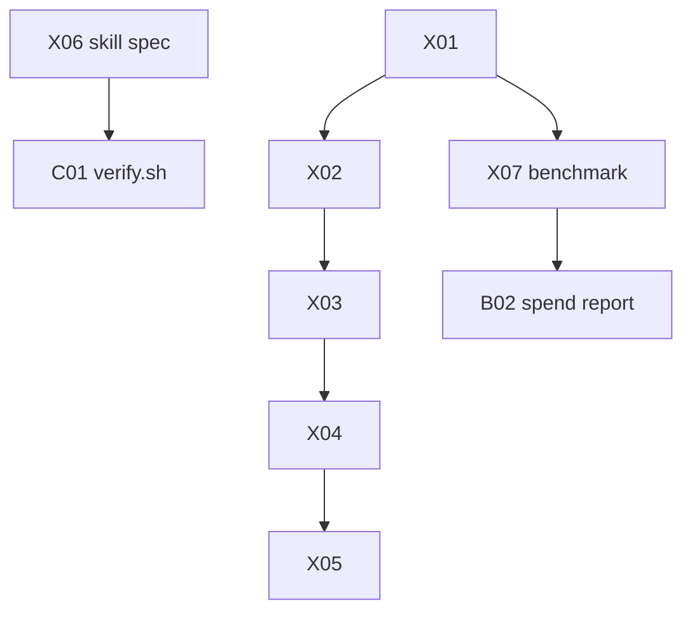

# testing: overview

**Purpose:** Trial repo, fixtures, verification skill, evals.

## PBIs

- [X01: X01-test-repo-trialops](X01-test-repo-trialops.md)
- [X02: X02-staged-dry-run-checklist](X02-staged-dry-run-checklist.md)
- [X03: X03-gate-fixtures](X03-gate-fixtures.md)
- [X04: X04-graders-evals](X04-graders-evals.md)
- [X05: X05-wasm-playground](X05-wasm-playground.md)
- [X06: X06-verification-skill](X06-verification-skill.md) (first Block 1 PBI, before C01)
- [X07: X07-workflow-benchmark](X07-workflow-benchmark.md)

## Dependency sketch

