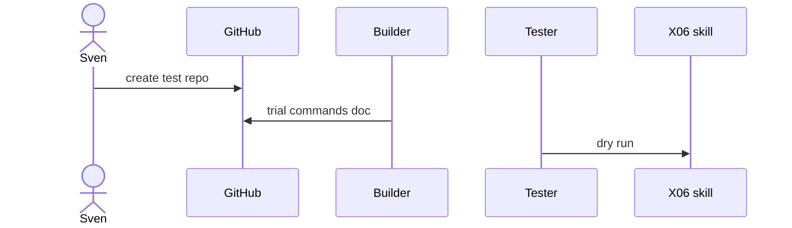
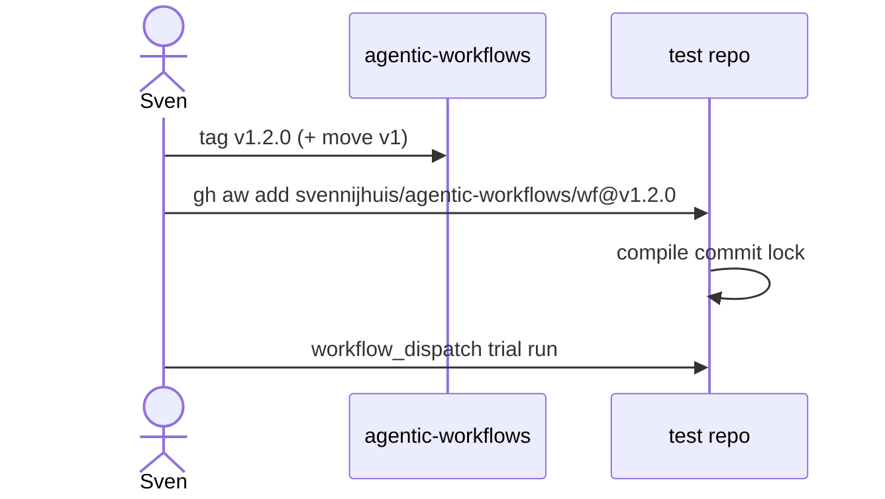

# X01: Test repo + TrialOps
- Status: todo
- Area: testing
- Wave: PR 0
- Block: 1
- Lane: Cursor CLI
- Depends on: C01, G01
- proof: gh repo view <trial-repo> && ./scripts/verify.sh
- door: one-way
- one-way gate: Sven's exact yes required (named ask in its block). Rollback: archive or delete trial test repo
## Goal
Define a dedicated personal test repo and TrialOps process for every catalog workflow before consumer repos.
## Context
Bar H requires trial-repo run. TrialOps experimental pattern from gh-aw. X01 test repo needs Sven approval for name and visibility.
## Steps
1. Propose test repo under svennijhuis account (name TBD with Sven).
2. Document install pin @vX.Y.Z and compile commit flow.
3. Checklist: dispatch, staged, measure AIC, promote.
4. Link packet flow (a) central distribution.
## Definition of Done
- [ ] Test repo documented in CONSUMING.md cross-link (Builder).
- [ ] Every workflow PBI cites X01 trial before prod.
- [ ] TrialOps steps mirrored in X02 checklist.
## Technical design
- Components and files: Test repo (name Q0), `docs/how-to/trial.md`
- Interfaces: `gh aw trial` commands documented, not run in B1
- Sequence:

- Failure modes: A trial hits a real repo, so a trial always targets the test repo
- Security: The test repo gets its own PAT later (Sven sets it)
- Observability: Trial run links in Evidence
- Cost: 0 AIC in B1; trial runs need Sven's yes (B2)
- Rollback: Archive the test repo
- Proof: Test repo exists and the doc is merged
- Door: one-way (Sven creates the repo)
## Evidence
(commands, logs, verify log on SHA, run links)
## Flow

## Named asks for Sven
(X01 (test repo name and OK to create))
## Cost
n/a
## Sources
- https://github.github.com/gh-aw/experimental/trial-ops/
- https://github.github.com/gh-aw/reference/faq/
- https://github.github.com/gh-aw/guides/sharing-workflows/
