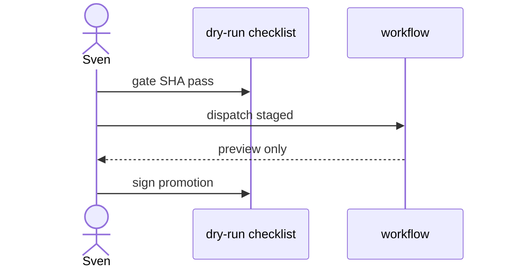

# X02: Staged dry-run checklist
- Status: todo
- Area: testing
- Wave: PR 0
- Block: 5
- Lane: Cursor CLI
- Depends on: X01, O02, G01
- proof: test -f docs/pbi/testing/X02-staged-dry-run-checklist.md
- door: two-way
## Goal
Publish a repeatable checklist for staged and report-only dry runs before enabling writes or schedules.
## Context
Pairs with O02 and G01 ladder. Used by Builder before merging new workflows.
## Steps
1. List pre-run gates: scripts/verify.sh on SHA, compile --strict.
2. List run steps: dispatch, verify staged artifacts, confirm 0 writes.
3. List promotion requirements: 3 audits, cost tier, Sven yes for cron.
## Definition of Done
- [ ] Checklist markdown ready for docs/how-to (Builder).
- [ ] Referenced from every agent-factory workflow DoD.
## Evidence
(commands, logs, verify log on SHA, run links)
## Flow

## Named asks for Sven
(none)
## Cost
n/a
## Sources
- https://github.github.com/gh-aw/reference/staged-mode/
- https://github.github.com/gh-aw/guides/safe-rollout/
