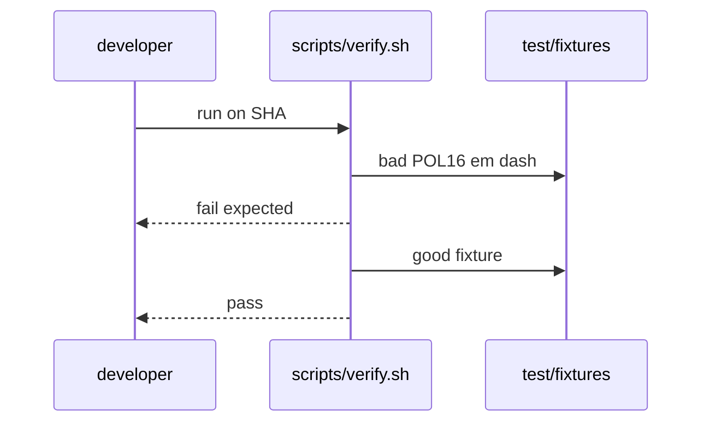

# X03: Verify fixtures
- Status: todo
- Area: testing
- Wave: PR 0
- Block: 1
- Lane: Builder
- Depends on: C01, POL01-POL23
- proof: ./scripts/verify.sh (all POL checks with good and bad fixtures per POL23)
- door: two-way
## Goal
Document test/fixtures good and bad layout: one bad fixture per policy exercised by scripts/verify.sh.
## Context
C01 local verify replaces CI until Q0 fixed. Fixtures prove policies fail closed. [POL23](../policies/POL23-no-tautological-checks.md) requires every check to fail on bad and pass on good fixtures under `test/fixtures/{good,bad}/`.
## Steps
1. Map each POL id to `test/fixtures/bad/<id>.md` and paired `test/fixtures/good/` path.
2. Document good fixture minimal valid workflow snippet.
3. Wire scripts/verify.sh to run policy checks, POL23 meta-check, and compile strict.
## Definition of Done
- [ ] Every POL has bad and good fixture paths documented.
- [ ] POL23 linked; verify.sh fails if any check is tautological.
- [ ] scripts/verify.sh on clean SHA passes; bad fixtures fail in tests.
- [ ] Evidence records verify log on exact SHA.
## Evidence
(commands, logs, verify log on SHA, run links)
## Flow

## Named asks for Sven
(Q0)
## Cost
n/a
## Sources
- https://github.github.com/gh-aw/reference/compilation-process/
- https://github.github.com/gh-aw/reference/workflow-linters/
