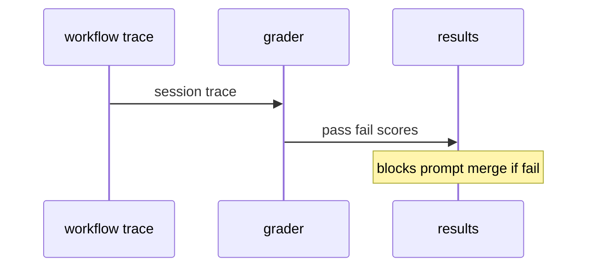

# X04: Graders/evals
- Status: todo
- Area: testing
- Wave: PR 0
- Block: 5
- Lane: Cursor CLI
- Depends on: B01, X01
- proof: ./scripts/verify.sh && test -f test/evals/README.md
- door: two-way
## Goal
Document trace graders for evaluating agent quality on fixed fixtures without shipping regressions to consumer repos.
## Context
Graders experimental spec supports offline eval of prompts for F01 review quality etc.
## Steps
1. Summarize graders specification and trace-graders experimental page.
2. Define eval dataset location (no secrets, synthetic repos).
3. Require grader pass before prompt changes merge.
## Definition of Done
- [ ] Eval scope defined for F01 and F02 at minimum.
- [ ] Grader runs documented as optional CI when Q0 fixed.
## Evidence
(commands, logs, verify log on SHA, run links)
## Flow

## Named asks for Sven
(none)
## Cost
Tier M, 20-60 AIC per eval batch (unverified)
## Sources
- https://github.github.com/gh-aw/experimental/trace-graders/
- https://github.github.com/gh-aw/specs/graders-specification/
