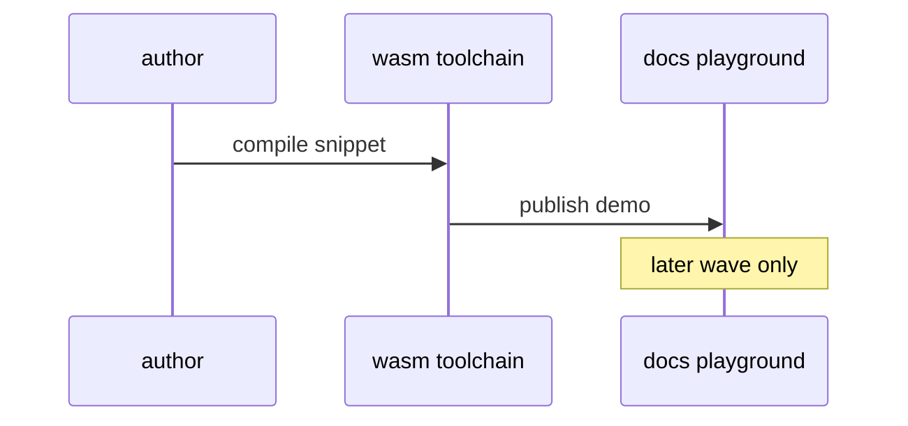

# X05: Wasm playground
- Status: todo
- Area: testing
- Wave: PR 0
- Block: 6
- Lane: Cursor CLI
- Depends on: C01
- proof: ./scripts/verify.sh
- door: two-way
## Goal
Document WebAssembly compilation playground for safe experimentation with gh-aw toolchain (later wave).
## Context
Wasm compilation reference supports isolated experiments. Not required for v1 catalog delivery.
## Steps
1. Summarize wasm-compilation reference.
2. Defer integration until core workflows stable.
## Definition of Done
- [ ] Explicit W6 deferral.
- [ ] No wasm requirement in W1 gate.
## Evidence
(commands, logs, verify log on SHA, run links)
## Flow

## Named asks for Sven
(none)
## Cost
n/a
## Sources
- https://github.github.com/gh-aw/reference/wasm-compilation/
