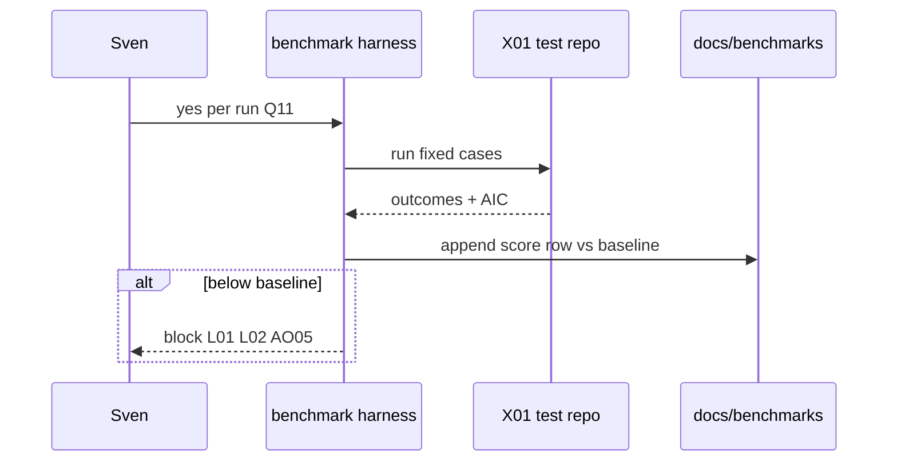
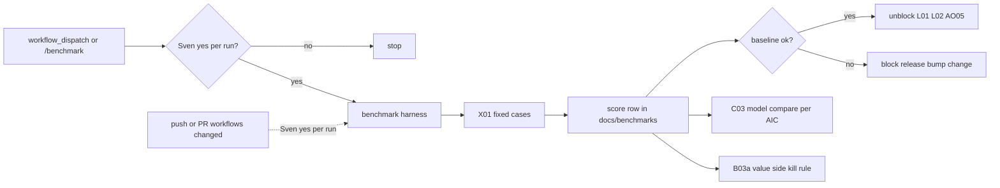

# X07: Workflow benchmark harness
- Status: todo
- Area: testing
- Wave: W2
- Block: 2
- Lane: Builder
- Depends on: X01, X06, O02
- proof: ./scripts/benchmark-workflows.sh --dry-run && test -f docs/benchmarks/README.md && ./scripts/verify.sh
- door: one-way
- one-way gate: Sven's exact yes required per benchmark run (named ask Q11). Rollback: revert the docs/benchmarks/<wf>.md row and the harness commit; runs stop because each run needs a fresh yes
- triage: spec (spend)
- feedback: ./scripts/benchmark-workflows.sh --dry-run
- harness: none (script), runs each workflow through gh-aw per case
- review-input: diff + this PBI + DoD (+ linked spec) + PR description, never builder session logs (PA6)
- kind: script
- Source: PA8 (pre-link PBI edited in PR #4, origin in its Sources) https://github.com/svennijhuis/agentic-workflows/pull/4
## Goal
Ship the only benchmark PBI: a harness that scores NOW workflows on fixed cases in the [X01](X01-test-repo-trialops.md) test repo with known ground truth. This is not a cost-compare workflow; it measures found, false alarms, misses, turns, time, and AIC per run and stores results beside a baseline row in `docs/benchmarks/<workflow>.md`.
## Context
Plan v3.7 makes X07 the regression gate for [L01](../release/L01-v1-moving-v1-changelog.md), [L02](../release/L02-update-vs-upgrade-safe-update.md), and [AO05](../agent-ops/AO05-change-management.md). [C03](../done/C03-shared-defaults.md) and [B03a](../observability/B03a-value-vs-cost.md) use the same case set to compare models and prompts per AIC. [AO08](../agent-ops/AO08-red-team-set.md) adds red-team cases; [AO13](../agent-ops/AO13-calibrated-judge.md) scores judgment cases; [AO10](../agent-ops/AO10-sampled-human-review.md) supplies human labels for ground truth. Harness uses [O02](../safe-outputs/O02-staged-mode.md) staged paths until promoted. Each Block 3 NOW workflow needs at least 5 cases (plan v3.7 B3).
## Steps
1. Add `scripts/benchmark-workflows.sh` and seed the X01 repo: PRs with planted bugs, issues with a known correct label, failing CI runs with a known cause.
2. Per run, record one score row: found, false alarms, misses, turns, time, AIC; append to `docs/benchmarks/<workflow>.md` next to the baseline row.
3. Wire regression rule: release ([L01](../release/L01-v1-moving-v1-changelog.md)), pin or gh-aw bump ([L02](../release/L02-update-vs-upgrade-safe-update.md)), or prompt or model bump ([AO05](../agent-ops/AO05-change-management.md)) runs X07 first; score below baseline blocks those changes.
4. Triggers: `workflow_dispatch` and `/benchmark` only. On `push` or `pull_request`, run only when `workflows/*.md` changed and only after Sven's yes per run ([LP02](../loops/LP02-event-map.md)).
5. Document Q11 per-run AIC budget from measured first trial runs and [B02](../observability/B02-weekly-spend-overview.md) (no guess).
## Definition of Done
- [ ] Fixed cases documented on X01 with known answers (PR bugs, issue labels, CI failure causes)
- [ ] One score schema per run (found, false alarms, misses, turns, time, AIC) in `docs/benchmarks/<workflow>.md` with baseline row
- [ ] Each Block 3 NOW workflow has at least 5 benchmark cases
- [ ] Regression rule documented: L01, L02, AO05 blocked when score is below baseline
- [ ] Triggers limited to dispatch and slash; path-filtered push/PR only with Sven yes per run
- [ ] door one-way; Sven's exact yes per benchmark run (not per block)
- [ ] Mermaid flow present
## Technical design
- Components and files: `scripts/benchmark-workflows.sh`, `docs/benchmarks/<workflow>.md` per NOW workflow, `workflows/benchmark.md` (dispatch and slash), X01 seeded fixtures under `test/fixtures/benchmark/`
- Module boundary: fixed cases per workflow are the interface; the runner is behind it
- Interfaces: workflow frontmatter caps per C03; import `shared/defaults.md`; inputs for workflow id and case subset; safe-output report rows to benchmark markdown; exit 1 when score below baseline
- Sequence:

- Failure modes: missing seed data fails fast; partial run does not update baseline; below-baseline score fails CI gate for release jobs
- Security: no secrets in benchmark markdown; threat detection on agent steps; cases treat issue and log text as untrusted data
- Observability: run id and score row in B01 audit; weekly rollup in B02
- Cost: per-run cap from named ask Q11 (filled from measured trial runs and B02)
- Rollback: revert docs/benchmarks/<wf>.md row and harness commit; further runs need fresh Sven yes
- Proof: `./scripts/benchmark-workflows.sh --dry-run` lists cases; one audited run row in Evidence
- Door: one-way (each run spends AIC and needs Sven's exact yes)
## Evidence
(verify log on SHA, benchmark markdown row, three audited run ids with measured AIC, Q11 value recorded)
## Flow

## Named asks for Sven
Q11 per-run AIC budget (from measured cost of first trial runs and B02, no guess); Sven's exact yes before every benchmark run that spends AIC
## Cost
Bounded by Q11 per run; multiply by case count only inside approved runs
## Sources
- Plan v3.7 (agentic-workflows-pbi-plan.md) X07 benchmark harness
- Plan v3.8b LP02 event map
- Related: [L01-v1-moving-v1-changelog.md](../release/L01-v1-moving-v1-changelog.md), [L02-update-vs-upgrade-safe-update.md](../release/L02-update-vs-upgrade-safe-update.md), [AO05-change-management.md](../agent-ops/AO05-change-management.md), [C03-shared-defaults.md](../done/C03-shared-defaults.md), [B03a-value-vs-cost.md](../observability/B03a-value-vs-cost.md)
